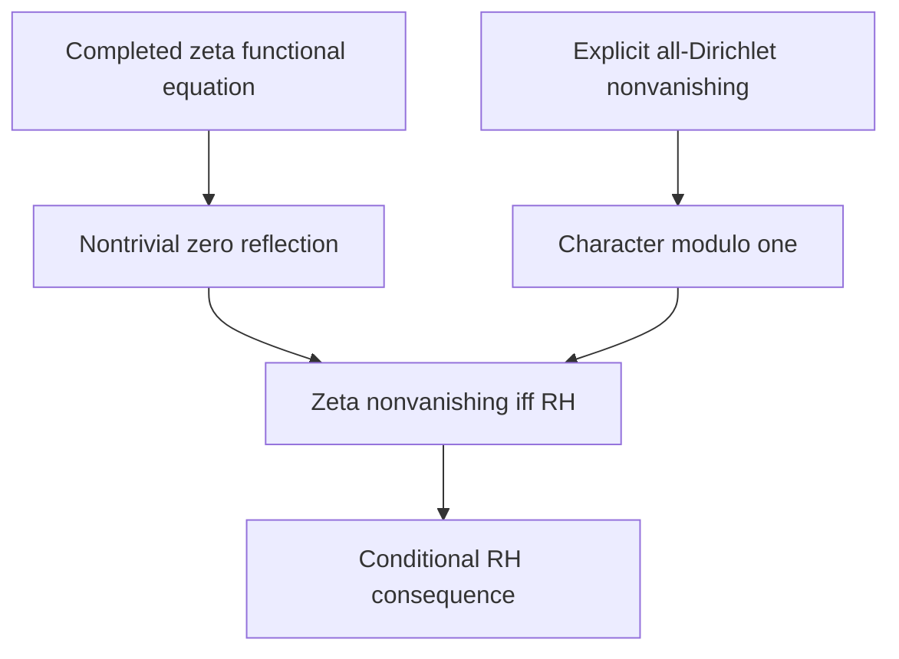

# Riemann hypothesis half-plane reduction: theorem contract

## Intake and provenance

The user requested an audit of
[CocoSgt/riemann-hypothesis-lean](https://github.com/CocoSgt/riemann-hypothesis-lean)
and publication of the resulting checked mathematics to the established
`nickgou-nuke/info-geometry-lean` upstream. The reviewed external snapshot is
`7cbf7a0c32fca1badf05931879a37c3f8a2b03b4`, using Lean 4.33.1 and Mathlib
`0df444a360eaa60ab8c11dca51a86af692955474`.

This contribution independently proves final analytic reductions using the
current repository's Lean 4.34.1 / Mathlib
`d13f23b723b8a846827a245b89c10fc7d3f11612` environment. It imports no code from
the external submission and does not claim to have built or certified it.

Related [PR #421](https://github.com/nickgou-nuke/info-geometry-lean/pull/421)
formalizes finite Mangoldt smoothing. The present change is independent of that
branch and does not infer zero-free regions from its finite identities.

## Formal intent

Carrier: Mathlib's `ℂ`, with its native `riemannZeta`, completed zeta function,
`Complex.Gammaℝ`, and `DirichletCharacter.LFunction`. Real inequalities use `ℝ`.
The target is explicitly `_root_.RiemannHypothesis`, avoiding ambiguity with
the repository's similarly named namespaces and selected-zero predicates.

Define `ZetaRightHalfPlaneNonvanishing` to mean that `ζ(s) ≠ 0` whenever
`1/2 < s.re` and `s ≠ 1`. Define `DirichletRightHalfPlaneNonvanishing` with all
nonzero moduli and all Dirichlet characters, excluding the simultaneous
principal-character/pole-location case by `χ ≠ 1 ∨ s ≠ 1`.

| Declaration | Exact scope |
|---|---|
| `nontrivial_zero_reflect` | A zeta zero outside the negative-even trivial zeros and `s=1` reflects to `1-s` |
| `riemannHypothesis_of_rightHalfPlane` | Explicit zeta nonvanishing implies Mathlib RH |
| `rightHalfPlane_of_riemannHypothesis` | Mathlib RH implies the zeta nonvanishing assertion |
| `riemannHypothesis_iff_rightHalfPlane` | Equivalence of those propositions |
| `zetaRightHalfPlane_of_dirichletRightHalfPlane` | Specialization to the character modulo one |
| `riemannHypothesis_of_dirichletRightHalfPlane` | Conditional Dirichlet-to-RH consequence |
| `exists_small_exponent` | For real `C`, `σ>1/2`, and `ε₀>0`, choose `0<ε<ε₀` with `1/2+C*ε<σ` |

The namespace is `InfoGeometry.Arithmetic.RiemannHypothesisHalfPlaneReduction`.
The axiom companion audits both definitions and all seven theorems.

## Existing owners and mathematical dependencies

Source searches covered canonical `lean/InfoGeometry` and mirrored
`src/InfoGeometry` declaration names, alternative half-plane predicates,
functional-equation uses, and consumers. This is a bounded source search,
not a fresh repository-wide declaration-DAG certificate.

- `RiemannZetaFiniteFacts`: reuse the nonzero value at zero and real parts of
  trivial zeros. Its reflected-zero theorem excludes every negative integer;
  the new helper only excludes actual negative-even trivial zeros and the pole.
- `RiemannZetaEquivalences`: existing completed-zeta and half-plane identities
  provide context; the new equivalence is not asserted by that owner.
- `RiemannHypothesisProjectiveFormulation`: its selected open-strip zero locus
  has a distinct proposition; it is not identified definitionally with Mathlib RH.
- `ActualRiemannZetaVonMangoldtBridge`: the existing logarithmic-derivative
  identity in `Re(s)>1` remains distinct from the claimed zero-free half-plane.

The proof uses `Complex.Gammaℝ_eq_zero_iff` to rule out a zero denominator,
`riemannZeta_def_of_ne_zero` to pass to completed zeta, and
`completedRiemannZeta_one_sub` to reflect zeros. The modulus-one specialization
uses `DirichletCharacter.LFunction_modOne_eq`.

For the real-inequality lemma, the witness is
`min (ε₀ / 2) ((σ - 1/2) / (2 * (|C| + 1)))`. No limiting interchange or
heuristic asymptotic step occurs in that lemma.

## Acceptance and open obligations

The equivalence, reflection law, and real inequality are direct analytic or
algebraic theorems. The RH consequence of Dirichlet nonvanishing is conditional
on its named argument. A clean axiom report does not discharge that argument.

The following remain outside this contribution: either nonvanishing premise,
unconditional RH or Dirichlet GRH, windowed Mangoldt growth estimates, a
windowed Landau theorem, and the arithmetic/theta-lift estimates in the
external submission. The submitted source has not been compiled in this task.

Focused checks use the new verification package and the root's unchanged
Mathlib pins. Root integration is checked separately through the maintained
locked build wrapper. Any missing path dependency or other root gate failure
is retained in `verification/riemann-half-plane/validation.json`; focused
acceptance must not be reported as a successful whole-repository build.

The required independent roles are source generation, read-only semantic
review, and a distinct QA rerun of the decisive commands. The validation record
contains their actual dispositions and source hashes.
