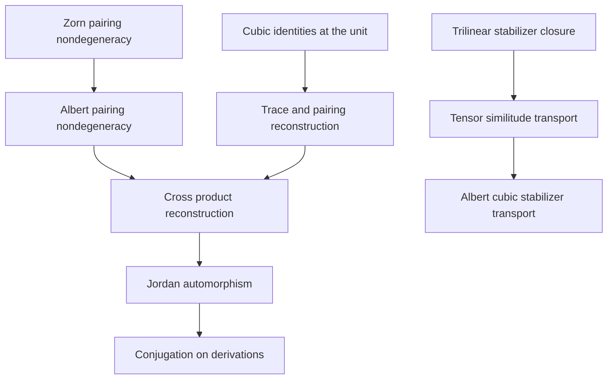

# Seligman: cubic geometry and noncommutative Albert operators

## Source and scope

Source: George B. Seligman, *On Automorphisms of Lie Algebras of Classical
Type. III*, Transactions of the American Mathematical Society 97 (1960),
286–316, especially §§5, 7, and 8, printed pages 304–306 and 310–314.
The supplied scan is `s0002-9947-1960-0123644-2.pdf`.
Its SHA-256 is
`1b7c5ac8325cca1b6c3c2c22aaa7ef1204e3d4342f1cc52b2641823e7b0595fe`.

This contract precedes implementation. It specifies a bounded theorem chain:
recover the real split Albert Jordan algebra from its native polarized cubic
norm and distinguished identity, and transport its genuine noncommutative
endomorphism Lie algebras. It does not assert the classification theorems for
the exceptional Lie algebras.

## Ground truth

The carrier is the existing full `InfoGeometry.Algebra.H3Zorn ℝ`, with three
real diagonal coordinates and three arbitrary split-octonion Zorn blocks.
The product is the repository's proved `candidateJordanMul`, installed as
the native Jordan multiplication. The operator carrier is
`Module.End ℝ (H3Zorn ℝ)`, with multiplication given by composition and
Lie bracket given by the composition commutator. No diagonal or scalar
subalgebra replaces either carrier.

Existing owners:

| Native datum | Owner |
| --- | --- |
| Full split octonions and their operations | `Algebra/ZornVectorMatrix.lean` |
| Full Albert carrier, trace, pairing, cross product | `Algebra/QuadraticJordanH3Zorn.lean` |
| Cubic polarization and trace/cross-product identities | `Algebra/H3ZornCubicOperators.lean` |
| `h3zornTraceBilin`, `h3zornNormTrilin`, product reconstruction | `Algebra/H3ZornJordanIdentity.lean` |
| Native verified Jordan instance | `Algebra/H3ZornJordanInstance.lean` |
| Multiplication and inner derivation operators | `Algebra/JordanInnerDerivations.lean` |
| `H3ZornJordanAut`, `H3ZornF4Derivations` | `Algebra/BaezF4H3Zorn.lean` |
| Native operator conjugation and restricted Lie equivalences | Mathlib `Algebra/Lie/OfAssociative` and `Algebra/Lie/Subalgebra` |

Write `t = linearTrace`, `B = traceBilin`, and `n = h3zornNormTrilin`.
The repository normalization is

\[
n(x,y,z)=\tfrac16 B(x,y\times z),\qquad n(x,x,x)=N(x),\qquad 1*x=x.
\]

Seligman's symmetrized Jordan product has `I · x = 2x`. His operator formulas
use right actions. This implementation uses the normalized product and left
actions: conjugation is `g ∘ D ∘ g⁻¹`, and `[D,Lₓ] = L_(D x)`.
In these conventions, `B_paper = 2 B` and `C_paper = 12 n`; preservation and
infinitesimal stabilization are unchanged by those nonzero real factors.
The split trace pairing is symmetric and nondegenerate; positivity is not
assumed. No Hermitian-adjoint claim is inferred from a bilinear pairing.

## Theorem obligations and dependency order

1. Prove the Zorn trace pairing nondegenerate by its actual coordinate probes.
   Lift this to nondegeneracy of the complete Albert trace pairing.
2. Prove the normalization identities
   `3 * n(x,1,1) = t(x)` and
   `6 * n(x,y,1) = t(x)*t(y) - B(x,y)`.
3. Prove injectivity of a linear map preserving `n`; no injectivity assumption
   is hidden in a certificate.
4. For a linear equivalence preserving `n` and fixing `1`, derive preservation
   of `t`, then `B`, then the cross product, then the Jordan product. Package
   the proved result in the existing `H3ZornJordanAut`.
5. For an arbitrary native trilinear form, prove that its infinitesimal
   stabilizer is a native Lie subalgebra of the entire endomorphism algebra.
   Prove that a tensor similitude transports it by conjugation, including the
   converse and a restricted native Lie equivalence.
6. For every actual Albert Jordan automorphism, prove conjugation covariance
   of multiplication operators and inner derivations and obtain a native Lie
   equivalence of the existing derivation subalgebra.
7. Prove that preservation of the actual cubic polynomial is equivalent to
   preservation of its polarized tensor, and that a polynomial similitude
   induces the same tensor scale. Instantiate the operator statements on the
   full Albert cubic form and verify a nonzero commutator using off-diagonal
   Albert elements.
8. Differentiate the reconstruction argument: cubic slot invariance and
   `D 1 = 0` imply trace annihilation, trace-pairing skew-adjointness,
   cross-product Leibniz, and Jordan Leibniz. Prove the actual native inclusions
   `stab(n) ⊓ ann(1) ≤ H3ZornF4Derivations ≤ ann(1)`.

This is the causal order of mathematical dependencies. The native
`LieSubalgebra` inclusion order describes the operator subobjects; it is not
interpreted as physical causality or as an inferred Git genealogy.

## Import boundary

The Albert closure previously imported the unrelated `FiniteSpinAlgebra`
module, whose broad tactic re-exports are used by many other repository
consumers. That shared module remains unchanged. The unused finite-spin
imports are removed only from the 18 Albert owners, and their actual Mathlib
dependencies are explicit. In particular, `JordanInnerDerivations` imports
`Mathlib.Algebra.CharP.Invertible` for the native invertibility-of-two instance.
The directly affected Zorn off-diagonal derivation consumer explicitly imports
its `LinearCombination` tactic.

The existing pairing/trace cancellation proofs in `JordanInnerDerivations`
use native subtraction cancellation instead of a general scalar normalizer.
This makes their scalar operation explicit to the staged proof-integrity gate.
The operators and their bracket definitions are unchanged.

## Acceptance and limitations

Acceptance requires compilation with the repository's pinned Lean and
Mathlib, no proof placeholders or custom axioms, explicit axiom inspection,
independent source/semantic review, and the repository staged proof gate.
The new algebraic transport results quantify over arbitrary operators, not
only a commuting example. The concrete noncommutativity check is a regression
for the full carrier, not a substitute for those quantified theorems.

Excluded: simplicity or dimensions of `F₄`/`E₆`; classification or surjectivity
of all Lie-algebra automorphisms; triality; generation by root transvections;
closure of an arbitrary cubic stabilizer under adjoints; finite characteristic
extensions; positive-definite geometry; and causal interpretations of spectra.

Navigation receipt: `artifacts/context/seligman-preflight.json`, generated
before implementation from a scoped owner search. Its unavailable live graph
sources are not treated as evidence for theorem truth. Compiler results and
final exact theorem names are recorded below.

## Delivered owners

The implementation adds 52 library theorems and 9 definitions in eight files.

| Owner under `lean/InfoGeometry/Algebra/` | Main result |
| --- | --- |
| `H3ZornTraceNondegenerate.lean` | `h3zornTraceBilin_nondegenerate` and full coordinate separation |
| `H3ZornCubicPolarization.lean` | Polynomial/tensor preservation equivalence and scalar similitude transport |
| `H3ZornCubicReconstruction.lean` | Injectivity and `h3zornJordanAutOfNorm`, with multiplicativity derived |
| `TrilinearStabilizer.lean` | Native endomorphism Lie subalgebra and `trilinearStabilizerLieEquiv` |
| `H3ZornAutomorphismConjugation.lean` | `H3ZornJordanAut.derivationLieEquiv` and multiplication/commutator covariance |
| `H3ZornInfinitesimalReconstruction.lean` | `h3zorn_cubic_unit_stabilizer_le_F4` and `h3zornF4Derivations_le_unitAnnihilator` |
| `H3ZornOperatorNoncommutativity.lean` | Explicit nonzero off-diagonal commutator on the full Albert carrier |
| `H3ZornCubicOperatorGeometry.lean` | Polynomial similitudes acting on the cubic stabilizer and norm/unit symmetries acting on all derivations |

For the noncommuting witness, take
`A = h3_off₁₂ 1`, `B = h3_off₂₃ 2`, and `X = h3_off₂₃ 3`.
Their octonion blocks are respectively the distinct generators `U 0`, `U 1`,
and `U 2`; all Albert diagonal coordinates vanish. The theorem proves
`([L_A,L_B] X).a.b = -1/4`, hence the endomorphisms do not commute and the
associated bundled derivation is nonzero.

## Verification record

- Compiler: Lean `4.34.1`, commit
  `5045d0056413266e57c625dcd7c365b10e377c52`.
- Mathlib: pinned revision `d13f23b723b8a846827a245b89c10fc7d3f11612`.
- Every source in the aggregate owner's import closure was compiled
  sequentially with that compiler and the exact pinned Mathlib cache. No
  dependency pin, cache, or compiler source was changed.
- `tests/SeligmanCubicOperatorTests.lean` proves four semantic regressions:
  a nonzero isotropic vector, negative and positive values of the split trace
  pairing, and unequal actions of the two operator compositions.
- The repaired `Zorn/OffDiagonalDerivation.lean` consumer and the existing
  `H3ZornAdjointProductIdentity.lean` consumer were separately compiled after
  the scoped import changes. A source/import review found no additional
  missing imports among the remaining exposed direct consumers.
- `tests/SeligmanCubicOperatorAxiomAudit.lean` uses the repository's canonical
  native declaration auditor. It checks every declaration, including generated
  auxiliaries, owned by the eight new modules, the existing Jordan inner
  derivation owner whose cancellation proofs changed, the repaired consumer,
  and the regression module: **150 declarations across 11 modules**.
  It rejects unsafe or partial declarations in those modules and rejects any
  transitive axiom outside **`propext`, `Classical.choice`, `Quot.sound`**.
  The audit passed with exactly that foundational axiom set.
- All eight new owners and both new test files compiled without warnings.
  Existing dependency proof bodies emitted 94 linter warnings: 4 in
  `AlternativeDerivations`, 89 in `ZornAlternativeLaws`, and 1 in
  `QuadraticJordanH3Zorn`. Those warnings are not concealed or counted as
  new-proof failures.
- Independent mathematical/source review checked the normalization, full
  carrier, hypotheses, noncommuting witness, infinitesimal inclusion, and
  final polynomial/operator integration. It found no semantic defects.

An exploratory broader audit of every declaration in all existing dependency
owners stopped at the pre-existing compiler-generated runtime helper
`ZornVectorMatrix.nsmulZorn._unsafe_rec`. The existing recursion code was not
changed. That wider audit is **not** reported as passing; the successful
150-declaration audit covers every new proof and follows its axiom dependencies
transitively. Likewise, the scoped compilation is not a repository-wide build
or a classification theorem for the exceptional Lie algebras.

For a normally provisioned checkout, the public entry point is
`InfoGeometry.Algebra.H3ZornCubicOperatorGeometry`. After building that target
under the repository's shared build lock, the regression module can be compiled
with `--root=tests` into the active Lean output search path, followed by
`tests/SeligmanCubicOperatorAxiomAudit.lean`. The latter imports the regression
module so its four proof declarations receive the same native audit.
