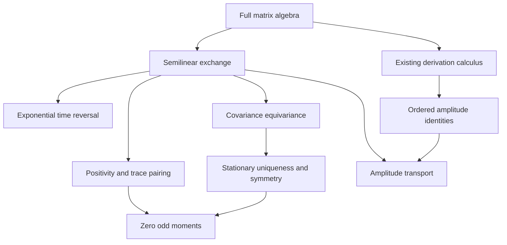

# Semilinear symmetry and ordered operator amplitudes

## Mathematical contract

This development extracts finite noncommutative operator statements from the
two-sector/CPT/Madelung narrative. Its common matrix carrier is

\[
\mathcal A_n=M_{n\sqcup n}(\mathbb C),
\]

for an arbitrary finite index type `n`. All four matrix blocks are available;
the algebra is not restricted to diagonal or commuting matrices. The generic
amplitude identities hold in any associative `R`-algebra, with `R` commutative
and the algebra itself unrestricted. Statements about normed matrix dynamics
use Mathlib's native `Matrix.Norms.L2Operator` scope.

The entry point is:

```lean
import InfoGeometry.OperatorAlgebra.SemilinearOperatorGeometry
```

This extends `NoncommutativeCovarianceClosure` through actual theorem
dependencies. The previous covariance verification receipt remains a record
of its earlier source revision. The semilinear extension has its own source
hashes, native declaration audit, dependency graph, and independent review.

## Existing owners and the missing implications

| Existing owner | Actual input reused | New implication |
|---|---|---|
| `DerivationRightLogarithmicForm` | The one-form `δ(g) * g⁻¹` and its ordered product cocycle | Riccati identity and amplitude-square defect |
| `DerivationGaugeTransport` | Proven ordered derivative of an inverse unit | Second derivative quotient without scalar division |
| `DerivationMatrixGeometry` | All Leibniz derivations of full matrices; native inner Lie homomorphism | Concrete double-commutator amplitude quotient |
| `MatrixOperatorIdentities` and `MatrixTraceGeometry` | Native associative bracket, adjoint and cyclic trace | Semilinear Liouvillian transport and trace cancellation |
| `CovarianceTransport` | `C ↦ T * C * star T + Q` | Conjugate-linear exchange equivariance |
| `CovarianceContraction` and `CovarianceStationary` | Constructed unique positive fixed point and convergence under `‖T‖ < 1` | Invariance of that fixed point, derived from uniqueness |
| Native Mathlib matrix, algebra-equivalence, exponential and order APIs | Full block matrices, real algebra equivalences, PSD cone, norm-convergent exponential | Concrete sheet action, positivity and time reversal |

The existing real doubled Krein/CPT owners were inspected as semantic
references. They construct real continuous operators and indefinite pairings;
they do not already supply the particular conjugate-linear complex matrix
automorphism below. Existing scalar Madelung formulas are not imported as a
replacement for the noncommutative carrier. The new direction map is the
existing `matrixInnerLieHom`; its scalar kernel is not claimed to disappear.

## 1. Concrete conjugate-linear exchange

`SemilinearSheetGeometry.sheetConj` is a native real algebra equivalence:

\[
\Theta(X)=S\overline X S,
\qquad S=\begin{pmatrix}0&I\\I&0\end{pmatrix}.
\]

The implementation composes `Complex.conjAe.mapMatrix` with
`Matrix.reindexAlgEquiv`. It proves the displayed sandwich formula, rather
than assuming it as a structure field. The fundamental identities are

\[
\Theta^2X=X,\quad
\Theta(zX)=\overline z\,\Theta(X),\quad
\Theta(XY)=\Theta(X)\Theta(Y),\quad
\Theta(X^*)=\Theta(X)^*.
\]

Thus the exchange preserves multiplication order; the native matrix adjoint
still reverses it. The exchange is real-linear and complex conjugate-linear.
It is not represented as a complex-linear Kraus channel. Positivity,
Hermiticity, trace conjugation, and conjugation of the Hilbert–Schmidt pairing
are proved for this concrete map.

For the unrestricted coupled block matrix

\[
H=\begin{pmatrix}A&B\\B^*&D\end{pmatrix},
\]

the exact classifications are

\[
\Theta(H)=H\iff D=\overline A\ \text{and}\ B^{\mathsf T}=B,
\]

\[
\Theta(H)=-H\iff D=-\overline A\ \text{and}\ B^{\mathsf T}=-B.
\]

Hermiticity is separately equivalent to Hermiticity of `A` and `D`.
No commutation of `A`, `B`, and `D` is assumed.

## 2. Odd observables and time reversal

For Hermitian `ρ` and `A`, the trace of `ρ * A` is real by the adjoint and
cyclic trace identities, even when the two matrices do not commute. If
`Θ(ρ) = ρ` and `Θ(A) = -A`, its complex conjugate is also its negative.
Consequently,

\[
\operatorname{tr}(\rho A)=0.
\]

Without the Hermitian hypotheses, invariance and oddness alone give an
anti-real trace, not necessarily zero. Normalization and positivity are not
required for this algebraic cancellation theorem; the concrete examples
add both and preserve noncommutation.

The ordered generator is `liouvillian H X = -I • ⁅H, X⁆`. Its exchange law is

\[
\Theta(\mathcal L_HX)=-\mathcal L_{\Theta H}(\Theta X).
\]

The native matrix exponential supplies the actual evolution

\[
U_H(t)=\exp(-itH),\qquad
\Theta(U_H(t))=U_{\Theta H}(-t).
\]

The code also proves the one-parameter composition law and unitarity for a
Hermitian Hamiltonian. An exchange-even Hamiltonian therefore has time
reversal covariance without being exchange-odd. Odd-charge cancellation is
not an energy-sign theorem.

## 3. Constructed invariant stationary covariance

Write `F(T,Q,C) = T * C * star T + Q`. The exchange satisfies

\[
\Theta(F(T,Q,C))=F(\Theta T,\Theta Q,\Theta C)
\]

and the corresponding identity for every finite iterate. Assume

\[
\|T\|_{\mathrm{op}}<1,\quad Q\succeq0,\quad
\Theta T=T,\quad\Theta Q=Q.
\]

The earlier covariance owners construct a unique positive stationary matrix
`C∞`. Equivariance makes `Θ(C∞)` another fixed point; contraction uniqueness
then proves `Θ(C∞) = C∞`. The new code derives this invariance instead of
including it as an input field. Every initial full matrix converges to `C∞`,
and every exchange-odd Hermitian observable has zero trace pairing with it.
No commutation between transition, noise, covariance, or observable is used.

The strict covariance contraction `T` is a separately specified operator.
The unitary evolution `U_H(t)` belongs to the time-reversal branch: on a
nonzero carrier it does not itself satisfy `‖T‖ < 1`, and evenness of `H`
relates `U_H(t)` to `U_H(-t)`, not generally to itself.

## 4. Ordered amplitude geometry

Let `δ` be one direction of the existing derivation action and `g` an actual
unit. Reusing `ηg = δ(g) * g⁻¹`, the new identities are

\[
\delta(\eta_g)+\eta_g^2=\delta^2(g)g^{-1},
\]

\[
\eta_{g^2}-2\eta_g=[g,\eta_g]g^{-1}.
\]

The second product rule retains the ordered mixed term:

\[
q_{gh}=q_g+\operatorname{Ad}_g(q_h)
       +2\eta_g\operatorname{Ad}_g(\eta_h),
\qquad q_g=\delta^2(g)g^{-1}.
\]

The finite-family theorem sums the exact Riccati identities; it does not
identify that sum with an unspecified spatial Laplacian.

In the full matrix specialization, `δ = ad H` and

\[
B=[H,[H,g]],\qquad Q_H(g)=Bg^{-1}.
\]

For Hermitian `H` and Hermitian unit `g`, `B` and `g⁻¹` are Hermitian, giving

\[
Q_H(g)^*=g^{-1}B,\qquad
Q_H(g)-Q_H(g)^*=[B,g^{-1}].
\]

Self-adjointness of the quotient is equivalent to `Commute B g⁻¹`. This is a
conclusion characterizing the obstruction, not an ambient commutation
restriction. Native `selfAdjointPart ℝ` gives the self-adjoint operator

\[
\tfrac12(Bg^{-1}+g^{-1}B).
\]

The norm theorem, without Hermitian assumptions, is

\[
\|Q_H(g)\|_{\mathrm{op}}
\le4\|H\|_{\mathrm{op}}^2\|g\|_{\mathrm{op}}\|g^{-1}\|_{\mathrm{op}}.
\]

The inverse-amplitude factor is retained. The theorem supplies no uniform
bound as an amplitude approaches a nonunit. For Hermitian `H`, `ad H` is
anti-star on one derivative; `i ad H` has a different convention. The double
commutator restores Hermiticity, and no spatial derivative is silently
identified with either convention.

Finally, the same concrete exchange transports the quotient through its
native induced map on units:

\[
\Theta(Q_H(g))=Q_{\Theta H}(\Theta g).
\]

## 5. Noncommuting witnesses

The example module uses full two-by-two blocks to construct a four-by-four
coupled Hamiltonian and a normalized positive Gram density. The density and
an exchange-odd Hermitian observable do not commute. The odd moment vanishes
by the general theorem. A second, exchange-even Hermitian Hamiltonian also
does not commute with the density and has expectation `136 / 19`.
The example is a counterexample to automatic zero energy, not a restriction
of the general theorems to four dimensions.

A second full matrix example uses a positive invertible amplitude and a
noncommuting Hermitian generator. Its ordered second quotient is not
Hermitian, exhibiting the exact obstruction described above.

## Dependency partial order

The machine-readable dependency graph is generated from dependencies in
checked Lean declaration types and values. It records direct dependencies,
a topological ordering, and a transitive reduction among the selected owned
declarations; each record also retains references to existing dependencies.
The following is only
the conceptual projection of those proof dependencies:



These are mathematical proof dependencies, not a cosmological causal order.

## Source provenance and limits

Sakharov's original 1967 paper already discusses CPT-related negative- and
positive-time epochs, with an infinite-density junction; his 1980 paper
develops that hypothesis. The historical connection is real, but it does
not supply the interacting hydrodynamic, negative-mass, or regularization
claims in the motivating narrative.

Primary sources inspected:

- Sakharov, *Violation of CP invariance, C asymmetry, and baryon asymmetry of
  the universe* (1967), [publisher reprint](https://ufn.ru/ufn91/ufn91_5/ufn915h.pdf).
- Sakharov, *Cosmological models of the Universe with reversal of time's
  arrow* (1980), [publisher PDF](https://jetp.ras.ru/cgi-bin/dn/e_052_03_0349.pdf).
- Boyle, Finn, Turok, [*CPT-Symmetric Universe*](https://arxiv.org/abs/1803.08928)
  and [*The Big Bang, CPT, and Neutrino Dark Matter*](https://arxiv.org/html/1803.08930v2).
- Falciano, Pinto-Neto, Struyve, [*Wheeler-DeWitt quantization and
  singularities*](https://arxiv.org/pdf/1501.04181).
- Gorobey, Lukyanenko, Goltsev, [*CPT symmetry in the mirror
  universe*](https://arxiv.org/html/2511.11109v1).

The Boyle–Finn–Turok dark-matter result uses additional right-handed neutrinos,
a stabilizing symmetry, and a preferred vacuum assumption. The detailed
vacuum construction distinguishes a family of invariant vacua from an
additional minimizing criterion. Their model retains the background
singularity. The cited Bohmian analysis contains both singular and bouncing
trajectories, depending on the state and trajectory. None of these sources
justifies generic singularity removal merely from the existence of a quantum
potential.

The Lean development proves none of the following: a physical representation
of spacetime CPT, a second observed universe, Einstein or bimetric field
equations, baryogenesis, dark-matter identification, emergent spacetime,
geodesic completeness, or bounded spacetime curvature. Those are separate
targets requiring specified carriers, equations, states, and analytic
hypotheses. No missing target is replaced by a proof hole or an assumed
conclusion in a promoted structure.

## Validation and reproduction

The verification record accompanying this file gives exact source hashes,
compiler and dependency pins, independent review dispositions, declaration
counts, and the dependency graph. New mathematical owners and the native
audit are checked with compiler warnings treated as errors. Unchanged
dependencies may retain inherited warnings.

For a checkout containing this change, with the pinned Mathlib checkout and
its native artifacts already available:

```bash
python3 tools/quality/check_operator_geometry.py \
  --mathlib /path/to/pinned/mathlib \
  --work-dir /path/to/isolated/semilinear-check \
  --target InfoGeometry.OperatorAlgebra.SemilinearOperatorGeometry \
  --owner InfoGeometry.OperatorAlgebra.SemilinearSheetGeometry \
  --owner InfoGeometry.OperatorAlgebra.DerivationAmplitudeGeometry \
  --owner InfoGeometry.OperatorAlgebra.SemilinearCovarianceGeometry \
  --owner InfoGeometry.OperatorAlgebra.SemilinearGeometryExamples \
  --owner InfoGeometry.OperatorAlgebra.SemilinearOperatorGeometry \
  --audit \
  --audit-source tools/quality/SemilinearGeometryDeclarationAudit.lean \
  --owner-warnings-as-errors \
  --base-ref b4d246c80027e27c74360e7f45da1dcc39fe6731

python3 tools/quality/operator_geometry_dependency_order.py \
  /path/to/isolated/semilinear-check/declaration-audit.jsonl \
  /path/to/isolated/semilinear-check/dependency-order.json
```

The public baseline above and the local verification baseline
`169b613066750153826bb41473d873dcc2aa1ab3` have the identical Git source tree
`23ed0663e8bca14989a72f8512d815aa3c0e517e`. The verification receipt records
which baseline object was available locally. No toolchain or dependency pin
was changed. The session's previously disclosed executable-path compatibility
helper is an environment repair, not a change to Lean or its kernel; details
are retained in the verification receipt.

The root-package limitation remains the missing `HomotopyHypothesis` and
`Atlas` path packages and the uninitialized `GIFT` gitlink. Selected-closure
verification is not a root-package or push-gate certificate; the PR remains
a draft pending those repository gates.
