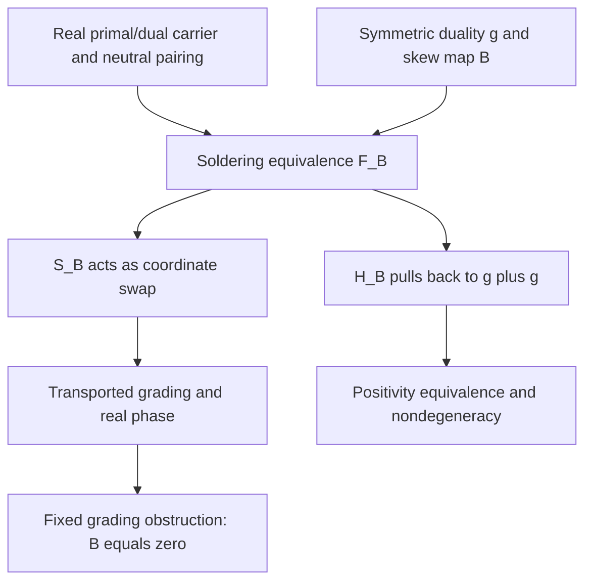

# Shared real formalism: theorem contract

## Intake and provenance

Source: the user's 2026-11-23 conversation, supplied with the GitHub connector.
The intake proposes that `(N₊ ⊕ N₋, Γ, J, D)` and real Clifford/Peirce towers
give exact realizations of seven mathematical-physics theories: Krein spectral
triples; generalized/DFT/Born geometry; Hestenes/GTG; twistor and spinor
soldering; split-octonionic particle models; Nambu/BLG; and chiral
supersymmetry/Cartan gravity. Its claim that every correspondence has already
been rigorously verified is intake provenance, not acceptance evidence.

Baseline: `fe24e350b08fdea04f74c0748ef9fd9417c47529`. Upstream `main` was still
at that revision when the user requested publication on 2026-11-24. The
previous scratch checkout and QA logs were no longer available. Both Lean
owners were recovered byte for byte from the conversation and checked against
the recorded SHA-256 hashes below. This contract and the verification runner
were reconstructed; they are not claimed to be byte-identical recovered files.
No dependency or toolchain pin is changed.

| Recovered owner | SHA-256 |
| --- | --- |
| `PhaseSpaceBFieldCompatibility.lean` | `d53a8997c81a330ee595f1bbec43dcc3680178fca8d456d0aece252f0b14e465` |
| `GeneralizedMetricPositivity.lean` | `d8998bf7deebaaaaba9ca2a20dac629de2712976527ebd604a718e07f787843d` |

## Formal intent and supplied data

The missing edge is compatibility of a nonzero skew B-field with the real
doubled grading and the generalized metric. The covariant bilinear form `H`
and its neutral-raised involution `S` have different types. A fixed primal/dual
grading is not compatible with every `S_B`: transporting the grading by the
same B-transform preserves compatibility, while the original grading works
exactly when `B=0`.

Carrier: `PhaseSpaceCarrier E = E × Module.Dual ℝ E`, for a real module `E`
with `AddCommGroup E`. `GeneralizedMetricDatum E` supplies a symmetric linear
equivalence `gFlat : E ≃ₗ[ℝ] E*` and a skew linear map `B : E →ₗ[ℝ] E*`.
Positivity is an explicit additional hypothesis, not a structure field already
assumed. No finite-dimensional typeclass, manifold, differential-operator
domain, or field equation is inferred. The algebraic self-duality equivalence
is strong supplied data; this does not construct a duality with the full
algebraic dual for an arbitrary infinite-dimensional Hilbert space.

Conventions:

- `η((x,φ),(y,ψ)) = φ(y)+ψ(x)` is `canonicalNeutralBilin`.
- `K(x,φ) = (x,-φ)` is `neutralParaInvolution`.
- `T_B(x,φ) = (x,Bx+φ)` and `T_B⁻¹(x,φ) = (x,φ-Bx)` are the B-transforms.
- `S_B = T_B S₀ T_B⁻¹` is `polarization`, where `S₀(x,φ)=(gFlat.symm φ,gFlat x)`.
- `H_B(X,Y) = η(X,S_B Y)` is `generalizedMetricForm`.
- `F_B(x,y) = (x,gFlat y+Bx)` is the existing `generalizedSoldering` equivalence.

## Canonical structural vocabulary

| Narrative motif | Precise object and prerequisite |
| --- | --- |
| Complementary null channels | `E × E*` with the evaluation pairing; each coordinate summand is isotropic. |
| Grading | The sign involution `K`; the full-B compatible construction is its conjugate `K_B`. |
| Exchange or mirror | The linear involution `S_B`, requiring the symmetric duality and skew map. Positivity of `η(-,S_B -)` is a separate condition. |
| Real phase | `I_B = K_B S_B`, with `I_B²=-1` in `Module.End ℝ (E × E*)`. No complex scalar field is introduced. |
| Directed nilpotency | In a unital associative algebra, an idempotent `p` and `q=1-p` give square-zero corners `pAq` and `qAp`. For nonzero `p`, the left ideal `Ap` contains the non-nilpotent idempotent `p`. |
| Odd differential and coupling | For a Peirce grading automorphism `γ` and odd `u`, `d_u(x)=ux-γ(x)u` satisfies `d_u²=ad(u²)`; two odd generators give `{d_u,d_v}=ad(uv+vu)`. The exact square-zero condition is `ad(u²)=0`; `u²=0` is sufficient. |
| Alternative multiplication and Clifford action | Split-octonion multiplication stays nonassociative. Imaginary left-multiplication operators satisfy a quadratic Clifford relation and extend to a representation on the octonion carrier. |

The Peirce and octonionic rows refer to existing source owners. They are not
additional theorems established by the two new modules. Identifying an
algebraic endomorphism with an unbounded Dirac operator requires additional
representation and analytic constructions.

## Owner search and reuse

The original bounded source search covered canonical `lean/InfoGeometry`
owners, their `src/InfoGeometry` parallels, definitions, imports, and consumers.
It found no transported-grading owner or fixed-grading/B-zero equivalence.
The publication recovery uses the same baseline and exactly the same Lean
sources. A navigation graph is not being used as proof of closure.

| Existing owner | Reused content |
| --- | --- |
| `Clifford/NeutralPhaseSpaceCore.lean` | Evaluation pairing, grading, neutral anti-isometry, isotropic summands. |
| `Clifford/PhaseSpaceGeneralizedMetric.lean` | Actual `g,B` data, B-transform inverse laws, `S_B²=1`, neutral invariance, symmetric `H_B`. |
| `Canonical/GeneralizedSolderingBridge.lean` | Native linear equivalence `F_B`, swap action of `S_B`, pullbacks of `η` and `H_B`. |
| `Clifford/ParaKahlerGeneralizedMetric.lean` | Existing zero-B compatibility and positivity results, used for comparison. |

The older `GeneralizedMetricCore` and `GeneralizedMetricBField` seeds contain
products of anticommuting involutions that square to `-1`. Such a phase
endomorphism is not the positive covariant generalized metric. Those seeds are
not used as authority for a DFT identification.

## New declarations and dependency order

`PhaseSpaceBFieldCompatibility.lean` adds two definitions and eleven theorems:

1. `K_B = T_B K T_B⁻¹`, its coordinate formula `(x,2Bx-φ)`, its square-to-one
   identity, and neutral anti-isometry.
2. `K_B F_B(x,y)=F_B(x,-y)` and `K_B S_B=-S_B K_B`.
3. `I_B=K_B S_B`, `I_B F_B(x,y)=F_B(y,-x)`, `I_B²=-1`, and
   `S_B I_B S_B=-I_B`.
4. `K_B=K ↔ B=0` and `K S_B=-S_B K ↔ B=0`, including the nonzero-B failure
   corollary. These are operator equalities on the full primal/dual carrier.

`GeneralizedMetricPositivity.lean` adds six theorems:

1. For `X=(x,φ)` and `ξ=gFlat.symm (φ-Bx)`,
   `H_B(X,X)=g(x,x)+g(ξ,ξ)`.
2. Nonnegativity and strict positivity transfer from the base form.
3. Nondegeneracy from the supplied duality, without assuming positivity.
4. Nonnegativity and positive-definiteness equivalences with the base form.

The fixed-grading obstruction evaluates the first coordinate of the operator
relation at `(x,0)` and uses `-gFlat.symm(Bx)=gFlat.symm(Bx)` to obtain `B=0`.
The converse positivity implications restrict the pulled-back metric to
`F_B(x,0)`. Neither argument replaces the target with a scalar or commuting
surrogate.

The phase convention is `I_B=K_B S_B`; the opposite order gives its negative.
The identities imply `η(I_B X,I_B Y)=-η(X,Y)` and
`H_B(I_B X,I_B Y)=H_B(X,Y)`. These are explanatory algebraic consequences,
not additional named Lean declarations in this change. Square minus one alone
does not identify this phase with an `η`-orthogonal generalized complex
structure or the scalar complex structure of a twistor/Krein Hermitian model.

All new targets are algebraic. Completed Krein-space analysis, Courant
integrability, closedness of a differential B-field, DFT constraints/actions,
global Born geometry, spectral-triple domains, and equivalence of physical
theories remain outside these statements.

## Primary-source claim ledger

| Intake claim | Accepted formulation and boundary |
| --- | --- |
| Seven theories are exact realizations of one complete object. | Several theories share algebraic components. Equivalence of theories needs maps preserving operations, representations, domains, constraints, and dynamics; no seven-way equivalence is supplied here. |
| Spectral-triple real structure, Tomita mirror, and Krein fundamental symmetry are the same operator. | Distinguish grading, antilinear charge conjugation/real structure, linear fundamental symmetry, and Tomita conjugation. Identifications require constructions. |
| The DFT generalized metric obeys `H²=1`. | For the covariant matrix, `S=η⁻¹H` is the involution and `Hη⁻¹H=η`. Using `H` for the raised endomorphism is another convention and must be stated. Positivity requires a positive base form. |
| Every maximal isotropic subbundle is a Dirac structure. | Courant involutivity is additional on a manifold. Linear Dirac structures at a vector space use a separate convention. |
| Generalized geometry has no Clifford spinors. | Its canonical Clifford action on exterior forms is central to the theory. |
| Lorentzian chirality gives two independent compact real `su(2)` factors. | `spin(4)=su(2)⊕su(2)` is Euclidean. Real Lorentzian `spin(1,3)` is `sl(2,ℂ)` viewed as a real Lie algebra; complexified chiral factors obey a reality relation. |
| An arbitrary real bivector replaces scalar `i`. | STA uses a specified right-multiplication representation of phase; its multiplication and commutation laws matter. |
| Spacetime points are twistor alpha-planes. | A complexified spacetime point determines a projective twistor line; a projective twistor point determines an alpha-plane in spacetime. Complex Hermitian signature `(2,2)` realifies to real dimension eight and signature `(4,4)`. |
| Split-octonion Peirce poles leave compact `SU(3)` unbroken. | Ordered split Peirce poles have real `SL(3,ℝ)` stabilizer, with infinitesimal action `(Lu,-Lᵀv)`. Compact `SU(3)` belongs to the positive division-octonionic choice. |
| Triality is simply a `G₂(2)` symmetry. | Triality is the outer `D₄`/`Spin(4,4)` symmetry; split `G₂` is the corresponding octonionic automorphism/fixed structure. |
| `1+3` channels establish three generations. | A singlet/triplet decomposition is not a generation theorem. A minimal left ideal is not generally a nilpotent operator subspace. |
| `A₄` is the unique finite-dimensional positive metric 3-Lie algebra, with split inner form. | It is the nonabelian indecomposable positive example up to normalization; orthogonal sums and abelian factors occur. The induced BLG gauge-algebra invariant form has signature `(3,3)`; the matter form is positive. This induced form differs from the Killing form. |
| Every alternating associative triple product is a BLG bracket. | Full alternation and the Filippov identity must both be proved. A Lie triple/derivation identity is insufficient. |
| Nilpotent `N=1` charges force null momentum; their pairing gives BPS mass. | Massive and massless representations occur. Rank-one spinor Gram nullness and determinants of sums are separate identities; particle BPS bounds need the relevant central-charge extension. |
| A Cartan symmetric-pair grading is supersymmetry. | This is an ordinary Lie-algebra grading. Curvature/torsion use the Lie bracket and wedge product; fermionic interpretation is additional. |

Primary references for the claim ledger:

1. Hohm, Hull, Zwiebach, [Generalized metric formulation of double field theory](https://arxiv.org/abs/1006.4823), §5.2 and footnote 6.
2. Gualtieri, [Generalized complex geometry](https://annals.math.princeton.edu/wp-content/uploads/annals-v174-n1-p03-p.pdf), §§1–3, Definition 2.6 and Proposition 3.2.
3. Van den Dungen, [Krein spectral triples and the fermionic action](https://arxiv.org/abs/1505.01939), Definitions 2.1–2.2 and the Lorentz-type condition.
4. Tong, [The Supersymmetry Algebra](https://davidtong.org/pdfs/teaching/supersymmetric-field-theory/susy2.pdf), §§2.1, 2.3, 2.4.2.
5. Lasenby, Doran, Gull, [Gravity, Gauge Theories and Geometric Algebra](https://arxiv.org/abs/gr-qc/0405033), §3.3 and Appendix A.
6. Adamo, [Lectures on twistor theory](https://arxiv.org/abs/1712.02196), incidence correspondence and reality conditions.
7. Schulte-Hengesbach, [Half-flat structures on Lie groups](https://www.math.uni-hamburg.de/home/schulte-hengesbach/diss.pdf), Chapter 1, Proposition 4.5 and equation (4.11).
8. Mikosz and Weber, [Triality, characteristic classes, D4 and G2 singularities](https://doi.org/10.1007/s40062-014-0094-3), split triality and fixed algebra.
9. Figueroa-O'Farrill, [Three lectures on 3-algebras](https://arxiv.org/abs/0812.2865), positive-definite classification and equation (29).
10. Wise, [Symmetric Space Cartan Connections and Gravity in Three and Four Dimensions](https://arxiv.org/abs/0904.1738), symmetric Lie grading and equation (3).

## Existing source boundaries

- `OperatorAlgebra/RealDoubledChiralKrein` contains real grading, swap,
  square-minus-one phase, isotropic sheet, and positive-form identities;
  this does not automatically construct Tomita standard form.
- `Canonical/PeirceBoundaryComplex` supplies the associative graded-commutator
  identities and a native corner cochain complex. These are not duplicated.
- `Lie/CanonicalZornPeirceSL3Bridge.peirceStabilizerEquivSL3` has a trace-zero
  real matrix carrier. Its uppercase name does not turn the Lie-algebra
  result into a compact color-group theorem; bracket preservation is separate.
- `Algebra/ZornStandardTernaryIdentity` supplies a derivation fundamental
  identity without total alternation; it is not a BLG classification.
- `Algebra/OctonionMatrixObstruction` excludes an injective product-preserving
  map into ordinary matrix multiplication. `Lie/SplitOctonionCliffordAction`
  instead extends imaginary left-multiplication operators by the Clifford
  universal property. The octonions are the representation carrier, not an
  associative subalgebra; faithfulness of the full representation is not claimed.
- `Canonical/ConnesSpectralTripleBridge.SpectralTriple` contains `dirac : A`
  for a normed ring and commutator-norm estimates. This is narrower than an
  analytic Krein spectral triple.
- `Twistor/RealTwistorIncidence` supplies real algebraic incidence. Its
  two-real-component spinor chart is not automatically the complex Hermitian
  `SU(2,2)` model.

These additional owners were source-inspected in the original analysis and
are not presented as newly rebuilt by the two-owner verifier.

## Verification protocol

Unchanged pins:

- Lean: `leanprover/lean4:v4.34.1`.
- Mathlib: `d13f23b723b8a846827a245b89c10fc7d3f11612`.

Run `python3 verification/shared-formalism/check.py` from the repository root
with the pinned toolchain available. It uses the existing focused package and
one shared lock for the build, both fresh warning-as-error source checks, and
the canonical exhaustive ownership audit. The audit includes generated and
private declarations, rejects unsafe/partial declarations, and permits only
`propext`, `Classical.choice`, and `Quot.sound` as transitive axioms. Source,
helper, configuration, compiler, dependency-HEAD, and execution evidence are
recorded. The pin comparison covers the nine focused Git dependencies against
their corresponding root-manifest revisions, not the root's external path
dependencies. Before/after hashes cover the enumerated owner, helper, and
configuration inputs; they are not a snapshot of the entire imported source
closure. A focused result does not replace the root-package pre-push gate.

Publication roles:

- Root: exact Lean-source recovery, integration, contract, and publication.
- `verifier_recovery`: reconstructed runner candidate, no Lean-source authorship.
- `publication_audit`: independent source/semantic review and read-only policy
  and dependency-provenance audit.
- `publication_qa`: fresh independent verification, no source or runner edits.

### Historical evidence, not current acceptance

The previous conversation reported independent semantic review and five
passing static checks. Its first focused build found two local proof failures
and two unused simp arguments; the now-recovered sources contain the reviewed
repairs. That build reported 14 warnings in existing imported owners. The
repaired-source verifier was still queued at handoff. No successful final
kernel/axiom receipt was observed or recovered after the environment reset.

The earlier root-package build stopped before theorem elaboration because
`external_refs/homotopy-hypothesis-lean4` was absent. The 2026-11-24 provenance
audit found no authoritative revision for that path in the inspected records.
GIFT's exact gitlink remains `e6f3c3ac2140c2324fb2ae029c32233e73aa5e92`; current
official-upstream commit lookup did not resolve it. Atlas has a documented
historical revision, but restoring it alone does not resolve the other root
dependencies. No unpinned substitute or stub package is installed by this PR.

### Current publication verification

Independent source and semantic review by `publication_audit`: **PASS**.
The review checked the inherited carrier and datum assumptions, full-B
statements, both iff directions, the phase sign, and the different scopes of
positivity and nondegeneracy. The reviewer made no source edits and ran no
compiler or tests.

Fresh independent static QA on 2026-11-24: **PASS**. All five commands exited
zero on both recovered owners, with identical before/after source hashes:

- `opengauss_screener.py --strict --json`: no violations or quarantine.
- `opengauss_cli.py refute --strict --json`: no traps, errors, or warnings.
- `opengauss_cli.py review --gate GATE_4 --json`:
  `STATIC_REVIEW_PASSED_KERNEL_UNVERIFIED`.
- `semantic_vacuity_gate.py --fail-on warning`: no findings.
- `proof_proxy_staged_gate.py --strict`: no findings.

The first fresh grouped verification attempt stopped with `No space left on
device` before reaching either new owner. Its failure also prevented the
automatic receipt's final update, leaving a stale `running` status. An
independent supplemental failure record identifies that interrupted attempt;
it supplies no owner-build, fresh-source, or axiom-audit acceptance.

The replacement combined build completed ten repository dependency modules,
through `Canonical.GeneralizedSolderingBridge`, but its build subprocess then
exited `-9` (`SIGKILL`). The runner recorded a durable `failed` receipt. The
available diagnostics do not establish the signal's cause. Its log contains
fourteen existing dependency warnings, one suggestion, and no Lean error
lines. Neither new owner completed; neither fresh-source check nor the
owned-declaration/axiom audit ran. All twelve enumerated inputs and repository
HEAD were unchanged. This is incomplete verification, not source acceptance
or a Lean proof rejection.

The revised runner builds one owner at a time using separate Lake commands,
retaining the same lock, snapshots, fresh-source checks, exhaustive audit, and
axiom restrictions. The exact two-line change passed independent static review.
Lake retains its normal dependency scheduling within each owner build.

The sequential focused retry remains pending. Historical reports are not
being represented as fresh kernel acceptance.

### Root-package publication gate

The tracked `.githooks/pre-push` was executed for code checkpoint
`62f9d1d50ff931b9774133c6a4dfdad20bd74d60`, with new-ref input for
`codex/shared-formalism-boundaries-20261123` and comparison base
`fe24e350b08fdea04f74c0748ef9fd9417c47529`. It exited **1** on 2026-11-24.

Its incremental route invoked the normal locked root-package Lake build of
both changed owners. After fetching the unchanged pinned LeanCopilot revision,
Lake stopped before owner elaboration because
`external_refs/homotopy-hypothesis-lean4` was missing. The scoped source
axiom/debt scan, semantic-content audit, and tracked Lean scope audit all
passed. The source scan is not the kernel's transitive-axiom audit.

The hook stopped at that failed incremental gate; it did not reach its later
no-argument gate invocation. No successful root-package build or full-repository
certificate is asserted. The source and dependency pins remain unchanged, and
no replacement Homotopy package or stub was added.

On 2026-11-24, after the failed pre-push gate and incomplete kernel audit were
reported explicitly, the user confirmed publication in response to the request
for a draft-publication exception. Publication is therefore authorized as a
draft with these blockers documented. This task-specific authorization does
not supply kernel acceptance, a passing root gate, or permission to merge.
