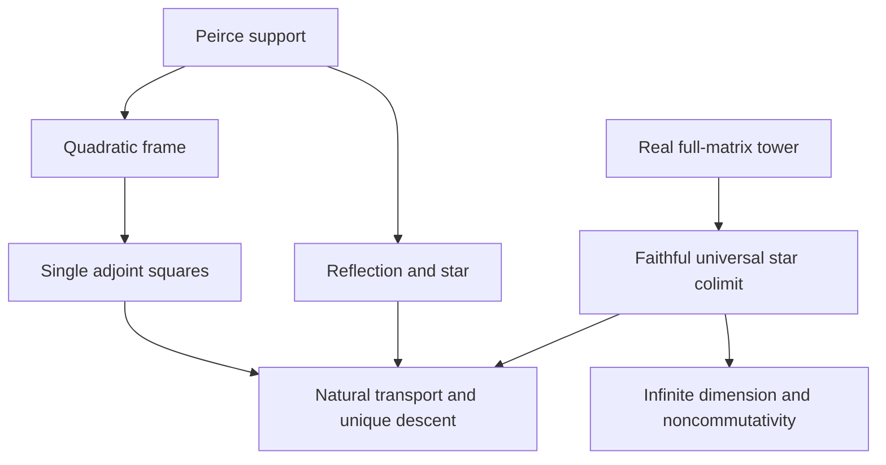

# Real star-algebra colimit and single adjoint squares

## Intake

The exact supplied text is frozen at
`docs/intake/star-colimit-chiral/raw-source.txt`, with provenance alongside it.
SHA-256: `ed173d8b5378504778890883f318dae17a7c3cc9cbd17573668338d93375c1c4`.
Base revision: `87bfa4567046db6f475a9df2903bd4060dc773ca`.
The source's assertions of prior verification are not build evidence.

This contract is written before new proof candidates. The target is the
mathematics of Archetype LII on the existing real full-matrix tower and its
actual native algebraic direct limit. No complexification, diagonal carrier,
commutative surrogate, new colimit quotient, or physics-named axiom is used.

## Owner audit

Read the repository deep-search protocol, categorical infrastructure map,
canonical pipeline, epistemic-compilation skill and anomaly-resolution skill.
The context preflight found no available declaration DAG, LeanSearch export,
or raw InfoTree artifact. Accordingly, source and import tracing determine
this contract; there is no claim of a fresh graph export.

| Mathematical object | Existing owner |
| --- | --- |
| Peirce corners and square-zero laws | `Core.PeirceDecomposition`, `Core.PeirceGrading` |
| Reflection, parity, star projections | `Core.PeirceGrading`, `Core.PeirceStarCharges` |
| Independent opposite corners; reflection exchanges quadratic product and bracket | `Core.PeirceCoupledCorners` |
| Sum/difference squares, anticommutation, quadratic centralizers | `Core.PeirceQuadraticFrame` |
| Paired symmetric generator | `Core.LieJordanGenerators` |
| Full real stages, tensor inclusions, injectivity, star preservation | `Clifford.Cl11TensorTower`, `Clifford.TowerMatrix` |
| Native direct-limit carrier, real algebra, star, stage injections | `Clifford.Cl11TensorTowerLimit` |
| Existing algebra-hom inclusion | `Canonical.Cl11TensorInductiveLimit.ofStageAlgHom` |
| Universal ring lift, compatibility, uniqueness, faithful inclusions | `Algebra.DirectLimitSuperClosureLemmas` |

`Canonical.FilteredStarAlgebraDirectLimit` is a complex C-star construction.
`FilteredIsometricInnerProductColimit` and its compatible-operator consumer
also assume complex inner-product spaces. They do not supply a real theorem
for this task. The new real universal map must reuse the existing real
carrier and ring universal property.

## Exact finite algebra

Use native `LieAlgebra.ad` and `Module.End R A`, where `R` is a commutative
scalar ring and `A` is an associative, possibly noncommutative, algebra.
The concrete and colimit instances are over the real numbers.

For opposite Peirce corners `u` and `v` of an idempotent `p`, set

```
E = u + v          F = u - v
K = u*v + v*u      C = ⁅u,v⁆
D₊ = -(ad E * ad E)
D₋ =   ad F * ad F
```

The source's factor four is correct for these two single-generator operators.
They are distinct from `symmetricGenerator u v`. The unrestricted relation is
`D₊ + D₋ = 2 • symmetricGenerator u v` as native endomorphisms.

| Input | D₊ action | D₋ action |
| --- | --- | --- |
| `1` | `0` | `0` |
| `K` | `0` | `0` |
| `E` | `0` | `-(4 • (K*E))` |
| `F` | `-(4 • (K*F))` | `0` |
| `C` | `-(4 • (K*C))` | `-(4 • (K*C))` |

The coefficients `K` remain operators. No scalar eigenvalue or scalar
spectral gap is inferred from these multiplication identities. The generic
action table consumes the existing square, anticommutation and centralizer
lemmas. Naturality of both endomorphisms is proved for native algebra
homomorphisms, rather than using a custom `StarRingHom` record.

## Reflection and star branch

Use the existing reflection `s = 2*p - 1`. Opposite-corner support gives
`s*E*s = -E`, `s*F*s = -F`, `s*K*s = K`, `s*C*s = C`, and `s*K = C`.
Already-owned statements are reused; only genuinely missing consequences
are added. Odd/even conjugation is an algebraic grading, not a theorem
about spontaneous symmetry breaking or about stationarity.

For `IsStarProjection p` and arbitrary `u ∈ peirce10 p`, take `v = star u`.
No self-adjointness of the arbitrary corner input is assumed. The reflected
star has `s * star u * s = -star u`, and its negative anticommutator with
`u` is exactly `u*star u + star u*u`. This is a star-square sum identity.
In an arbitrary star ring it is not an order assertion or an
Osterwalder–Schrader reconstruction theorem.

## Actual real colimit

Let `Stage n` and `Limit` be the existing `Cl11TensorTowerLimit` types;
`Stage n` is the full real matrix algebra on `TowerMatrix.Idx n`.
Bundle the already-owned `ofStageAlgHom n` with `ofStage_star n` into
a native `Stage n →⋆ₐ[ℝ] Limit`. Prove bonding compatibility and injectivity.

For every real target ring/algebra with star and every native star-algebra
family `g n : Stage n →⋆ₐ[ℝ] B` satisfying
`g (n+1) (stageEmbed n x) = g n x`, construct the universal map
`Limit →⋆ₐ[ℝ] B` from the existing `directLimitLift stageBond`.
Prove evaluation on stages, star/scalar preservation, and uniqueness.
Compatibility must be consumed in the construction; an arbitrary cone is
not renamed a colimit. The universal property concerns star-algebra maps;
no topological universal property is asserted.

Faithfulness preserves every nonzero element and every nonzero commutator
from a stage. It does not assert that arbitrary input pairs fail to commute.
Also prove an unconditional `∃ a b : Limit, a*b ≠ b*a` by transporting an
existing full-stage witness; conditional preservation alone is insufficient
to assert that this particular carrier is noncommutative.
The existing stage dimension is `(2^n)*(2^n)`. Injectivity of its real-linear
inclusion and the unboundedness of these dimensions prove
`¬ FiniteDimensional ℝ Limit`. This gives a genuinely infinite-dimensional
real noncommutative carrier without adding a norm or a completion.

The Peirce/star/action statements are instantiated on this actual carrier.
Transport equalities must connect finite expressions, their canonical
images, refinement, and the universal map. They must also permit arbitrary
elements of the algebraic limit, using its existing ring/algebra structure.
Avoid a giant conjunction with an unused cone-compatibility premise.
Compatible coefficient families on an arbitrary cofinal tail `Stage (m+n)`
also induce unique native real linear endomorphisms of the entire limit with
the stated finite-stage actions. The seed is an arbitrary full matrix at
stage `m`; starting every coefficient at the scalar stage zero would give a
degenerate commuting family and is insufficient here. Descent consumes
coefficient compatibility, refinement to a common later stage, and native
representative induction. It does not introduce a Hilbert-space completion.

## Dependency order



1. Existing Peirce support and quadratic frame imply the two single-square
   action tables and the reflection/star identities.
2. Existing tensor embeddings and native ring colimit imply faithful real
   star-algebra inclusions and a universal star-algebra lift.
3. Faithful real-linear inclusions and unbounded matrix dimensions imply
   infinite dimension of this same carrier.
4. Algebra-hom naturality, stage compatibility, and the universal-lift
   evaluation law give refinement-invariant transport of the action table.
5. The independent reflection/star branch gives the transported star-square
   identity; it does not provide the analytic premises missing below.

## Scope boundary

No scalar lower bound, OS positivity, Hilbert completion, spectrum, semigroup,
or Yang–Mills mass gap follows from the supplied cone assumptions. A
compatible family alone supplies neither universality nor injectivity nor
infinite dimension. Here the first three are proved for an existing native
real full-matrix system. The source's analytical conclusions are not renamed
into weaker claims carrying those same names.

Finite positive gaps alone need not give a uniform lower bound. Ordinary
unnormalized Frobenius norm squared scales by two under `X ↦ X ⊗ I₂`;
it cannot be silently treated as an isometric Hilbert tower. Analytic
transport would require explicit compatible inner products, a uniform lower
bound, and appropriate boundedness/completion hypotheses. These are not
provided by this intake, so the implementation makes no such assertion.

## Verification and publication

Keep repository toolchain and dependency pins fixed. Parent owns the single
compiler lane and shared build lock. Authors write only new sandbox files;
parent applies changes. Extend the existing scoped checker and path filter
to the new modules and their actual source dependencies. Compile exact
source copies, audit the full repository import closure, and build an
isolated native Lake package. No admitted proofs, extra axioms, unsafe
evaluation, or scalar replacements are acceptable. Record the exact result,
source hashes and transitive axioms after verification. Independent semantic
review and separate artifact/publication acceptance precede completion.

The strict declaration audit also covers inherited owners. It exposed the
compiler-generated partial runtime auxiliaries of `TowerMatrix.Idx` and
the root-level `iota_seq` in `Canonical.TensorTowerColimit`. The type-valued
`Idx` keeps its exact recursive body and is explicitly `noncomputable` to
suppress runtime code generation. The iterated linear map `iota_seq` is
expressed directly with `Nat.rec`. Both retain their original types and
definitional zero and successor equations. All existing theorem statements
remain unchanged. The existing Cartan inverse proof now uses its transpose
premise to identify the inverse with the transpose. The two existing
off-diagonal `Cl11Matrix` seeds receive an explicit noncommutation theorem in
their own owner, which `TowerMatrix` imports. These three owners become strict
warning-as-error targets, with the existing `Cl11Matrix` lint warnings repaired.
The verifier's
unsafe/partial rejection and its axiom allowlist remain unchanged, with no
declaration exceptions.

## Entry point

```lean
import InfoGeometry.Canonical.Cl11PeirceStarColimit
```
