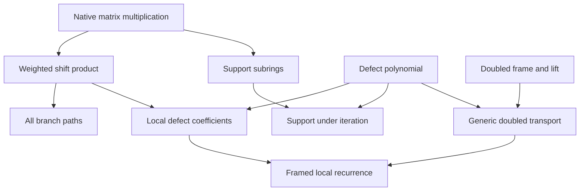
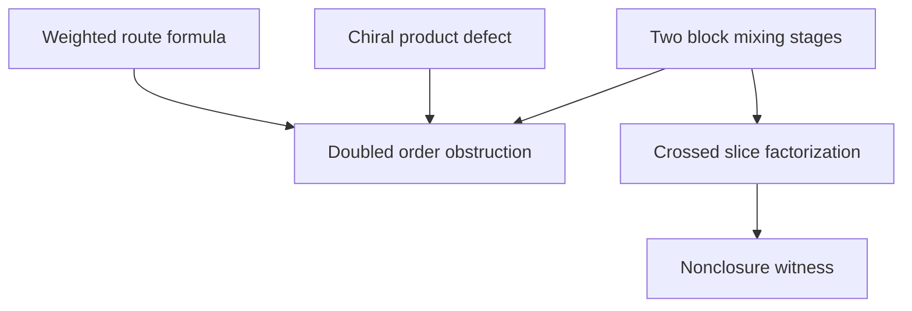

# Ordered structured operators: theorem contract and claim ledger

## Intake and provenance

This continuation examines three user-supplied texts dated 2026-11-04. Their
unmodified originals remain the intake record. Narrative interpretations are
not axioms of the Lean development.

| Source | SHA-256 |
|---|---|
| `Pasted text(20261104-134325).txt` | `cf6fdf2b209190d29ea3f3cc787525e95da27565564b4e827176f6708f47cecb` |
| `Pasted text (2)(20261104-134516).txt` | `cd357a912194951f38a382fc36bc9276ab712578d94b8db3cfedb560a950eba7` |
| `Pasted text (3)(20261104-135638).txt` | `751b58c857d1a33c1e4c6b0130d0c150e1b74febe68882ca58b68e036554db83` |

The base work is the chiral transpose lift and compression-defect synthesis
in [draft PR #280](https://github.com/nickgou-nuke/info-geometry-lean/pull/280).
Its local source tree is `3df1f0e3057908da72e8760cb56c389854964d1f`, shared by
local commit `2ff5e14693f068c4a0a696d7ea2c6300af0e7858` and upstream commit
`8784d757e67ff64b6377b8f6406d0723e2e77003`.
This document distinguishes new results, reused owners, conditional claims,
countermodels, and unproved hardware/analytic assertions.

The source's psychological labels are interpreted as a proposed mathematical
organization. They are not diagnoses, empirical psychological laws, or new
axioms of Lean. The formal assumptions are the displayed algebraic typeclasses
and hypotheses. An idempotency defect is failure of an algebraic equation,
not a logical contradiction from which arbitrary conclusions follow.

## Ground-truth contract

Column vectors fix the composition convention: the rightmost operator acts
first. A weighted displacement on a finite additive abelian group `G` is
`W_g(d)[i,j] = d(j)` when `i = g+j`, and zero otherwise. Coefficients live in an
arbitrary associative ring `R`, which need not be commutative. The address group
is commutative; its weighted matrix operators generally are not.

The exact ordered product is

`W_g(d) W_h(e) = W_(g+h)(j ↦ d(h+j)e(j))`.

For `a_A(g,j) = A[g+j,j]`, the full matrix product is

`a_(AB)(g,j) = Σ_h a_A(g-h,h+j) a_B(h,j)`.

The new owner proves this product, exact reconstruction, the ordered-word
formula, and the induced idempotency-defect recursion. A two-route stage
`B_g(d,e) = W_0(d)+W_g(e)` stays within its scale under defect iteration when
`g+g=0`. Native subgroup/subring containment supplies the actual partial order
for support restrictions. No strict growth of this order is asserted.

The Monarch continuation uses native finite matrices on `I × J`, native
`Matrix.blockDiagonal`, and a product-index permutation. It proves

`M[(i,a),(j,b)] = L[a,i,j] R[j,a,b]`.

Fixing `a,j` gives an outer product in the remaining indices `i,b`. Ordinary
coarse blocks instead fix `i,j` and need not have rank one. An explicit
four-state counterexample refutes closure under squaring without asserting
that every square escapes the class.

The Krein continuation retains an explicit inverse hypothesis for the
Cayley denominator. Preservation of a sesquilinear form is distinct from a
bound on a positive norm. Any depth-stability conclusion needs a separate
quantitative argument, not a per-layer indefinite conservation identity.

## Canonical relational chain and its existing owners

The initial construction is already owned by `Core/PeirceDecomposition.lean`.
In an associative unital ring, choose an idempotent `p`, and put `q = 1-p`.
Then `p+q=1`, `p*q=q*p=0`, and `q*q=q`. The cut is an explicit hypothesis;
the development does not infer a preferred idempotent from unstructured prose.

For any full operator `x`, the four components reconstruct it exactly:

`x = p*x*p + p*x*q + q*x*p + q*x*q`.

For the column-vector convention, the source sector is on the right.

| Requested relational role | Mathematical component | Directed reading |
|---|---|---|
| Internal self-sector | `p*x*p` (`component11`) | `p → p` |
| Outward transfer | `q*x*p` (`component01`) | `p → q` |
| Inward transfer | `p*x*q` (`component10`) | `q → p` |
| Complementary self-sector | `q*x*q` (`component00`) | `q → q` |

The off-diagonal components are transfer operators, not themselves idempotent
projections. Choose independent `u ∈ pAq` and `v ∈ qAp`. Their support relations
force `u*u=v*v=0` but do not force `u*v=v*u`. The existing
`Core/PeirceCoupledCorners.lean` and `Core/PeirceQuadraticFrame.lean` prove:

| Extracted structural quantity | Definition | Consequence of corner mechanics |
|---|---|---|
| Integrated transfer | `S = u+v` | `S^2 = E` |
| Directional difference | `D = u-v` | `D^2 = -E`, `S*D = -D*S` |
| Combined round trips | `E = u*v+v*u` | Commutes with `u`, `v`, `S`, and `D` |
| Ordered round-trip difference | `K = u*v-v*u` | `K = D*S = -S*D`, `K^2 = E^2` |

`u*v` and `v*u` occupy opposite diagonal corners. The reflection `2*p-1`
interchanges their sum and difference by left multiplication. This supplies
an exact change of perspective. Positivity of `E` is not an arbitrary-ring
consequence: the complex matrix owner additionally requires `p` to be a star
projection and the two transfers to be adjoints before deriving Gram positivity.

`Core/IdempotencyDefect.lean` defines `δ(x)=x*x-x` and proves
`δ(x)=0 ↔ IsIdempotentElem x`. The dependent `Core/PeirceDefect.lean` computes

`δ(p+u+v) = u*v+v*u = E`.

Thus the defect is the actual round-trip operator. It is not an assumed
vanishing quantity. `Core/DefectIteration.lean` supplies finite iteration,
annihilation transport, and an antitone chain of generated subalgebras.
The new audit checks `δ^[k](2)=2` over the reals and formally refutes
`∀ x : ℝ, ∃ k, δ^[k](x)=0`. Recursion alone therefore cannot justify an
inevitable final synthesis with zero defect.

The previous chiral owner supplies an exact frame `F` and lift `L` with

`F(L(A)) = diag(A,Aᵀ)`

and

`F(L(A)*L(B)-L(A*B)) = diag(0,(B*A-A*B)ᵀ)`.

It follows that `L` preserves a product exactly for commuting inputs. It
preserves squares, Jordan products, sandwiches, and every finite defect
iterate without assuming that all input operators commute. The new structured
owners compute this retained obstruction in actual routing coordinates.

## New proof chain

### 1. Exact displacement coordinates

Owner: `Algebra/MatrixDisplacement.lean`.

`sum_weightedShift_coefficient` reconstructs an arbitrary finite matrix:

`A = Σ_g W_g(j ↦ A[g+j,j])`.

This keeps `|G|^2` coefficients. The matrix algebra is not replaced by the
commutative span of constant translations. `weightedShift_mul` and
`weightedShift_commute_iff` distinguish the two orders exactly:

`W_g(d)W_h(e)=W_h(e)W_g(d)` iff
`∀ j, d(h+j)e(j)=e(g+j)d(j)`.

`prod_weightedShift` computes an entire ordered word. For a list
`[(g₁,d₁),...,(gₘ,dₘ)]`, its displacement is the sum of the `g` values, while
each left coefficient is evaluated after all jumps to its right. The recursive
`wordWeight` retains that evaluation order and coefficient multiplication order.

The focused continuation `Algebra/ButterflyPaths.lean` expands a list of
two-route stages into its complete native list of Boolean branch choices.
`length_paths` gives `2^k` choices, counting multiplicity, and
`length_of_mem_paths` gives one branch per stage. Ordered distributivity proves
the product equals the sum of route products. The final theorem
`prod_bitStep_eq_sum_weightedShift` then evaluates every route with the existing
`wordDisplacement` and `wordWeight`. No involutive-displacement assumption is
needed for this expansion. Enumeration length is not a fast evaluation bound;
the theorem claims neither distinct endpoints nor nonzero weights.

`coefficient_defect` and `coefficient_iterate_succ` compute the defect tower
using twisted convolution. For one involutive displacement `g+g=0`,
`bitStep_mul` gives the full two-route composition law:

`B_g(d,e)B_g(a,b) = B_g(d*a + e(·+g)*b, d(·+g)*b + e*a)`.

The exact convention is `e(g+j)` in Lean; `G` is abelian. Consequently, the
coefficient update for one defect step is

`(d,e) ↦ (j ↦ d(j)^2+e(g+j)e(j)-d(j),`
`          j ↦ d(g+j)e(j)+e(j)d(j)-e(j))`.

`iterate_bitStep` proves every finite iterate equals the stage reconstructed
from that iterated pair. `iterate_bitStep_apply_of_ne` proves that it has no
entry away from the identity and the same displacement. This includes the
degenerate `g=0` case as a valid reconstruction, without a uniqueness claim
for its redundant coefficient pair.

`displacementSubring H` is a native Mathlib subring for each additive subgroup
`H ≤ G`. `displacementSubring_mono` proves that subgroup inclusion implies
subring inclusion. `iterate_mem_displacementSubring` proves closure of all
finite defect stages. This is an actual partially ordered family of support
restrictions, with no claim that a defect orbit strictly ascends it.

`BitAddress n = Fin n → ZMod 2` has cardinality `2^n`, and every displacement
satisfies `g+g=0`. These are the precise Boolean-address specializations.

### 2. Frozen spectral filters

Owner: `Algebra/SpectralFilter.lean`.

For one real square matrix `H`, define `F_H(w)=H*diag(w)*Hᵀ`.
Every such filter is symmetric, even before orthogonality is assumed. Under
the single hypothesis `HᵀH=1`, native finite square-matrix inverse theory
derives `HHᵀ=1`. The owner then proves

`F_H(u)F_H(v)=F_H(u*v)`, `δ(F_H(w))=F_H(δ(w))`,

and collapse of any finite list of these filters to the pointwise product of
its weights. Injective readback proves that idempotence is equivalent to every
weight being zero or one. The basis and weights are frozen; no inference is
made about an input-dependent map `X ↦ F_H(w(X))X` or intervening nonlinearities.
The owner assumes `H`; it does not construct a general normalized FWHT.

### 3. Monarch routing and its obstruction

Owner: `Algebra/MonarchFactorization.lean`.

`coarseMix L` and `fineMix R` are actual native block-diagonal matrices with
the required product-index reindexing. `monarch_mulVec` proves the two-stage
execution formula, with the fine-index multiplication first.

The slice `M[(i,a),(j,b)]` with fixed `a,j` is the outer product
`L_a(:,j) R_j(a,:)`; its native matrix rank is at most one over a field.
Over a commutative ring, every two-by-two minor of that slice is zero.

The rational witness is, in ordinary coarse blocks,

`M = [[I,0],[I,X]]`, where `X=[[0,1],[1,0]]`.

It is produced by `L₀=L₁=[[1,0],[1,1]]`, `R₀=I`, `R₁=X`. Its ordinary
upper-left block is `I₂` and has rank two. Its square has the crossed-index
slice `[[1,0],[1,1]]`, whose minor is one. The theorem
`witness_square_not_isMonarch` therefore excludes **every** possible block
factorization of this square, not just reuse of the original parameters.
The existential nonclosure statement does not exclude identity or other
special matrices whose squares remain in the class.

The same owner proves that its actual two-by-two `coarseBlock` and `fineSwap`
do not commute: their products differ at entry `(0,0)`. The vanishing minor
proof explicitly isolates a scalar `CommRing` calculation and then applies it
to the route factors; it does not commute matrix operators.

### 4. The doubled order obstruction in routing coordinates

Owner: `Krein/StructuredTransposeLift.lean`.

`frame_weighted_product_defect` specializes the chiral obstruction to

`diag(0, W_(g+h)(j ↦ e(g+j)d(j)-d(h+j)e(j))ᵀ)`.

The reverse-minus-forward sign is fixed by the second transpose sector.
`frame_iterate_bitStep` combines the explicit local coefficient recurrence
with the existing exact defect transport, yielding the readout at every
finite depth.

For the two actual Monarch stages, `fineMix_mul_coarseMix_apply` computes
the reversed route. The final criterion is

`L(coarseMix L)*L(fineMix R)=L(monarch L R)` iff
`∀ i j a b, L[a,i,j] R[j,a,b] = R[i,a,b] L[b,i,j]`.

The symbols `L` for the lift and for the block family are distinguished in
the Lean names. This theorem combines the existing representation law with
the newly proved route formula; it does not bundle unrelated conclusions
or assume the desired commutation as a structure field.

### 5. Cayley form conservation and the growth countermodel

Owner: `Algebra/CayleyForm.lean`.

For any ring with star, the hypotheses

`star Ω*J+J*Ω=0`, `(1+Ω)*r=1`

imply `star U*J*U=J` for `U=(1-Ω)*r`. The proof needs no positive form,
commuting factors, self-adjointness of `J`, or unstated inverse. Only the
displayed right inverse is required for this identity. Ordered list products
and powers preserve the same form.

Owner: `Krein/CayleyGrowthObstruction.lean`.

On the existing doubled real carrier, let
`J=diag(I,-I)` and `C=[[0,I],[I,0]]`. The explicit values

`Ω=-(1/2)C`, `r=(4/3)I+(2/3)C`, `U=(5/3)I+(4/3)C`

satisfy the generic theorem's hypotheses. `boost_preserves_grading` derives
conservation from that theorem. For `v₊=(v,v)`, the development proves

`v₊ᵀJv₊=0`, `U^k v₊=3^k v₊`, and
`(U^k v₊)ᵀ(U^k v₊)=9^k(v₊ᵀv₊)`.

With the concrete one-dimensional vector `v=1`, `boost_energy_unbounded`
proves that this positive energy exceeds every proposed real bound at some
finite depth. Thus form conservation, even for an actual well-defined Cayley
transform, does not establish uniform depth stability.

The same swap `C` is form-skew, but `I+C` has no right inverse on a nonempty
carrier. The proof uses the existing nonzero minus null projector, which
annihilates `I+C`. The inverse hypothesis is therefore substantive.

### 6. Audit entry point

`Krein/StructuredOperatorAudit.lean` imports the new owners, prints the axiom
dependencies of their principal results, and proves a Boolean-address
noncommutation witness and the nonresolving defect tower. Independent QA
additionally enumerates and inspects **every** new theorem's axiom footprint.

## Dependency order and synthesis boundary

The following are proof-dependency diagrams. Each arrow means that the lower
construction or theorem uses an already established result. They do not
claim physical or psychological causation. Unrelated mathematical branches
are retained rather than forced into a false total order. The Peirce cut,
corner products, and coupled defect form the earlier branch described above;
the generic doubled transport does not depend on that special coupled defect.





The order on additive subgroups and their corresponding displacement
subrings is a separate, native partial order proved in the new code. The
finite iteration index orders evaluations, but it does not imply new
independent generators or eventual disappearance of the defect.

The structural synthesis is conditional and exact: a cut determines corners;
opposite transfers determine round trips and defects; coordinate and frame
maps transport those defects while retaining the obstruction to reversing
products. A conclusion of universal zero defect, universal short routing,
positive-norm stability, or hardware efficiency would require additional
theorems. Several of those unrestricted conclusions have explicit countermodels
in this change.

## Source-ledger corrections

| Intake claim | Disposition |
|---|---|
| Full matrix-algebra generation gives a short butterfly factorization of every matrix | Unsupported; the exact displacement expansion retains every coefficient. Generation and a fixed product family are different statements. |
| Diagonal extraction is an involution | False: it is an idempotent projection. |
| The unweighted XOR permutations span the whole off-diagonal space | False: arbitrary source-dependent weights are required. The unweighted translation family itself commutes. |
| All butterfly entries are nonzero for every choice of weights | False: routing support allows an entry; its coefficient may vanish. |
| For epsilon=XZ, the lower Witt coefficient is sym-causal | False: it is sym+causal; the upper coefficient is sym-causal. |
| A Monarch matrix has rank-one ordinary coarse blocks | False: the rank-one constraint applies after fixing fine output and coarse input. |
| Every Monarch square lies outside the class | False: identity is an immediate exception. The class can fail closure, as witnessed by a particular matrix. |
| Nonzero skew part is equivalent to non-normality | False; a skew matrix can be normal. Nor does either condition establish temporal causality. |
| The bilinear code's four coefficient fields are all flip-invariant | False: its polarization and antisymmetric cross fields are flip-odd. Two odd factors can yield a symmetric weighted shift. |
| Krein skew-adjointness alone makes the Cayley inverse exist | False; denominator invertibility is an additional requirement. |
| A bounded per-layer rapidity prevents growth at arbitrary depth | False; repeated admissible boosts can amplify a null direction geometrically. |
| Iterating `x ↦ x*x-x` necessarily reaches zero | False over the reals: two is a nonzero fixed point, checked at every finite depth. |
| A cyclic shift cannot be routed by a bitwise butterfly | The supplied obstruction is invalid: binary increment can route high bits first, using lower original bits as controls, then flip the lowest bit. No general impossibility theorem is promoted. |
| A bijective XOR bank map proves a GPU kernel fast and race-free | Unsupported; the address lemma needs an execution/memory model before those conclusions follow. |
| Numerical assertions constitute universal exact verification | False; the supplied second script also has a Python syntax error before its assertions can execute. |

Additional convention checks from the independent mathematical review:

- With `epsilon=XZ`, the correct Witt expansion is
  `X*s+epsilon*c = sigmaMinus*(s+c)+sigmaPlus*(s-c)`. The pasted second script
  reverses these coefficients and contains the invalid assignment
  `A_diag_ conjugated = ...`; its claimed PASS text is not execution evidence.
- For `A=S+K`, `Sᵀ=S`, and `Kᵀ=-K`,
  `AAᵀ-AᵀA=-2[S,K]`. The prior chiral owner proves the equivalent opposite
  Gram-order formula. A nonzero skew operator can still be normal.
- A flip-odd weight multiplying a flip-odd sign becomes flip-even.
  `weightedShift_odd_product_symmetric` proves the exact reason the alleged
  local skew channel may be symmetric. A cascade can still be asymmetric
  because its distinct symmetric stages need not commute.
- The scalar Cayley map `(I-κX)(I+κX)⁻¹` and the normalized boost
  `(I+κX)/sqrt(1-κ^2)` are different parameterizations. At `κ=1/2`, the former
  has expanding eigenvalue three, not square root of three. The checked
  rational boost also equals the latter at `κ=4/5`, below the pasted `0.85`
  cutoff, yet repeated depth is unbounded.
- Entrywise bounded `tanh` does not imply an operator-norm contraction. An
  arbitrary nonnormal matrix functional calculus does not supply this either.
  Bounds for a frozen matrix do not automatically bound the Jacobian of an
  input-dependent matrix-vector map.
- Existence of the Cayley inverse does not itself prove membership in the
  identity component of an indefinite orthogonal group. Such a claim needs
  a suitable nonsingular path or an equivalent component argument.
- The XOR swizzle is bijective on each row and column under the stated bank
  address model, but diagonal accesses can all map to bank zero. Bank conflicts,
  coalescing, synchronization, weight traffic, and the selected computation
  graph must be specified before a hardware complexity or throughput claim.

These last source corrections are exact algebraic or implementation-level
review findings where indicated. Only declarations named in the theorem
inventory and the verified dependency closure are presented as Lean results.

## Existing owner boundaries

- `Clifford/Cl11Matrix.lean` owns the real two-by-two Clifford equivalence;
  its negative generator uses `ZX`, opposite to the intake's `XZ` convention.
- `Clifford/Cl11TensorStageFactorization.lean` owns actual tensor-stage algebra
  equivalences and successor compatibility, not a short-factorization theorem.
- `Clifford/CliffordBitWordEquivalence.lean` owns Boolean-index and finite-index
  transport of the tensor tower.
- `Canonical/CelikKocakCantorOperators.lean` owns concrete bit tilt/switch laws.
- `Canonical/V4GroupFourierTransform.lean` is a four-character Fourier owner;
  its scope must not be silently promoted to an arbitrary-dimensional FWHT.
- `OperatorAlgebra/IndividuatedCayley.lean` owns generic starred-ring unitarity
  with a supplied two-sided inverse. Positive and indefinite adjoints differ.
- `Krein/SplitBoost.lean` and `Canonical/BipolarTwoPortScattering.lean` already
  distinguish indefinite norm preservation from positive-unitary behavior.
- `Core/IdempotencyDefect.lean`, `Core/DefectIteration.lean`, and
  `Krein/ChiralTransposeLift.lean` supply the reused defect and doubled-frame laws.
- `Analysis/MatrixSpectralSelfConcordantBarrier.lean` supplies an existing
  orthogonal diagonalization carrier and trace-square/cube formulas. Its
  inspected proofs perform sandwich cancellation locally, but the bounded
  owner search found no generic filter product/readback/list API; the new
  `Algebra/SpectralFilter.lean` exposes that precise missing implication.
- `Categorical/FiniteWordPathWeights.lean` concerns fixed-letter commutative
  path weights. It does not supply the translated, noncommutative matrix-path
  expansion proved by the focused `Algebra/ButterflyPaths.lean` continuation.

The source search also inspected nearby complex modular/Weyl diagonal
carriers and the categorical/tensor owner map. Source review of a nearby owner
is not counted as a fresh compilation of that owner unless it occurs in the
reported import closure. No categorical colimit or completion is introduced.

## External comparison sources

The Monarch paper's equation (2) fixes the crossed-index rank-one slices:
[Dao et al., ICML 2022](https://proceedings.mlr.press/v162/dao22a/dao22a.pdf).
Its approximation and hierarchy results are not imported Lean proofs here.

The Kaleidoscope universality result depends on circuit complexity and the
specified hierarchy/expansion parameters:
[Dao et al., Kaleidoscope](https://arxiv.org/abs/2012.14966).
It does not justify a fixed-width, fixed-depth universal fast representation.

Hardware bank behavior depends on actual access patterns and execution details:
[NVIDIA CUDA Programming Guide](https://docs.nvidia.com/cuda/cuda-programming-guide/02-basics/writing-cuda-kernels.html).
No hardware performance certificate is claimed by the present algebra.

## Verification status

### Final theorem inventory

There are 89 new theorem declarations in eight new Lean files. Existing
Peirce, defect, matrix, and chiral declarations are reused rather than counted
as new results.

| Owner relative to `lean/InfoGeometry/` | New theorems | Principal result |
|---|---:|---|
| `Algebra/MatrixDisplacement.lean` | 26 | Full noncommutative coordinates and finite defect recursion |
| `Algebra/ButterflyPaths.lean` | 4 | Exact sum over every ordered branch choice |
| `Algebra/MonarchFactorization.lean` | 18 | Native routing slice rank/minor and nonclosure witnesses |
| `Algebra/SpectralFilter.lean` | 11 | Frozen common-basis filter product and idempotence criterion |
| `Algebra/CayleyForm.lean` | 5 | Arbitrary starred-ring form preservation with a right inverse |
| `Krein/StructuredTransposeLift.lean` | 7 | Explicit routing-order obstruction and framed local recurrence |
| `Krein/CayleyGrowthObstruction.lean` | 15 | Exact form-preserving boost with unbounded positive energy |
| `Krein/StructuredOperatorAudit.lean` | 3 | Noncommuting weighted shifts and a nonresolving defect tower |

### Frozen Lean sources

| Source basename | SHA-256 |
|---|---|
| `MatrixDisplacement.lean` | `5bb8087587958a74449df7d957e81ea7bd91244cebc618a95293b666246fa3d5` |
| `ButterflyPaths.lean` | `6208dd434aede0d352e15d56070824f2001d28f3dfbc182efc89046fd6295e49` |
| `MonarchFactorization.lean` | `438e31fd951b5017c1b4fd929c1d6ea84da30392d3bf31a92d54479d001a5901` |
| `SpectralFilter.lean` | `435aa4514a798d1fda709eb0a69740c3e92b1f925863d3408b6db56b02b1a4e8` |
| `CayleyForm.lean` | `fbe4140aa0b3411a18f9d8871bb374bf5d80c0a1c154dc36d8fe55d29e90d926` |
| `StructuredTransposeLift.lean` | `77f6a2c391cc05268900b13789d850bd2b4669cf217f07ded69644f171ee0d47` |
| `CayleyGrowthObstruction.lean` | `5da9288514c48867b5611668dcf499f50df19dbdca332a8e84e2cdd192849695` |
| `StructuredOperatorAudit.lean` | `74e69f72aa04650b1120af37abe4964ea23968a534b49fd01f4c7bdb8ab211e7` |

### Acceptance record

**[accepted_limited_scope]** Independent verification accepted the final
frozen source for the stated finite algebraic scope. Root-package integration
remains blocked, so this is a draft contribution, not a merge-ready certificate.

| Check | Final result |
|---|---|
| Fresh repository-source import closure | 20/20 modules compiled successfully |
| New Lean files | All eight compiled with zero errors and zero warnings |
| Axiom dependencies | All 89 theorem names present exactly once; no disallowed axiom |
| Required headers and prohibited proof mechanisms | Passed; no proof holes, custom axioms, unsafe/native bypasses, or trivial `True` targets |
| Maintained semantic-vacuity gate | Exit 0; zero errors, nine reviewed short-proof warnings |
| Regex vacuity scanner | Eight files scanned; six lexical false positives reviewed |
| Unchanged staged proof gate | Independently passed, exit 0 |
| Frozen source/index and import-closure hashes | Unchanged before and after final QA |
| Dependency pins and gate sources | Unchanged |
| Actual root Lake integration build | Exit 1 before target elaboration; absent HomotopyHypothesis path |

The allowed foundational axiom union is exactly `propext`, `Classical.choice`,
and `Quot.sound`. They occur in 88, 72, and 85 theorem records respectively;
those counts overlap and do not represent extra assumptions about operators.
The axiom probe imports the final audit entry point and prints every new
theorem, including the new concrete block noncommutation witness. There is no
`sorryAx` or authored replacement axiom.

The nine semantic warnings concern legitimate evaluation and short transport
lemmas: source-entry evaluation, coefficient extraction, an outside-support
entry, Boolean address cardinality, the two native block-entry formulas,
coarse-stage matrix-vector evaluation, spectral defect transport, and swap
action on a duplicated vector. The separate regex scanner's six matches were
also inspected. Neither lexical heuristic is treated as a substitute for
kernel checking or independent semantic review.

The final closure contains the eight new modules and these twelve reused
modules: `Algebra.FiniteSpinAlgebra`, `Krein.LaggedCoincidenceDiracOperator`,
`Core.IdempotencyDefect`, `Core.PeirceDecomposition`, `Core.PeirceGrading`,
`Core.PeirceStarCharges`, `Core.PeirceCoupledCorners`,
`Core.PeirceQuadraticFrame`, `Core.PeirceDefect`, `Core.DefectIteration`,
`Core.PeirceCompressionDefect`, and `Krein.ChiralTransposeLift`.
The unchanged lagged-coincidence dependency emitted 17 existing linter
warnings. All other closure modules emitted none.

The first QA attempt is retained separately. Its compilation and 88-theorem
axiom audit passed, but the staged gate rejected the missing owner-local
noncommutation witness and did not recognize the scalar target of the minor
calculation. The correction introduced the actual block witness, exposed the
scalar calculation, and closed the generic variable section before the
concrete constants. Both independent semantic review and the unchanged gate
accepted the correction. The final 20-module closure and 89-theorem audit were
then rerun; no failing rule was disabled or rewritten.

### Runtime and exact commands

The unchanged environment pins are Lean `4.34.1` (runtime commit
`5045d0056413266e57c625dcd7c365b10e377c52`) and Mathlib
`d13f23b723b8a846827a245b89c10fc7d3f11612`. The isolated checks consume that
exact populated Mathlib cache and freshly rebuild every repository module in
the selected closure. The application-path compatibility shim only normalizes
the executable-path lookup; it does not alter the kernel or elaborator.

The independent QA driver, logs, source snapshots, hashes, and axiom records
are in `/workspace/scratch/e5b2bf2848d3/verification-runtime/qa-structured-final/`.
The prior rejected attempt remains in the separate `qa-structured/` directory.
The final driver was invoked with the following modes, in this order:

```bash
qa_driver=/workspace/scratch/e5b2bf2848d3/verification-runtime/qa-structured-final/verify_structured.py
python3 "$qa_driver" prepare
python3 "$qa_driver" closure
python3 "$qa_driver" axioms
python3 "$qa_driver" parse-axioms
python3 "$qa_driver" gates
python3 "$qa_driver" root
python3 "$qa_driver" snapshot-after
```

Each source compilation uses the maintained wrapper with the shared lock:

```bash
python3 tools/infra/run_locked_lean.py --wait-for-build-lock \
  --lake /workspace/scratch/e5b2bf2848d3/verification-runtime/lake-isolated \
  lean/InfoGeometry/Krein/StructuredOperatorAudit.lean \
  -o .lake/build/lib/lean/InfoGeometry/Krein/StructuredOperatorAudit.olean
```

The same wrapper checked the generated ignored probe
`lean/TempStructuredOperatorFinalQaAxioms.lean`. The driver records the exact
per-file commands for the other nineteen modules. The maintained source gates
include `tools/quality/proof_proxy_staged_gate.py`,
`tools/quality/semantic_vacuity_gate.py`, and
`scripts/vacuity-linter.py`, all at their actual selected eight-file scope.

The separate root-package command was also executed:

```bash
python3 tools/infra/run_locked_lake_build.py --wait-for-build-lock \
  InfoGeometry.Krein.StructuredOperatorAudit
```

It failed during package initialization with:

```text
error: HomotopyHypothesis: package directory not found:
/workspace/scratch/e5b2bf2848d3/info-geometry-lean/external_refs/homotopy-hypothesis-lean4
```

Both root cache hydration and the actual Lake build stop at that dependency.
The root Mathlib cache is unpopulated. Prior dependency inspection also found
the local Atlas dependency absent and the pinned GIFT submodule uninitialized.
HomotopyHypothesis and Atlas use local manifest paths without reconstructible
source revisions. No substitute package, cache deletion, dependency update,
or gate change was introduced. The successful file-level source closure is
therefore distinct from root-package or whole-repository integration.

### Review disposition

The review base is `feat/krein-chiral-defect-synthesis` at upstream commit
`8784d757e67ff64b6377b8f6406d0723e2e77003`, corresponding to draft PR #280.
This continuation is prepared as a stacked draft under the user's upstream
publication authorization. Root integration and the root push-quality gate
remain unsatisfied and must be resolved before merge readiness. The new code
does not modify the dependency declarations, toolchain pins, hooks, or gates.

**[kernel_verified]** The named finite identities and counterexamples compile.
**[bucket_2_conditional]** Idempotent cuts, orthogonal bases, involutive local
displacements, and actual Cayley right inverses remain the displayed
hypotheses of their respective results. **[countermodel_found]** Universal
resolution of the real defect tower, closure of the Monarch family under
squaring, and uniform depth stability from Krein conservation fail in the
checked examples. **[bucket_3_open_debt]** A general normalized FWHT,
short-factorization universality, adaptive/nonlinear network analysis,
CUDA/Triton refinement and performance, and analytic or categorical limits
are not supplied by these finite theorems.
