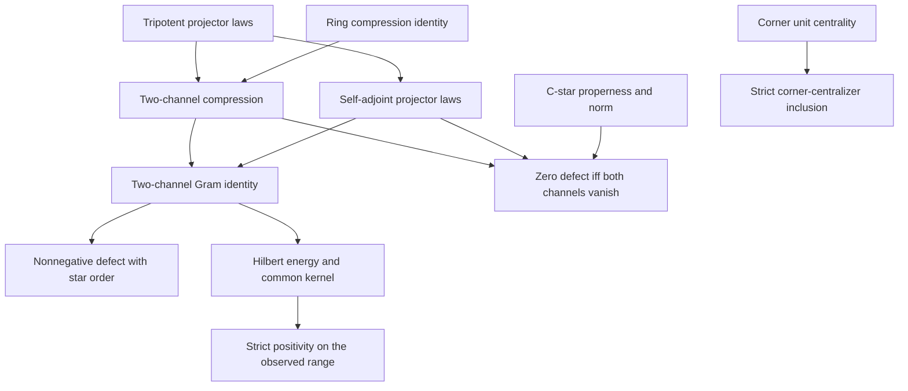

# Tripotent compression: theorem contract

## Intake and provenance

Base revision: `a392af178af1fe2bcba2ba39eb405700c6ee103c`.
The 2026-11-12 conversation supplies the Bulgarian triadic Peirce narrative
(sections I–V, deductions D1–D7) and the attachment
`Pasted text(20261112-082444).txt`. The latter additionally proposes parity,
supertrace balance, Andreev reflection and photon interpretations. The attached
source is preserved in `docs/intake/TRIADIC_SUPERGRADING_2026_11_12.txt`.

The exact implementation target is the ordered two-channel compression identity,
its star, C-star and real-Hilbert consequences, and the distinction between an orthogonal
corner and an ambient commutant. This contract also records the independently
existing owners for the other valid algebraic branches. The proposed physical
equivalence is not an assumption or a theorem in the implementation.

## Existing owners and conventions

| Carrier / operation | Source owner | Relevant existing declarations |
|---|---|---|
| Associative real algebra; normalized tripotent projectors | `Physics/Algebra/TripotentPeirceProjectors.lean` | `projPos`, `projZero`, `projNeg`, their idempotence, all six orthogonality laws, `proj_sum_eq_id` |
| Nine joint projectors and five ranges | `Physics/Algebra/TripotentFiveGradingDecomposition.lean` | `fiveGradeProjector`, `fiveGradeRange`, reconstruction |
| Native real adjoint eigenspaces | `Core/TripotentEigenspaces.lean` | `fiveGradeRange_eq_eigenspace`, multiplication/Lie weight addition and out-of-range vanishing |
| Ring compression | `Core/PeirceCompressionDefect.lean` | `compression_mul_defect`, `compression_defect_sum`, `compression_adjoint_mul_defect` |
| C-star zero detection and norm | `Core/PeirceCompressionCStar.lean` | `compression_adjoint_square_eq_iff`, `compression_square_eq_iff`, `norm_compression_adjoint_square_defect` |
| Corner centrality | `Core/CornerCentrality.lean` | `unit_central_in_corner`, `commutes_iff_block_diagonal` |
| Parity from the zero projector | `OperatorAlgebra/PeirceSpine/TripotentParity.lean` | `oddGrade_projZero`, `evenGrade_projZero`, signed action on five ranges |
| Correct modular generator criterion | `Modular/DualFlowLieAlgebraBridge.lean` | `FullLieAlgebra.ad_eq_zero_iff_mem_center` |
| Pluecker chart and Bregman identity | `Geometry/PluckerDualFlatBridge.lean` | `pluckerBregman_three_point` |

Paths in this table are relative to `lean/InfoGeometry/`. The repository's
`IdempotencyDefect.defect x` means `x*x-x`; the intake uses the opposite sign,
`rho-rho*rho`. The new statements display the latter expression explicitly.

## New theorem contracts

1. For an arbitrary associative real algebra, `t*t*t=t`, and `p=projPos t`,
   resolve `1-p=projZero t+projNeg t`. Resolve the existing binary compression
   defect using these exact normalized projectors. For arbitrary ordered inputs
   `x,y`, retain each product order; for `x*x=x`, obtain the intake's `rho-rho²`.
2. With `[StarRing A] [StarModule ℝ A]` and `star t=t`, prove that the three
   existing normalized projectors are self-adjoint. Factor the polarized defect
   as the sum of the two mixed adjoint products. For self-adjoint idempotent
   `x`, obtain the sum of two star-squares.
3. Under a native star-compatible order, the displayed sum is nonnegative.
   Under native C-star hypotheses, use the existing properness/norm owner to
   prove that the defect vanishes exactly when both outgoing channels vanish,
   equivalently when `p` commutes with `x`. Either nonzero channel therefore
   implies a nonzero defect. No finite-dimensional restriction is imposed.
4. On an arbitrary real Hilbert space, the defect quadratic form is the sum of
   the squared norms of the two outgoing channels, and its kernel is exactly
   the intersection of their kernels. Strict positivity on the observed range
   is equivalent to that range meeting the common kernel only at zero.
   This pointwise condition does not assert a uniform spectral gap.
5. For orthogonal idempotent corners in an arbitrary associative ring,
   `qAq` is contained in the native `Set.centralizer` of `pAp`. If `p≠0`, the
   inclusion is strict, witnessed by `p` itself.
6. An explicit real `4×4` matrix projection has both nonzero channels while its
   defect kills a nonzero vector in the positive corner. Its compression has
   trace `1/3` and normalizing that compression gives another projection.

The new bridge adds no alternate projector, grading, derivation, or Bregman API.
Existing imports and original declarations are retained. The selected foundational
owners and all new mathematical owners are checked together.

## Canonical extraction of the relational narrative

The formal primitives are an associative algebra, an idempotent observing
boundary, ordered corner maps, and an idempotent input. The psychological names
serve as interpretations of these primitives; they add no proof assumptions.
Put `p = projPos t` and `e = 1-p`.

| Narrative role | Typed algebraic operation | What follows |
|---|---|---|
| Initial distinction | `p*p=p`, `e=1-p` | complementary idempotents, `p*e=e*p=0` |
| Internal consistency | `p*x*p` | an element in the observed corner |
| Outward projection | `e*x*p` | a map from the observed sector to its complement |
| Inward return | `p*x*e` | the reverse sector map; it is the adjoint of the outward map only with self-adjoint data |
| Unexamined ground | `e*x*e` | the complementary diagonal block |
| Common substrate | the same input `x` and the same decomposition of the identity | an actual composable pair of maps |
| Directional tension | `(p*x*e)*(e*x*p)` versus `(e*x*p)*(p*x*e)` | return operators in different corners, with different orders |
| Integrative bridge | the ordered return composition | for `x*x=x`, exactly `p*x*p-(p*x*p)^2` |
| Perspective change | restriction from the full algebra to one corner | multiplication is preserved precisely under the proved vanishing conditions |

There are two different notions of squaring. The compression **map** is
idempotent: applying `x ↦ p*x*p` twice changes nothing. The existing
`PeirceCompressionDefect.twoBoundaryCompression_idempotent` owns this fact.
Its output `rho=p*x*p` need not be idempotent under algebra multiplication.
The latter defect is not a logical contradiction; it measures failure of
compression to preserve the multiplication of the original idempotent input.

For the tripotent, write `q=projZero t`, `r=projNeg t`. The exact return identity
is

\[
\rho-\rho^2=(p x q)(q x p)+(p x r)(r x p).
\]

When `star t=t` and `star x=x`, set `a=q*x*p` and `b=r*x*p`. The same expression
is `star a*a + star b*b`. The real-Hilbert synthesis is

\[
\ker(\rho-\rho^2)=\ker a\cap\ker b,
\qquad
\langle v,(\rho-\rho^2)v\rangle=\|av\|^2+\|bv\|^2.
\]

Pointwise strict positivity on the observed range is equivalent to
`range p ⊓ (ker a ⊓ ker b) = ⊥`. Nonzero `a` and `b` do not entail this
condition. In a partially ordered operator algebra, `0 < D` may mean merely
`0 ≤ D` and `D ≠ 0`; it must not be silently strengthened to positive
definiteness or a positive spectral lower bound.

The recursive form is already owned by
`PeirceCompressionDefect.defect_nested_compression` and
`PeirceCompressionDefect.defect_compression_flag`. With the intake sign
`Delta(y)=y-y*y`, compatible nested idempotents `u*p=p*u=u` give

\[
\Delta(uXu)=u\Delta(pXp)u+uX(p-u)Xu.
\]

For a descending compatible finite flag `p_0,...,p_n`, iteration gives

\[
\Delta(p_nXp_n)=p_n\Delta(p_0Xp_0)p_n
+\sum_{i=0}^{n-1}p_nX(p_i-p_{i+1})Xp_n.
\]

These are exact finite identities, not assertions that every new correction is
nonzero. Repeating the same boundary contributes a zero relative sector.

The recursion stops at explicit additional hypotheses. Specifying an infinity
operator does not identify its kernel with the zero spectral sector until that
compatibility is proved or supplied. Identifying a commutator derivation with a
modular flow requires a state and a suitable representation; a nonzero
compression defect alone does not provide them. A Fisher metric, a Lorentzian
spacetime metric, and Einstein dynamics are distinct further targets.

## Actual dependency order

The edges below are uses of declarations, not physical implications:

The already owned five-grading, parity, Bregman identity, and inner-derivation
criterion form separate branches. No compression-to-gravity edge is asserted.
The source preflight found no current declaration-DAG artifacts in this checkout;
the diagram is a source-reviewed dependency account. The new native audit
separately enumerates direct references in declaration types and proof/definition
bodies for its nine selected owners. Its driver validates this induced graph
and exports a topological ordering. This is not a repository-wide graph refresh
or a new Lean theorem about a `PartialOrder` object.

## Corrections and open targets

| Intake claim | Disposition |
|---|---|
| `S³=S` gives normalized projectors and five possible adjoint weights | Existing theorem; some ranges may be zero; this is not a KKT classification |
| Orthogonal corner equals the full ambient commutant | False when the observed projector is nonzero; strict inclusion is proved |
| Both channels nonzero imply positive definite defect / faithful compression | False; explicit singular `4×4` compression and the exact common-kernel criterion supplied |
| A nonidempotent compressed element contradicts the idempotence of the compression map | False: these are two different multiplication/composition operations |
| Compression is a reduced density operator / proves entanglement | Not in general: compression differs from partial trace and need not have trace one |
| Krein self-adjointness supplies Hilbert positivity | False without a separate positive structure; ring identities remain valid |
| Odd elements automatically anticommute | False; oddness controls product parity, not Grassmann relations |
| Noncommutativity plus nonzero defect forces nontrivial modular flow | False; the exact generator criterion is noncentrality |
| `P₀=0` implies `I₀=0` and zero mass | False: zero kernel means injectivity; the zero operator instead has full kernel |
| `m=p×d` implies nonzero screw pitch | False: its dot product with `d` is zero; a screw needs an additional longitudinal term |
| Strict convexity implies everywhere positive Hessian or global gradient surjectivity | False without additional analytic hypotheses |
| Bregman divergence must differ on every reversed pair | False; the exact three-point identity is the valid reusable result |
| Supertrace arithmetic identifies a unique quantum field theory | Requires an actual representation, trace, quantization and anomaly calculation |
| Kerr resonances, Andreev reflection, photons, Einstein equations, universal triadic necessity | Open physical/mathematical targets; no implication supplied by these algebraic hypotheses |

### Literal commutant identification makes the proposed axioms inconsistent

If Axiom IV means the full ambient centralizer in the same algebra, Axioms
III–V have no model. A nonzero transfer `p*x*q` requires `p != 0`. But `p`
commutes with every `p*a*p`. The asserted equality with `r*A*r` would then
provide `p=r*b*r`; multiplying by `p` and using `p*r=0` gives `p=0`.
The new strict-inclusion theorem formalizes precisely this obstruction.

There is no contradiction if the prime symbol merely labels a commuting
opposite corner, with the proved inclusion replacing the asserted equality.
Nor does this argument concern left/right regular or Tomita standard-form
representations on different carriers. Those require their own representation
and compatibility theorems. No inconsistent axiom package is introduced to
make the requested physical conclusion vacuously provable.

## Validation scope

Use the pinned Lean `v4.34.1` and Mathlib
`d13f23b723b8a846827a245b89c10fc7d3f11612`. Preserve root dependency pins and
all publication gates. Builds are serialized through the shared build lock.
Record narrow compilation, complete owner axiom enumeration, source screening,
independent semantic review and separate acceptance QA. A focused build does
not replace the repository's root integration or pre-push gate.

## Primary background references

- [Mathlib: star-ordered rings](https://leanprover-community.github.io/mathlib4_docs/Mathlib/Algebra/Order/Star/Basic.html).
  The code is checked against the pinned local source; these online docs explain
  the meaning of the native ordered-star hypotheses.
- [Witten, *Notes on Some Entanglement Properties of Quantum Field Theory*](https://arxiv.org/abs/1803.04993).
  Standard modular theory requires the appropriate algebra and cyclic/separating
  representation data. It is not obtained by declaring two orthogonal corners
  to be each other's full commutants.
- [Jacobson, *Thermodynamics of Spacetime: The Einstein Equation of State*](https://arxiv.org/abs/gr-qc/9504004).
  The thermodynamic argument includes entropy proportional to horizon area,
  the Clausius relation on all local Rindler horizons, and energy-flux/Unruh-
  temperature interpretations. These geometric hypotheses are not consequences
  of the present ring or Hilbert-operator identities.
