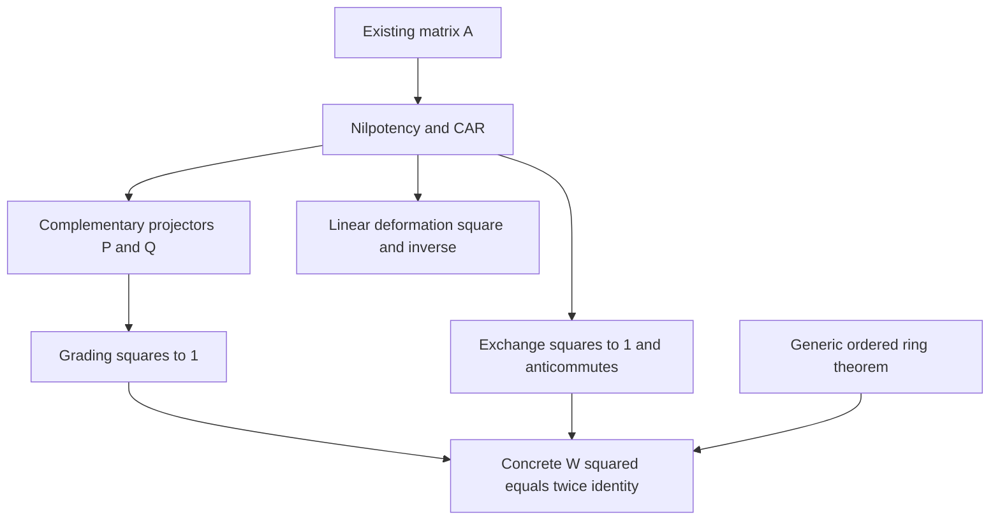

# Infinity operators, ordered Hadamard action, and incidence–mass separation

## Intake and theorem boundary

The [archived intake](TWISTOR_INFINITY_INTAKE.md) mixes exact ring identities,
twistor coordinate formulas, proposed Lean code, and physical interpretations.
This contract extracts their mathematical content on the repository's existing
carriers. The supplied assertion that its complete module is machine verified
is not verification evidence.

Source baseline: `c143c264bc18bbf41d692be4e270b5b7f7405702` on upstream `main`.
Original intake SHA-256:
`2be1fcc2e7e4fdafba89427ff6b69c13ae40b26525d62d1ed9b5a2d19fd1fd39`.
The source is 34,573 UTF-8 bytes, preserved exactly between the archive markers.
This work is independent of the null-projector changes proposed in PR #307.

Status at contract creation: candidate statements, not yet kernel verified.
The final verification record belongs to the pull request and its exact-source
CI artifact; a successful narrow check does not certify the root Lake package.

## 1. Carriers and conventions

- `Twistor4 = Spinor2 × Spinor2`, with upper and lower two-spinors in that order,
  from `PenroseIncidence`. The paper convention is
  `paperIncidence X π = (-Complex.I • X.mulVec π, π)`.
- `PerjesConventions.wittPair` is conjugate-linear in its first argument. Write
  it as `h(Z,W)`. The same-point isotropy theorem requires `Xᴴ = X`.
- `InfinityTwistor.infinityTwistor` is a complex-linear map to the dual,
  with `μ(Z,W) = Z.2 0 * W.2 1 - Z.2 1 * W.2 0`. It is alternating.
- `TwistorConstituentKinematics.pairMassSq Z W = Complex.normSq (μ(Z,W))`.
  The existing paper normalization is `m² = 2 * pairMassSq`; the new work
  does not silently change it.
- `ConstituentColumnEquivalence.infinityRaisingMatrix` is the existing native
  `Matrix (Fin 4) (Fin 4) ℂ` matrix
  `A = !![0,0,0,1; 0,0,-1,0; 0,0,0,0; 0,0,0,0]`.
  Its owner's coordinate bridge expresses `infinityConjugate` as
  `A * (columnEquiv Z).map star`. That operation is antilinear.
- `Aᴴ` below is the ordinary coordinate conjugate transpose, not the adjoint
  for the indefinite Witt form. Products retain their written order. The
  deformation `A - λ • Aᴴ` is a complex-linear matrix family, distinct from
  the existing antilinear operation.
- The abstract Hadamard result uses an arbitrary associative `[Ring R]`.
  It assumes `J*J = 1`, `K*K = 1`, and `K*J + J*K = 0`; it does not assume
  commutativity or nonzero characteristic.

## 2. Smallest useful additions

### Ordered Hadamard operator

`InfoGeometry.LinearAlgebra.SplitHadamard` defines

\[
W_{J,K}(X)=KXK+JX.
\]

Under the three stated ring relations it proves

\[
W_{J,K}(W_{J,K}(X))=2X,
\]

and the four readouts on the distinguished elements `1`, `J`, `K`, and `J*K`.
They are not assumed to form a basis. This is the exact
superoperator from the intake. It is unnormalized and is not an involution
in general.
In characteristic two its displayed square is zero. A ring-homomorphism
transport law preserves the ordered products without introducing
another tower carrier.

### The actual infinity-raising matrix

`InfoGeometry.Twistor.InfinityRaisingAlgebra` reuses `A` and proves

\[
A^2=(A^\dagger)^2=0,\qquad AA^\dagger+A^\dagger A=1.
\]

For `P=AAᴴ` and `Q=AᴴA`, the target is complementary idempotency and
orthogonality. The inequality `AAᴴ ≠ AᴴA` witnesses noncommutativity on this
same matrix carrier. The derived matrices

\[
J=P-Q,\qquad K=A+A^\dagger
\]

satisfy the hypotheses of the generic Hadamard theorem. Thus its concrete
specialization is a consumer of proved matrix relations, not a supplied
certificate or a replacement scalar model.

For every complex scalar `λ`, the deformation satisfies

\[
D_\lambda=A-\lambda A^\dagger,\qquad D_\lambda^2=-\lambda I.
\]

For `λ ≠ 0`, `-λ⁻¹ Dλ` is a two-sided inverse. The zero parameter retains
the original nilpotency. No curvature tensor, cosmological constant, or
de Sitter model is constructed by this matrix identity.

### Incidence and the mass determinant

`InfoGeometry.Twistor.IncidenceMassSeparation` first proves, for arbitrary
spacetime matrices `X,Y` and spinors `π,ρ`,

\[
\mu(\operatorname{inc}_X\pi,\operatorname{inc}_Y\rho)
=\det(\pi,\rho),\qquad
\operatorname{pairMassSq}(\operatorname{inc}_X\pi,\operatorname{inc}_Y\rho)
=|\det(\pi,\rho)|^2.
\]

Consequently, at every Hermitian `X`, same-point incidence gives zero Witt
pairing while a nonzero lower-spinor determinant gives positive pair mass.
Taking `π=e₀`, `ρ=e₁` makes the entire Witt Gram matrix zero but gives
`μ=1` and `pairMassSq=1`.

Conversely, for `Z=(0,e₀)` and `W=(i e₀,e₀)`, both self-pairings vanish,
both lower spinors are nonzero, and

\[
h(Z,W)=i\ne0,\qquad \mu(Z,W)=0,\qquad
\operatorname{pairMassSq}(Z,W)=0.
\]

These two directions refute the proposed identification of mutual Hermitian
nonincidence with the invariant controlling the mass of the pair.
That invariant belongs to the chosen constituent pair. It is not an intrinsic
mass of the projective twistor line or spacetime event: a general change of
its two-column frame multiplies `μ` by the frame determinant and
`pairMassSq` by that determinant's squared modulus.

## 3. Claim ledger

| Intake claim | Disposition and exact boundary |
| --- | --- |
| Hermitian same-point incidence is Witt-isotropic | Existing theorem `PerjesConventions.paperIncidence_witt_isotropic`. |
| Same-point incidence implies `μ=0` or zero two-constituent mass | Counterexample above; new parameterized separation theorem. |
| Nonzero mutual Witt pairing is necessary or sufficient for positive pair mass | Both implications fail, including on individually Witt-null constituents. |
| A single lower-spinor dyad has zero determinant | Existing `TwistorKinematicTensor` momentum theorem. Nonzero rank one additionally needs a nonzero lower spinor. |
| The two-constituent mass is controlled by the lower-spinor determinant | Existing `pairMomentum_determinant`, `pairMassSq_zero_iff_infinityTwistor_pairing_zero`, and `paper_pair_mass`. |
| Infinity pairing is alternating, translation invariant, and has determinant weight | Existing `InfinityTwistor` theorems; these are spinor-frame changes, not unspecified internal label changes. |
| The infinity form is invertible | False for the existing flat form; its radical is the upper-spinor plane. |
| The existing raised infinity matrix is square-zero and obeys CAR with its adjoint | New concrete matrix lemmas. The sign relates the intake's second raised operator to `-Aᴴ`. |
| The CAR pair yields a binary cut and four matrix corners | New complementary projectors; ordinary Peirce corner theory is already owned. Psychological names are interpretations. |
| `KXK + JX` squares to twice the identity action | New ordered ring theorem and a concrete matrix consumer. |
| The unnormalized Hadamard operator is self-inverse | Incorrect; a compatible normalization is required. |
| A linear infinity deformation squares to `-λ I` | New matrix identity. This is not the square of an arbitrary complex-parameter antilinear deformation. |
| The deformation constructs cosmological spacetime | Open geometric debt: no such spacetime construction follows from the polynomial identity. |
| Upper/lower/upper block multiplication recovers `XZY` | Existing native block multiplication laws reconstruct it; no tuple matrix API is needed. |
| The ordinary double commutator recovers `XZY + YZX` | Correct with the stated bracket; it does not imply that the ambient algebra or every KKT construction is commutative. |
| Transporting a homotope reference produces a covariance defect | Exact additive/multiplicative map identity; a separate optional lemma, not a prerequisite for the new twistor results. |
| Finite tensor nesting preserves ordered ring-polynomial identities | Existing `Cl11TensorTowerIteration.iteratedStageEmbed` is a ring homomorphism. No analytic completion is inferred. |
| A numerical recurrence is the native Clifford-basis Arf census | Missing indexing/basis and square-sign-fiber bridge. A recurrence alone does not prove this identification. |
| Internal unitary label mixing preserves constituent momentum | Existing `TwistorInternalSymmetry` and `ConstituentMomentumTransport` owners, with their explicit unitary hypotheses. |
| The unnormalized pair `(Z₁+Z₂, -Z₁+Z₂)` preserves mass | Incorrect: its determinant is `2`, so the bracket doubles and `pairMassSq` quadruples. Normalize before asserting preservation. |
| A label-frame Gram matrix transforms without fixing conjugation/transposition conventions | Incomplete. For the native conjugate-first Gram form and right action `U ↦ U C`, the law is `G ↦ Cᴴ G C`. |
| A traceless Hermitian Gram matrix is itself an element of `su(2)` | Its multiplication by `i` is skew-Hermitian; keep the Hermitian observable and Lie-algebra convention distinct. |
| `-det H°` is automatically physical rest-frame spin squared | Open identification debt; an algebraic Hermitian invariant needs a proved bridge to a specified spin observable. |
| `H°=0` implies intersecting real null rays | Overstrong without self-nullity: a Gram matrix `2I` has zero traceless part but non-null columns. |
| Screw pitch equals spin/mass and half the skew-ray distance | Open physical/geometric debt: specify the ray space, frame, distance, and spin before claiming equality. |
| A quotient diverges merely because its denominator is zero | Not a limit theorem. The numerator, nonzero domain, and limiting path must be specified. Lean's totalized field division at zero does not express divergence. |
| Several twistors automatically produce hadronic multiplets | Interpretation-only; no representation or dynamics theorem is supplied. |
| The whole rhetorical hierarchy is a necessary synthesis | Replaced by the actual proof dependencies below; no new philosophical axioms are introduced. |

## 4. Owner search and reuse

Searches covered executable `lean/`, `src/`, relevant non-external `proofs/`,
and the actual pinned Mathlib source, followed by owner and consumer reads.
Names, generated graphs, and docstrings were navigation aids only. No fresh
global declaration-graph export is claimed.

The key existing owners are `PerjesConventions`, `InfinityTwistor`,
`TwistorKinematicTensor`, `TwistorConstituentKinematics`,
`ConstituentColumnEquivalence`, `TwistorInternalSymmetry`,
`ConstituentMomentumTransport`, `PerjesIncidencePairing`, and
`PerjesNullLineCorrespondence`. `PerjesParticleGeometry` is an existing
integration consumer. The real null-line correspondence needs a nonzero lower
spinor; it does not supply an optical-twist or screw-pitch theorem.

For the algebraic parts, `Cl11Matrix` owns the concrete split-Clifford
representation. `SplitCliffordTransformKernel` owns normalized Peirce
projectors. `GLSupermatrixGradedLie` owns native `Matrix.fromBlocks`
multiplication, consumed by `CattoGurseyBlockGrading`.
`PeirceSpine.Basic` owns the actual four corners and their support laws;
`PeirceSpine.Bergman` and `PeirceSpine.KantorCornerAnomaly` own ordered
triple and homotope operations. `Core.IdempotentGraphGrassmannian` owns
`idempotencyDefect`; its nontrivial matrix consumer
`PeirceSpine.IdempotencyDefectMatrixD63` explicitly refutes defect-zero
implying equality with the identity. `Cl11TensorTowerIteration` owns finite
iterated ring embeddings. None of those names establishes an additional
physical interpretation.

The exact `KXK + JX` superoperator was not located in the bounded search.
`RealDoubledChiralKreinHadamard` acts on doubled vectors, while the
`src`-only `MetriplecticCausalPlabicKreinYangianPoset` treats a different
`H X H` conjugation. Neither is silently reused as the requested theorem.

## 5. Dependency order and interpretation

The algebraic dependency chain is the existing matrix `A` → nilpotency and
CAR → complementary projectors → concrete anticommuting involutions →
the generic Hadamard specialization. The deformation-square proof also uses
the nilpotency/CAR relations. The incidence chain uses the existing incidence
map, isotropy theorem, and lower-spinor determinant to produce two genuine
separation results. There is no logical edge identifying their mass determinant
with the Hadamard action.

“Thesis/shadow” can label the complementary idempotents `P,Q`. “Fourfold
anatomy” can label `PXP`, `PXQ`, `QXP`, and `QXQ`. These are explanatory
labels; the mathematical objects are the projectors and ordered products.
The exact defect `X²-X` requires no claim about consciousness. Its propagation
through an existing ring homomorphism follows from preservation of products
and subtraction. A finite embedding theorem is not a claim about an unbounded
psychological or analytic limit.

For the complex-parameter antilinear action `z ↦ Dλ conjugate(z)`, composition
uses `Dλ (Dλ).map star`. Since `A` has real entries, its square matrix is
`-conjugate(λ) P - λ Q`. This equals `-λ I` for real `λ`; for `λ=i` it is
`i(P-Q)`. The parameter's conjugation is essential.

## 6. Verification contract

Add the three owners to the existing Perjes/Klein target selection. Its
maintained runner copies the exact repository import closure, checks the
pinned Lean/Mathlib versions, compiles the copied sources serially under the
shared build lock, and audits all declarations owned by the selected modules
only when all source compilation succeeds.

Required evidence: source hashes, exact checked commit/tree, exit statuses,
new-owner warnings, and axiom dependencies. Allowed foundational axioms are
`propext`, `Classical.choice`, and `Quot.sound`. No proof holes, custom axioms,
`native_decide`, unsafe bypasses, tuple matrix substitutes, or assumptions of
the desired conclusion are permitted.

Generation, independent mathematical audit, and final quality acceptance use
distinct agents. Static OpenGauss/refutation/vacuity checks are preliminary;
they cannot replace native Lean evidence. Root-package blockers and existing
warnings must be reported separately from the changed-source result.

## 7. Primary literature used to check interpretations

- Bette, Lukierski, and Miquel-Espanya,
  [Two-Twistor Space, Commuting Composite Minkowski Coordinates and Particle Dynamics](https://arxiv.org/pdf/hep-th/0503134),
  equations (17)–(20): the two-spinor mass normalization and momentum/spin
  constructions. Equation (17) uses `m² = 2|f|²`; this factor depends on the
  spinor-to-vector convention and agrees with the repository's explicit
  `paper_pair_mass` readout.
- Atiyah, Dunajski, and Mason,
  [Twistor theory at fifty](https://arxiv.org/pdf/1704.07464), section 2.2:
  the projective null-ray/Robinson-congruence distinction. It does not identify
  a scale-dependent Hermitian self-pairing with an optical twist scalar.
- Giulini,
  [Energy-Momentum Tensors and Motion in Special Relativity](https://arxiv.org/pdf/1502.03930),
  equation (87) and Definition 18: `‖S*‖/(M₀c)` is a Møller radius associated
  with observer-dependent mass centres.
- Müller,
  [Screw and Lie group theory in multibody dynamics](https://link.springer.com/article/10.1007/s11044-017-9583-6),
  Appendix B.2: twist and wrench pitches use the corresponding linear/angular
  dot products divided by squared rotational/force magnitudes. Therefore a
  spin-to-mass ratio needs a separate proved geometric identification before
  it is called that pitch or a particular ray separation.

These references inform the scope ledger. They do not supply Lean proof terms.
