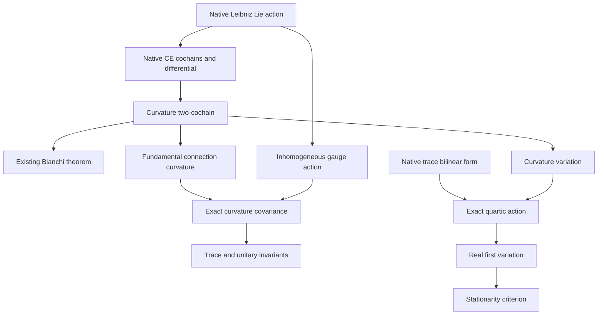

# Native noncommutative Yang–Mills algebra: theorem contract

## Source and intent

Arthur Jaffe and Edward Witten, *Quantum Yang–Mills Theory*, supplied PDF,
14 pages; SHA-256 `3558403ca14c11e382f73a09e548222708540bfdf478cf96aa11c52d43e23e09`.
The input asks for full Lean proofs in native Mathlib on genuine noncommutative
matrix/operator geometry, organized by actual proof dependencies. The source
is retained as the supplied attachment; this record preserves its provenance
and separates mathematical statements from interpretation.

Printed pp. 1–2 supply `F = dA + A ∧ A`, Bianchi, and the invariant quadratic
expression. Printed p. 6 motivates invariant trace polynomials in curvature
and covariant derivatives. The Yang–Mills equation is an additional equation,
not a consequence of Bianchi alone. The quantum existence and positive
spectral-gap problem on p. 6, and continuum/infinite-volume requirements on
pp. 11–12, are not established by this algebraic development.

## Ground truth and exact carriers

The existing owner is
`InfoGeometry.OperatorAlgebra.DerivationDifferentialForms`.
Its input `K : DerivationLieLane R A` acts faithfully by actual Leibniz
endomorphisms in the native Lie subalgebra
`NonAssocDerivation.derivations R A ≤ Module.End R A`.
For the connection results, `R` is a commutative ring and `A` is an arbitrary
associative unital `R`-algebra. No commutativity of `A` or of the derivation
directions is assumed.

`OneForm K` is Mathlib's `oneCochain`, namely `K.L →ₗ[R] A`.
`TwoForm K` is Mathlib's alternating bilinear `twoCochain`.
The differential is native `LieModule.Cohomology.d₁₂`/`d₂₃` through the
existing represented Lie action. With `ρ = K.operatorAction`,

```text
FΓ(x,y) = ρ(x)(Γ(y)) − ρ(y)(Γ(x)) − Γ([x,y]) + Γ(x)Γ(y) − Γ(y)Γ(x).
```

Existing theorems `exteriorDerivativeTwo_exteriorDerivativeOne`,
`covariantDerivative_commutator`, and `connectionCurvature_bianchi` prove the
actual differential-square and Bianchi identities. They will be imported and
kernel-checked, not reproduced under new names.

## Missing theorem cluster and conventions

1. Bundle `Γᵘ(x) = u Γ(x) u⁻¹ − ρ(x)(u) u⁻¹` as an actual native one-cochain.
2. Define the fundamental connection on the right regular module, with left multiplication potential, by
   `∇ˡ_x(a) = ρ(x)(a) + Γ(x)a` and prove
   `[∇ˡ_x,∇ˡ_y] − ∇ˡ_[x,y] = L_(FΓ(x,y))`.
3. Derive exact curvature covariance from this faithful left action. The
   adjoint curvature identity alone only determines curvature modulo the
   center and is not sufficient for this step.
4. Define the native covariant differential of a one-cochain and prove
   `F(Γ+tα) = FΓ + t dΓα + t²(α∧α)` with all multiplication orders retained.
5. Derive cyclic trace invariants and matrix norm-square invariance under
   unitary gauge maps, with the precise trace/adjoint assumptions stated.
6. Verify a fully off-diagonal, noncommuting matrix instance; it is a semantic
   regression under arbitrary-algebra theorems, not a replacement carrier.

The gauge convention is left conjugation. The finite frame is specified explicitly; it is not asserted orthonormal.
For a basis, zero positive energy detects the entire curvature cochain.
A finite trace expression is an algebraic functional, not the spacetime integral in the source. A norm square
uses the adjoint and positivity; ordinary `tr(F²)` is not asserted positive.
No manifold, Hodge operator, integral, Euler–Lagrange PDE, quantization,
renormalization limit, reflection positivity, or mass gap is supplied by these
results. No new theorem will assume its own conclusion in a proof field.

## Actual dependency order



## Owner search and import scope

The bounded context preflight and direct source search inspected the existing
CE owner and its entire small repo import closure, the fundamental
`Geometry.AssociativeGaugeConnection` owner, legacy NCG derivation systems,
optics gauge owners, and matrix Chern–Weil consumers. Other gauge APIs already
exist; the new cluster connects gauge and variation to this exact native CE
carrier. No repo-wide novelty claim is made.

Only irrelevant broad imports in the relevant owner closure may be narrowed;
`FiniteSpinAlgebra` itself must remain untouched. All affected direct consumers
will be inspected for lost imports. Existing definitions and theorem
statements remain the canonical surface.

## Delivered mathematical owners

All files below are under `lean/InfoGeometry/OperatorAlgebra/`.

| Owner | New theorems | Definitions | Mathematical result |
|---|---:|---:|---|
| `DerivationGaugeTransport.lean` | 15 | 3 | Fundamental End-valued connection, full inhomogeneous gauge equivalence, exact curvature covariance and flatness invariance |
| `DerivationCurvatureVariation.lean` | 8 | 2 | Native linearized curvature and exact quadratic perturbation, symmetric mixed difference |
| `DerivationCyclicAction.lean` | 5 | 2 | Native bilinear trace pairing, gauge-invariant trace action and complete quartic expansion |
| `DerivationCyclicActionDerivative.lean` | 3 | 0 | Native `HasDerivAt`, `deriv` and the all-direction stationarity criterion |
| `DerivationMatrixGeometry.lean` | 5 | 1 + 1 abbreviation | Full matrix derivation lane, native inner Lie homomorphism, exact-cochain curvature |
| `DerivationMatrixEnergy.lean` | 8 | 2 | Real/complex adjoint energy positivity, basis flatness detection and unitary gauge invariance |

Total: 44 new theorem declarations, 10 definitions and one abbreviation.
`tests/YangMillsMatrixGeometryTests.lean` supplies eight semantic regression
theorems. The input matrices `X = E12−E21`, `Y = E23−E32`,
`P = E13−E31` and resulting curvature all have zero diagonal. For the actual
native connection `Γ = dP`, the proofs establish
`FΓ(ad X, ad Y) = P ≠ 0` and noncommutation of the base endomorphisms.

The first-variation theorem is for the finite cyclic trace-square action,
not an unproved derivative of a spacetime integral. It proves derivative
existence explicitly. The positive matrix energy is a separate adjoint-based
functional; its trace-square analogue is not asserted nonnegative.

## Import compatibility

Five existing owners have only irrelevant broad-import removals and canonical
copyright headers. Their theorem definitions, statements and proof bodies are
unchanged. `FiniteSpinAlgebra.lean` is unchanged. Read-only comparison against
base `b143075bbf27e75860a1011e04423a0f227b7c41` found 20 direct external
consumers: 16 retain their own broad import, three retain an independent broad
path, and only `TKK.GenericRepresentationBridge` has a newly narrowed closure.
Its complete source was inspected and it was separately kernel-checked.
This is not a claim of a full-repository build.

## Validation record

The selected development was independently rebuilt using Lean 4.34.1
(`5045d0056413266e57c625dcd7c365b10e377c52`) and Mathlib
`d13f23b723b8a846827a245b89c10fc7d3f11612`. The compiler used the explicit pinned
Mathlib/dependency object paths and generated objects under
`artifacts/yangmills-check`, while holding the repository shared build lock.
No concurrent compiler/test process or dependency pin change was used.

- All six new mathematical owners, their five existing repo dependency
  owners, the direct compatibility consumer, and all eight regression
  theorems pass the Lean kernel check.
- The six new owners and regressions emit no warnings. The unchanged proof
  bodies in three dependency owners emit 13 existing linter warnings.
- `tests/YangMillsNativeGaugeAxiomAudit.lean` is generated by the unchanged
  canonical `tools/quality/reviewed_audit_source.py::audit_source`, with only
  target-array line wrapping and the mandatory copyright header added.
  It audits every declaration owned by all 13 selected modules and follows
  imported axiom dependencies transitively. The audit covers 401 declarations:
  123 in new owners, 255 in selected existing owners, and 23 in the regression
  module (including compiler-generated declarations).
- The complete allowed axiom footprint is `propext`, `Classical.choice`,
  and `Quot.sound`. The audit rejects unsafe/partial selected declarations
  and any other axiom. All selected owners pass.
- Staged/source equality, whitespace checks and the executable-source scan
  for proof holes, custom axioms, unsafe/partial declarations and
  `native_decide` pass.
- An independent mathematical reviewer inspected all six owners and the
  original imported definitions, checked the paper correspondence, and
  accepted the exact stated scope.

The staged proof-integrity gate initially rejected commutative `ring`
normalization in the generic bilinear quartic lemma. That proof now uses
`noncomm_ring`, preserving multiplication order even after the bilinear
readout. The revised action and derivative owners pass the kernel again;
the canonical staged gate and renewed full-owner audit both pass on the
final staged source. Independent execution-based acceptance is
`ACCEPTED_WITH_LIMITED_SCOPE`, with the repository-wide Lake limitation below.

### Reproduction

In a checkout with the pinned Lake path dependencies present, build the six
new owner modules and then check both test modules in the resulting Lean
search path. This session instead compiled each repository source in
import-topological order with the pinned native compiler and explicit
`LEAN_PATH`; the generated audit is executable Lean, not a Python assertion
of proof status.

The normal repository-wide Lake gate is blocked before compilation by the
existing dependency configuration at base
`b143075bbf27e75860a1011e04423a0f227b7c41`: Atlas at
`external_refs/atlas-lean` is absent and untracked, and GIFT at
`external_refs/gift-framework-core` is an uninitialized gitlink.
The maintained path-package preflight records these exact failures. No stub,
new upstream revision, dependency metadata change or cache deletion is used
to mask them. Repository-wide CI status is recorded separately in the PR.

### Acceptance boundary

These are kernel-checked algebraic connection and matrix-geometry theorems,
with a genuine real derivative of a finite traced action. They do not prove
the quantum-field existence or mass-gap problem in the source. Positivity
and faithful zero detection of a matrix norm square are not a spectral-gap
theorem. The proof-dependency DAG above records only actual mathematical
prerequisites and makes no physical-causality assertion.
