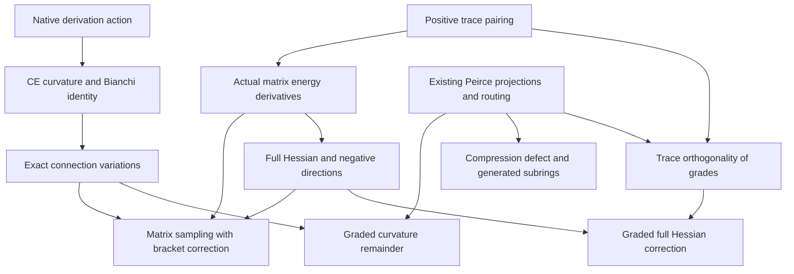
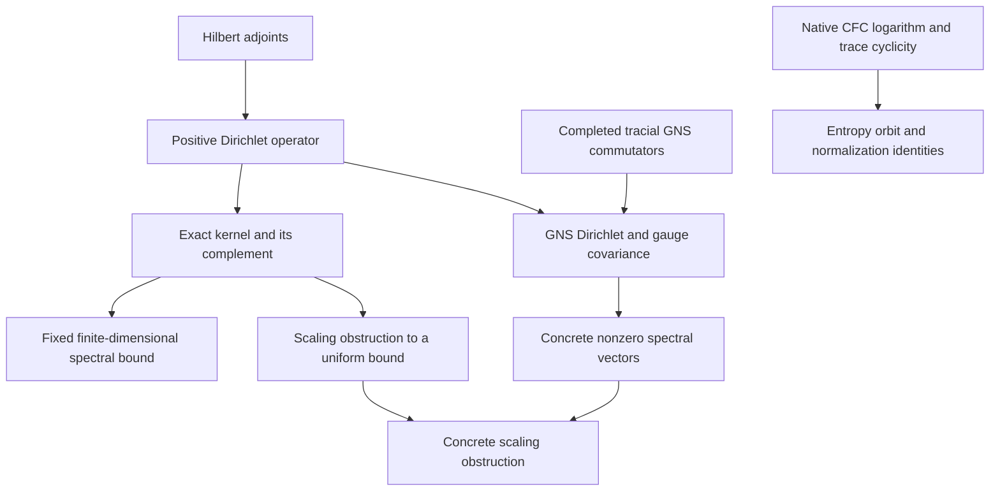

# Noncommutative curvature variation and Dirichlet operators

## Source and intent

The source is Michael Hanners, *Harmonic Coherence: A Unified Field Framework
for General Relativity, Quantum Mechanics, and the Standard Model*, the
29-page PDF supplied at
<https://zenodo.org/records/15338444/files/Yang_Mills_Solution_2025-05-01.pdf?download=1>.
Its SHA-256 is
`f445836f1bfba6d5e5e1060a72a4299a7f007fbedf14e45937e138e78bc7cbbe`.
Page references below count PDF pages. The paper is an intake source, not a
proof dependency. This development extracts associative operator algebra and
geometry; it does not formalize the paper's claimed quantum field theory.

The public carriers remain arbitrary associative algebras, full complex
matrix algebras, bounded operators, and the existing completed tracial GNS
space. No diagonal or commuting restriction replaces those carriers.

## Ground-truth theorem contract

### 1. Existing differential geometry and its variation

Owner: `InfoGeometry.OperatorAlgebra.DerivationDifferentialForms`.
For a faithful `DerivationLieLane R A`, a connection is the native one-cochain
`OneForm K`, and curvature is the native alternating two-cochain

\[
F_\Gamma(x,y)=\rho(x)\Gamma(y)-\rho(y)\Gamma(x)-\Gamma([x,y])
  +[\Gamma(x),\Gamma(y)].
\]

The existing `covariantDerivative_commutator` identifies its induced inner
derivation, and `connectionCurvature_bianchi` proves the actual covariant
Bianchi identity. `DerivationCurvatureVariation` reuses these owners and
preserves the bracket term. Its exact affine expansion is

\[
F_{\Gamma+t\alpha}=F_\Gamma+t\,d_\Gamma\alpha
                    +t^2(\alpha\wedge\alpha).
\]

This is an algebraic polynomial identity on the native form carrier. The
same owner proves that the covariant differential of a zero-form acts on
curvature by its inner derivation. `Geometry.DerivationMatrixCurvature`
then samples actual Lie directions through a linear map. It proves

\[
F_{\mathrm{CE}}(\Gamma)(v_i,v_j)
 =F_{\mathrm{matrix}}(\Gamma\circ v)_{ij}-\Gamma([v_i,v_j]),
\]

with the corresponding first-variation identity and an exact mixed
second-variation comparison. No commuting-direction assumption or
injectivity of sampling is used. Finite dimensionality supplies continuity
of each represented derivation on the matrix coefficient space; the Lie
direction space itself need not be finite dimensional.

### 2. Actual matrix energy derivatives

For finite direction and matrix index types, retain the full matrix curvature
of `Geometry.AssociativeGaugeConnection.curvature`. For real-linear base
derivatives, the positive energy is the finite sum

\[
\mathcal E(A)=\tfrac12\sum_{i,j}\operatorname{ReTr}
 (F_{ij}(A)^*F_{ij}(A)).
\]

`MatrixCurvatureEnergy` and `MatrixCurvatureHessian` prove native
`HasFDerivAt` statements for the energy and its continuous-linear-map-valued
first derivative. The resulting actual iterated `fderiv` retains both terms in

\[
D^2\mathcal E_A[B,B]=\sum_{i,j}
 \operatorname{ReTr}((DF_A[B])_{ij}^*(DF_A[B])_{ij})
 +2\sum_{i,j}\operatorname{ReTr}(F_{ij}(A)^*[B_i,B_j]).
\]

At a flat background the pure sum-of-squares reduction follows; a general
background retains the curvature correction. The cyclic square
functional in the existing gauge owner has no implicit positivity: the
star/sign relation must be proved when it is used. This is a finite
matrix-valued connection functional, not a spacetime integral.

`MatrixCurvatureNonconvexity` provides a generic noncommutative check.
For arbitrary full matrices `X,Y`, the connection `A = (X,Y)` and direction
`B = (X,-Y)` with zero base operators satisfy

\[
DF_A[B]=0,\qquad
D^2\mathcal E_A[B,B]=-4\operatorname{ReTr}([X,Y]^*[X,Y]).
\]

The Hessian value is strictly negative exactly when `X,Y` do not commute.
This is directional stationarity, not a claim that `A` is a full critical
point. It shows why the background-curvature term cannot be discarded.

### 3. Positive bounded Dirichlet operators

For a finite family of native bounded operators `T i : E →L[ℂ] F` between
Hilbert spaces, construct the actual operator

\[
L_T=\sum_i T_i^*T_i.
\]

`OperatorDirichletLaplacian` proves self-adjointness, positivity, the exact energy identity
`Re ⟪x, L_T x⟫ = ∑ i, ‖T i x‖²`, and
`ker L_T = ⨅ i, ker (T i)`. Unitary covariance and real quadratic scaling
are operator equalities. Under finite-dimensionality,
`OperatorDirichletSpectralGap` derives a positive
lower bound on the orthogonal complement of this actual kernel, and connects
the bound to native spectral exclusion. A uniform bound for an entire
changing family is a separate theorem, not a consequence of individual
positivity. `OperatorDirichletScaling` proves this distinction: nonzero
common real scaling preserves the actual kernel and its orthogonal
complement, while `L_(rT) = r² L_T` and its energy scale quadratically.
If the complement contains a nonzero vector, no common positive coercivity
constant works for all positive scalings. The full operators converge to
zero in operator norm as the scale tends to zero.

### 4. Native tracial GNS specialization

Owner: `InfoGeometry.OperatorAlgebra.TracialGNSCommutator` in namespace
`PositiveLinearMap`. It constructs
`f.tracialCommutatorGNS htr H = L_H - R_H` on the actual completed `f.GNS`,
proves its dense representative action `[H,a]`, and proves self-adjointness
for self-adjoint `H`. Apply the bounded Dirichlet construction to this exact
operator. Faithfulness is explicit when a zero GNS class is identified with a
zero algebra element. In the unital setting the identity class lies in the
kernel; its nonzeroness requires a nonzero positive functional.
`TracialGNSGauge` constructs the unitary on the completed GNS carrier and
proves covariance of both the operator and its native spectrum under inner
unitary conjugation.

`TracialGNSMatrixTests` constructs the ordinary faithful positive trace on
the full algebra `Matrix (Fin 2) (Fin 2) ℂ`. It reuses the repository's
noncommuting self-adjoint pair

\[
X=\begin{pmatrix}0&1\\1&0\end{pmatrix},\qquad
Y=\begin{pmatrix}1&1\\1&0\end{pmatrix}.
\]

For `C = [X,Y]`, it proves `[X,[X,C]] = 4C` and `[Y,[Y,C]] = 5C` by native
matrix calculations. The nonzero GNS class `[C]` therefore satisfies
`L[C] = 9[C]`. Both `0` and `9` belong to the native spectrum, and the kernel
orthogonal complement contains a nonzero vector. The same concrete family
instantiates the no-uniform-scaling-bound theorem.

Here `9` is a proved positive eigenvalue, not a claimed least positive
eigenvalue. These tests do not construct a finite-dimensionality instance
for the GNS completion or instantiate the generic finite-dimensional gap
theorem there. The trace is unnormalized: `Tr(1) = 2`.

The positive Dirichlet operator is not identified with the full nonlinear
curvature-energy Hessian. The variation theorem above gives a sufficient
flatness condition for a pure-square Hessian.

### 5. Entropy along actual unitary orbits

On strictly positive full complex matrices, use the native `CFC.log` in
`S(ρ) = -ReTr(ρ * CFC.log ρ)`. `MatrixEntropyUnitaryOrbit` proves its
invariance under native unitary conjugation by CFC naturality and trace
cyclicity. Trace-one normalization is preserved by the same conjugation,
and for `Z = ReTr(P) > 0` it proves

\[
S(P/Z)=Z^{-1}S(P)+\log Z.
\]

The density-weighted formula has no dimension factor. This is an entropy
symmetry theorem; no entropy-to-gap implication or equality with the logdet
barrier is claimed.

### 6. Retained defects, their grades, and their generators

`Core.PeirceGrading` already supplies the native complementary linear
projections `even p` and `odd p`, their internal direct sum, and the full
associative multiplication routing. For an idempotent `p`, write them as
`E_p` and `O_p`. `PeirceCurvatureDefect` connects these existing projections
to the actual nonlinear remainder:

\[
R_{\Gamma,\alpha}=F_{\Gamma+\alpha}-F_\Gamma-d_\Gamma\alpha
                =\alpha\wedge\alpha.
\]

Two odd input values generate an even remainder. The mixed second variation
is even for two odd variations, and odd for an even/odd pair. These statements
grade the isolated remainder; commuting the grading through the full
covariant derivative would need an additional compatibility hypothesis.

The same owner proves the exact compression identity

\[
p(xy)p-(pxp)(pyp)=p\bigl(O_p(x)O_p(y)\bigr)p.
\]

This defect is even. If it is nonzero, both odd components on the right are
nonzero. Its generation statement is literal native subring membership,
and the universal property of `Subring.closure` gives

\[
\operatorname{Subring.closure}\{p(xy)p-(pxp)(pyp)\}
\;\leq\;
\operatorname{Subring.closure}\{p,O_p(x),O_p(y)\}.
\]

This is an order statement on actual generated subrings, not an assigned
ordering of names. No reverse inclusion or strict inclusion is asserted.
Each evaluated curvature remainder likewise belongs to the subring
generated by its two connection values.

For `IsStarProjection p`, `PeirceCurvatureHessian` derives the trace
orthogonality and decomposition

\[
\langle E_pX,O_pY\rangle_{\rm tr}=0,\qquad
\langle X,Y\rangle_{\rm tr}
=\langle E_pX,E_pY\rangle_{\rm tr}
 +\langle O_pX,O_pY\rangle_{\rm tr}.
\]

It then specializes the actual second derivative to a pointwise odd
variation. The correction becomes
`2 * tracePair (even p F_ij) [B_i,B_j]`, with the full linearized-curvature
square retained. The correction has no automatic sign. Self-adjointness
of the projection is explicit and is essential for trace orthogonality.

The existing `Algebra.ChiralOperatorSymbolProjection` and
`Clifford.ProjectedShadowAkivisDefect` explain associator and Jacobiator
defects of an explicitly projected product by its discarded complementary
terms. These are read-only related owners, outside this PR's new proof
closure. Ambient matrix multiplication remains associative, and its native
commutator satisfies Jacobi. A projected operation needs its own laws.

## Source claim classification

| PDF pages | Mathematical content | Treatment |
| --- | --- | --- |
| 8 | Associative curvature with its commutator term | Existing owner plus exact variation |
| 11 | Adjoint covariant derivative and Bianchi identity | Existing native CE owner; preserve its carrier |
| 11, 14 | Stationarity, variational energy, and gradient-flow language | Native derivatives; no assumed minimization or flow solution |
| 12 | Positive covariant Laplacian and spectral claims | Construct a bounded Dirichlet operator and prove its kernel and precisely scoped bounds |
| 9–12 | Entropy | The source expression translates to von Neumann entropy, not the logdet barrier |
| 10 | Stationarity implies discrete spectrum and a positive spacing | No typed operator/domain or coercivity proof is supplied; not used as a lemma |
| 15–16 | Quantum Hamiltonian, clustering, and uniform limiting gap | Not established by this operator-algebra development |
| 17–19 | Confinement and global regularity | No such conclusion is inferred from the finite or bounded identities |

In particular, a scalar functional does not have an operator resolvent until
an operator and its domain have been constructed. Vanishing first derivative
does not establish a minimum or a positive Hessian. A compact-resolvent claim
does not by itself provide uniform consecutive eigenvalue spacing. Gauge
invariance does not remove the commutant kernel.

## Dependency order

The arrows below denote proof dependencies, not a physical causal model.
The repository has no tracked file with the exact basename `CausalPoset.lean`.
`Cosmology.CausalPosetSynthesis` owns namespace `InfoGeometry.CausalPoset`;
`QuantumContext.CanonicalArchetypeCausalPoset` supplies the prerequisite-label
partial order. Both were inspected. The generator inclusions above instead
use the existing native order on `Subring A` directly.



The operator and entropy branches have their own prerequisites:



The sampling map connects CE variation to actual matrix differentiation.
The generic Dirichlet construction is separately instantiated on completed
GNS commutators. At a flat matrix background the Hessian is a proved sum of
trace squares. No equality between this Hessian and the GNS Dirichlet
operator is inferred without a carrier map and the needed hypotheses.

## Verification record

Independent semantic review and independent native acceptance both passed.
The acceptance build used Lean **4.34.1**, compiler commit
`5045d0056413266e57c625dcd7c365b10e377c52`, and pinned Mathlib revision
`d13f23b723b8a846827a245b89c10fc7d3f11612`.

- **33 repository source modules** rebuilt from a fresh copied import closure.
- **15 new owners; all 445 owned declarations** checked by the native audit,
  including private and compiler-generated helpers. This is a declaration
  count, not a count of named mathematical theorems.
- Transitive axioms: exactly `[propext, Classical.choice, Quot.sound]`.
  No disallowed axiom, unsafe declaration, or partial declaration passed the
  complete-owner audit.
- **Zero warnings in all 15 new owners.** The 20 notices in unchanged
  dependencies concern tactic style, unused simplification arguments, and
  deprecated names/imports. There were no proof-placeholder warnings.
- Exact matrix/GNS spectral regressions and the generic full-matrix Hessian
  regression compiled in the same source closure.

The [verification manifest](verification/yang_mills_operator_extraction_20261028.json)
records the actual import graph, copied-source hashes, staged Git blob hashes,
per-module outcomes, toolchain fingerprint, and declaration counts. The
[native audit output](verification/yang_mills_operator_extraction_axioms_20261028.txt)
records the complete declaration audit and final axiom set. The semantic
review reconciled all 15 frozen staged sources and found no open findings.

### Reproduce

The scoped workflow runs this exact acceptance command:

```bash
python tools/quality/check_yang_mills_operator_extraction.py \
  --mathlib-root /absolute/path/to/pinned-mathlib \
  --output /absolute/path/to/new-verification-directory \
  --fetch-cache
```

The output directory must be new. The maintained verifier enforces the
shared build lock, toolchain and Mathlib pins, rebuilds every repository
dependency from copied and hashed source, and audits every declaration owned
by the 15 selected modules. Existing repository oleans are excluded.
The working-tree base is `37c47ae5ddd9d00d700fe1df61b0c60ee80e2efc`;
the source hashes identify the exact additions accepted for this PR.
Imported existing owners are compiled as dependencies; the complete-owner
axiom audit selects the 15 new owners. A whole-repository build is outside
this scoped acceptance result.
