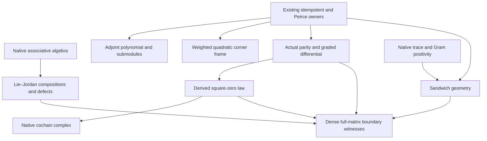

# Canonical noncommutative boundary mathematics

## Carriers and source order

Let `A` be an associative unital ring. When using `R`-linear endomorphisms,
let `R` be a commutative ring and equip `A` with an `R`-algebra structure.
Multiplication in `Module.End R A`
means composition, with the right factor acting first. Write

\[
D_a(x)=ax-xa,\qquad J_a(x)=ax+xa,\qquad S_{a,b}(x)=axb.
\]

These abbreviate native `LieAlgebra.ad`, the existing `jordanLeft`, and native
`LinearMap.mulLeftRight R (a,b)`. They do not introduce new operation wrappers.
The matrix specialization uses the full `Matrix n n ℂ` for arbitrary finite `n`.

The four frozen streams are retained in their supplied order. Their mathematical
atoms reorganize as follows; verification evidence is recorded separately.

| Frozen stream | Mathematical content | Canonical destination |
| --- | --- | --- |
| 1 | Supported nilpotent corners; alternating Lie/Jordan compositions; proposed differential | Exact mixed compositions, ordinary-square obstructions, actual Peirce-graded differential, native cochain complex |
| 2 | Mixed and pure symmetric compositions; two-sided multiplication; trace | Corrected composition table, sandwich map, exact trace-preservation condition, conditional positivity |
| 3 | Adjoint action of an idempotent; directed corner extraction; reciprocal cycle | Native endomorphism polynomial, range/kernel submodules, corner actions |
| 4 | Reciprocal-cycle Leibniz rules; quadratic centralizers; iterated brackets | Weighted quadratic corner frame and exact conservation equivalences |

## Proof-prerequisite partial order

Reflexive reachability in this acyclic prerequisite graph is the intended
partial order. The graph records the stated proof prerequisites, while the
machine-readable verification status records the exact module import DAG.
No conceptual analogy supplies an edge. The reciprocal-cycle subsection of
the quadratic module is independent of Peirce hypotheses.

## Exact native operator compositions

The self-compositions are

\[
D_aJ_a=J_aD_a=D_{a^2},\qquad
D_a^2=J_{a^2}-2S_{a,a},\qquad
J_a^2=J_{a^2}+2S_{a,a}.
\]

Thus `a*a=0` gives the two mixed zero composites and native submodule inclusions

\[
\operatorname{range}J_a\subseteq\ker D_a,\qquad
\operatorname{range}D_a\subseteq\ker J_a.
\]

It leaves the exact individual-square obstructions

\[
D_a^2=-2S_{a,a},\qquad J_a^2=2S_{a,a}.
\]

Each square vanishes exactly when `2 • LinearMap.mulLeftRight R (a,a)=0`.
There is no cancellation of two in this equivalence. The source's ordinary
square-zero assertion is therefore false in the general stated setting.

For arbitrary `a,b`, set `K=ab+ba` only as a notation. The complete new table is

| Composition | Exact expression |
| --- | --- |
| `D_a J_b + D_b J_a` | `D_K` |
| `J_a D_b + J_b D_a` | `D_K` |
| `D_a J_b - D_b J_a` | `J_[a,b] + 2(S_ab-S_ba)` |
| `J_a J_b + J_b J_a` | `J_K + 2(S_ab+S_ba)` |
| `D_a D_b + D_b D_a` | `J_K - 2(S_ab+S_ba)` |

Adding the last two rows gives `2J_K`; subtracting them gives
`4(S_ab+S_ba)`. The generator-swapped mixed difference in the third row
has a nonzero defect in the dense matrix witness. It is a different expression
from the existing operator commutator `D_a J_b-J_b D_a=J_[a,b]`.

These statements live in `Core.LieJordanBoundaryOperators`, as equalities of
native endomorphisms over an arbitrary associative algebra.

## Idempotent adjoint geometry

Let `p²=p`, `q=1-p`, and `T=ad_p` on the native integer module. The existing
Peirce projections give

\[
T^2=\mathrm{odd}_p,\qquad T^3=T,
\]
\[
\operatorname{range}T=\operatorname{range}(\mathrm{odd}_p),\qquad
\ker T=\operatorname{range}(\mathrm{even}_p).
\]

The native endomorphism polynomial is an annihilating polynomial; no minimality
claim is made. Directed corner extraction is

\[
p[p,x]=pxq,\qquad -[p,x]p=qxp.
\]

For independent `u∈pAq` and `v∈qAp`, the support equations imply

\[
[p,u]=u,\qquad [p,v]=-v,\qquad
[p,u+v]=u-v,\qquad [p,u-v]=u+v.
\]

`Core.PeirceAdjointCycle` obtains these results from the existing projections,
support laws and commutator reconstruction. They are valid in characteristic two.

## Weighted quadratic corner frame

For the same independent corners write

\[
E=u+v,\qquad J=u-v,\qquad K=uv+vu,\qquad C=[u,v].
\]

Same-corner products vanish. The existing square theorem and the new consumers
give

\[
E^2=K,\qquad J^2=-K,\qquad EJ+JE=0,
\]
\[
C=JE=-EJ,\qquad C^2=K^2.
\]

The operator `K` commutes with `u,v,E,J,C`. The weighted product and bracket
laws retain `K` as an operator:

\[
CE=KJ,\qquad CJ=KE,\qquad CE+EC=CJ+JC=0,
\]
\[
[C,E]=2KJ,\qquad [C,J]=2KE,
\]
\[
[C,[C,E]]=4K^2E,\qquad [C,[C,J]]=4K^2J.
\]

These are theorems of `Core.PeirceQuadraticFrame`. Commutation with the listed
generators does not assert centrality in all of `A`. No equation `K=1` or
`E³=E` follows from the support assumptions.

For arbitrary `a,e,j` satisfying `[a,e]=j` and `[a,j]=e`, the independent final
section proves the Leibniz identities

\[
[a,je]=e^2+j^2,\qquad [a,ej]=j^2+e^2,
\]
\[
[a,e^2]=je+ej,\qquad [a,j^2]=ej+je.
\]

Consequently, `[a,je]=0` is equivalent to `e²=-j²`, and `[a,e²]=0` is
equivalent to `je+ej=0`. Native `Commute` versions are proved as well.

## A genuine graded differential and native cochain complex

Continue with `p²=p`. Let `γ=2p-1` and let the existing involution be
`σ(x)=γxγ`. The new native
linear endomorphism on the whole algebra is

\[
d_u(x)=ux-\sigma(x)u.
\]

Its definition uses native left and two-sided multiplication maps. Membership
in the existing even and odd Peirce ranges gives the respective readouts
`d_u(x)=D_u(x)` and `d_u(x)=J_u(x)`. When `u` is odd, the map exchanges these
actual submodules. The proved full-algebra laws are

\[
d_u(xy)=d_u(x)y+\sigma(x)d_u(y),\qquad
\sigma(d_u(x))=-d_u(\sigma(x)),
\]
\[
d_u^2=D_{u^2},\qquad d_ud_v+d_vd_u=D_{uv+vu}
\]

with oddness of `u`, and of `v` in the last equation, stated explicitly.
The twisted Leibniz equation itself needs no oddness assumption on `u`.

A supported corner has square zero, so its differential has square zero.
`Canonical.PeirceBoundaryComplex.cornerComplex` constructs the actual
`CochainComplex (ModuleCat R) ℕ` with `A` in every degree and this differential
between consecutive degrees. Its composition-zero proof is derived from the
square-zero theorem. The readout `d_u(p)=-u` proves that this differential is
nonzero whenever the chosen `pAq` corner is nonzero.

The construction does not identify the opposite-corner differential as a
Hilbert–Schmidt adjoint or calculate cohomology. The mixed anticommutator is
the displayed inner action; no positivity theorem about it is asserted.

## Sandwich trace and positive matrix geometry

For arbitrary full finite matrices over a commutative coefficient ring, put
`Φ(x)=uxv+vxu`. Native trace cyclicity gives

\[
\operatorname{Tr}\Phi(x)=\operatorname{Tr}((uv+vu)x),\qquad
\Phi(1)=uv+vu.
\]

Native nondegeneracy of the matrix trace pairing gives the exact condition

\[
(\forall x,\ \operatorname{Tr}\Phi(x)=\operatorname{Tr}x)
\quad\Longleftrightarrow\quad uv+vu=1.
\]

No evenness hypothesis is needed for the trace identity. When `u,v` are
supported opposite corners, the image of `Φ` is even and its restriction to
the odd range is zero. For complex matrices with adjoint pairing, native Gram
positivity gives

\[
x\succeq0\quad\Longrightarrow\quad
uxu^\dagger+u^\dagger xu\succeq0.
\]

Adjoint pairing is a sufficient condition, not a claimed characterization.
These results are in `Canonical.LieJordanSandwichGeometry`.

## Full noncommutative matrix witnesses

The examples reuse the existing dense `3×3` matrices `P,S,U`, where each entry
of `P` is `1/3` and each row of `U` is `(-13,2,11)/9`. Existing owners prove
`P` is a star projection, `U∈PA(1-P)`, `U≠0`, and `UUᴴ≠UᴴU`.

`Canonical.LieJordanBoundaryExamples` proves the following exact evaluations:

| Full-matrix expression | Readout |
| --- | ---: |
| `(UUᴴU)₀₀` | `-1274/81` |
| `(D_U²(Uᴴ))₀₀` | `2548/81` |
| `(J_U²(Uᴴ))₀₀` | `-2548/81` |
| `((D_U J_Uᴴ-D_Uᴴ J_U-J_[U,Uᴴ])(P))₀₀` | `-338/27` |
| `[UUᴴ+UᴴU,S]₀₁` | `-13/9` |
| `((U+Uᴴ)³-(U+Uᴴ))₀₀` | `-2314/81` |
| `Tr(UP(-Uᴴ)+(-Uᴴ)PU)` | `-98/9` |

The evaluated objects are full noncommutative matrices and endomorphisms.
Their entries certify operator inequalities. In particular, `U²=0`, and
`Uᴴ` is an actual odd input, but neither ordinary action square vanishes.
The graded differential instead satisfies `d_U≠0` and `d_U²=0`.

The final negative-trace witness has positive semidefinite input `P` and
independent opposite corners `(U,-Uᴴ)`. It disproves unconditional positivity
for arbitrary opposite inputs. The other witnesses disprove the missing-defect,
ambient-centrality and unnormalized-tripotency assertions. No scalar, diagonal,
or commuting replacement carrier is used.
