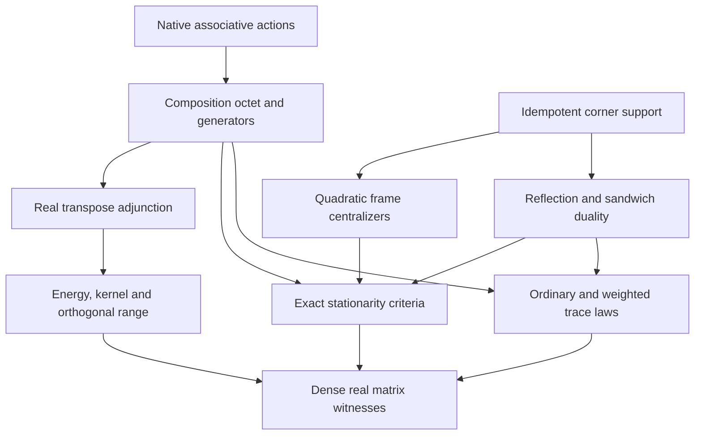

# Real Lie–Jordan generators: source map and prerequisite order

## Mathematical carriers

The algebraic theorems use an arbitrary unital associative algebra `A` and native
`Module.End R A`. No commutativity of `A` is assumed. Concrete geometry and all
new witnesses use full `Matrix n n ℝ`, directly over the reals. The Frobenius
structure is Mathlib's native matrix inner product at identity weight; that
choice of metric does not restrict the matrices under consideration.

Write `D_a = LieAlgebra.ad R A a`, `J_a = jordanLeft a`,
`S_ab = LinearMap.mulLeftRight R (a,b)`, `K=ab+ba`, and `C=[a,b]`.
The Jordan action is unnormalized. Products of endomorphisms compose with the
right factor acting first. The two sandwich maps are `PhiPlus=S_ab+S_ba` and
`PhiMinus=S_ab-S_ba`.

## Intake order and canonical ownership

| Intake atom | Canonical mathematical statement | Native owner |
| --- | --- | --- |
| Stream 1, eight compositions | Seven existing identities plus `J_a D_b-J_b D_a=J_C-2 PhiMinus` | `Core.LieJordanBoundaryOperators`; `Core.LieJordanComposition`; native `LieHom.map_lie (LieAlgebra.ad R A)` |
| Stream 1, projections of compositions | The mixed sum gives `2 J_C`; the mixed difference gives `4 PhiMinus` | `mixed_compositions_add`, `mixed_compositions_sub` |
| Stream 1, opposite-corner reflection | Left reflection exchanges the two sandwich maps; input reflection exchanges them with a minus sign | `Core.PeirceSandwichDuality` |
| Stream 1, image and kernel geometry | Native kernels and ranges agree; images are even and the actual odd sector is annihilated | `sandwich_ker_eq`, `sandwich_range_eq`, `sandwich_sub_mem_even`, `sandwich_sub_eq_zero_of_odd`, and the existing symmetric-sandwich owner |
| Stream 1, trace transport | `Tr(PhiPlus X)=Tr(KX)` and `Tr(PhiMinus X)=-Tr(CX)` | Existing `trace_sandwich_sum`; new `trace_sandwich_sub` |
| Stream 2, three generator formulas | `Gsym=-(D_a D_b+D_b D_a)`; `Gplus=D_a J_b-D_b J_a`; `Gminus=-(J_a D_b-J_b D_a)` | Exactly three definitions in `Core.LieJordanGenerators` |
| Stream 2, conservation claims | Distinct ordinary/weighted trace laws and distinct values at the unit | `Canonical.LieJordanGeneratorTrace` and generator `_one` lemmas |
| Stream 2, paired jump terms | Real transpose pairing gives `Gsym=2(T_u+T_(uᵀ))`, `Gminus=2(T_(uᵀ)-T_u)` | Bridges to existing `Modular.GKSL.dissipatorTerm`, with Heisenberg orientation |
| Stream 2, stationary complement | `Gsym(1-K)=Gminus(1-K)=0`; `Gplus(1-K)=4C(1-K)` | Generator `_one_sub_quadratic` lemmas |
| Stream 2, claimed projection | `(1-K)^2-(1-K)=K^2-K`; over real algebras skew-plus stationarity is equivalent to idempotence of `K`, hence of `1-K` | `one_sub_idempotence_defect` and exact real stationarity criteria |
| Geometric consequence of actual transpose adjunction | Negative two-square energy, common-centralizer kernel, and orthogonal range | `Canonical.RealLieJordanGeometry`, reusing `HodgeCohomology.HodgeDirac` |
| Boundary of the stronger interpretation | Dense real noncommuting counterexamples, exact nonpositive affine orbit, and distinct reflection-metric transpose | `Canonical.RealLieJordanExamples` |

The six monomial patterns in the expansion are not claimed to be linearly
independent after evaluation at arbitrary matrices. A source assertion of prior
verification is preserved in the raw intake and supplies no verification evidence.

## Proof prerequisite partial order

The edges below are theorem prerequisites. Reachability, together with equality,
gives the partial order; the diagram makes no claim about physical causation.

## Distinct generator laws

For opposite corners relative to an idempotent `p`, put `gamma=2p-1` and
`tau_gamma(X)=Tr(gamma X)`. Only the weighted column requires corner support.

| Generator | `Tr(G X)` | `tau_gamma(G X)` | `G(1)` |
| --- | --- | --- | --- |
| `Gsym` | `0` | `-4 Tr(CX)` | `0` |
| `Gminus` | `-4 Tr(CX)` | `0` | `0` |
| `Gplus` | `0` | `4 Tr(KX)` | `4C` |

These are annihilation laws for generators. Stationarity means `G(X)=0`.
The code does not call the generator a trace-preserving or unital map.

The supported evaluation table is also retained, without normalizing `K`:

| Input | `Gsym` | `Gplus` | `Gminus` |
| --- | --- | --- | --- |
| `p` | `-2C` | `2C` | `-2K` |
| `K` | `0` | `4CK` | `0` |
| `C` | `-4KC` | `0` | `-4K²` |
| `1-K` | `0` | `4C(1-K)` | `0` |

For arbitrary real `u`, the paired generator `Gsym(u,uᵀ)` satisfies

`inner X (Gsym X) = -(norm ([u,X])² + norm ([uᵀ,X])²)`.

Its kernel is the underlying submodule of the native subalgebra centralizing
`{u,uᵀ}`; its range is that submodule's orthogonal complement. The proof first
establishes the actual Frobenius adjunction, then consumes the existing real
adjoint-pair energy and kernel theorems. It assumes no square-zero property of
the ordinary commutator action. Quadratic-form positivity of `-Gsym` and
preservation of the matrix positive cone by the paired sandwich are separate
theorems with different types.

## Dense real countermodels

`P` has all entries `1/3`, `S=[[1,2,3],[2,4,5],[3,5,6]]`, and
`U=component10 P S`. Every entry of `P,S,U` is nonzero, and `U` does not commute
with `U.transpose`. Let `K=UUᵀ+UᵀU`, `C=[U,Uᵀ]`.

| Proposed strengthening | Exact obstruction |
| --- | --- |
| `1-K` is automatically idempotent | `((1-K)^2-(1-K)) 0 0 = 7921/81` |
| `1-K` is automatically stationary for `Gplus` | `(Gplus(1-K)) 0 0 = 25276/243` |
| `Gplus` annihilates the unit | `(Gplus 1) 0 0 = -284/27` |
| `Gminus` annihilates ordinary trace | `Tr(Gminus P) = -392/9` |
| The skew sandwich preserves positive semidefiniteness | `(PhiMinus 1) 0 0 = -71/27` |

The actual curve `X(t)=P+t Gplus(P)` satisfies `X(0)=P` and the native
`HasDerivAt X (Gplus(X(t))) t` equation. With `a=(-13,2,11)`, its matrix
quadratic form is `aᵀ X(t) a=-(19208/3)t`; hence `X(t)` is not positive
semidefinite for every `t>0`. This is an explicit curve theorem, without an
unproved identification with an exponential, uniqueness claim, or classification.

Finally `gamma` is proved symmetric and involutive, and
`gamma Uᵀ gamma=-Uᵀ`. The transformed seed `gamma S` is self-adjoint for
this reflection metric, while `Tr((gamma Uᵀ gamma)U)=-98/9`.
The positive Frobenius inner product, ordinary transpose, reflection-weighted
trace, and indefinite reflection-metric transpose are never identified.

## Acceptance scope

Verification evidence is recorded separately after the exact compiler, native
axiom audit, and isolated Lake build complete. The source contract does not
promote the raw prose's broader geometric, analytic, or classification claims.
