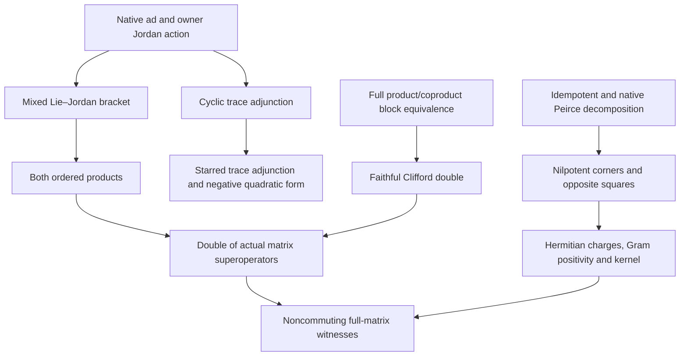

# Canonical mathematical map

## Carriers and conventions

All products are ordered associative products. On `Module.End R A`, multiplication
is composition: `(F * G) x = F (G x)`. The input algebra need not be commutative.
The Jordan action is unnormalized: `J_s x = s*x + x*s`. The native Lie action is
`ad_h x = h*x − x*h`. Write `C₊ = ad_h + J_s`, `C₋ = ad_h − J_s`.

The matrix specialization is the entire `Matrix n n ℂ`, with arbitrary finite
index type `n`. The doubled carrier is its product with itself. Thus matrix
superoperators act on a space of dimension `n²`, and the double on dimension
`2n²`. Input matrices are never identified with their superoperators.

## Prerequisite poset

The arrows below are prerequisites used by the proofs. Reachability, together
with equality, is the dependency partial order. The two Peirce and regular-action
branches are independent until the concrete matrix examples consume both.

The verification report also records the exact repository import DAG and SHA-256
of every module in that closure. This focused DAG does not assert freshness of
any unrelated repository-wide navigation index.

## Ordered Lie–Jordan products

`Core.LieJordanComposition` lifts existing ring identities to native endomorphisms:

\[
[\operatorname{ad}_h,J_s]=J_{[h,s]},\qquad
[J_h,J_s]=\operatorname{ad}_{[h,s]}.
\]

Its `minus_mul_plus` and `plus_mul_minus` prove, respectively,

\[
C_-C_+=\operatorname{ad}_h^2-J_s^2+J_{[h,s]},\qquad
C_+C_-=\operatorname{ad}_h^2-J_s^2-J_{[h,s]}.
\]

`plus_minus_commute_iff` proves that `Commute C₊ C₋` is equivalent to `Commute h s`
when doubling is injective. The converse evaluates the operator difference at
the identity and cancels doubling twice. Complex full matrices satisfy the
hypothesis, proved in `matrix_doubling_injective`.

## Pairings and algebraic tangent geometry

`traceBilinear` is the native bilinear form `Tr(x*y)`. Its symmetry and
nondegeneracy are proved against arbitrary test matrices. This is not the claim
that `Tr(x²)=0` implies `x=0`.

Conjugate-transpose trace pairing is handled separately. For arbitrary complex
matrices, the paired adjoints of `ad_h` and `J_s` have coefficients `hᴴ` and `sᴴ`.
Under `hᴴ = −h` and `sᴴ = s`, the proved identity is

\[
\operatorname{Tr}\bigl(x^\dagger C_-C_+(x)\bigr)
=-\operatorname{Tr}\bigl(C_+(x)^\dagger C_+(x)\bigr),
\]

with nonpositive real part by native matrix Gram positivity. No coefficient
commutation is required. This is a trace identity, not a pre-trace matrix identity.

The exact trace shifts are `±2 Tr(s*x)`. At `Tr(x)=1`, subtracting
`(2 Tr(s*x)) • x` from `C₊(x)` gives trace zero (`normalized_plus_trace_zero`).
This is the algebraic tangent equation of the trace-one affine hyperplane.

## Peirce charges and their zero modes

For `p²=p`, use the existing corners `u=p*x*(1−p)` and `v=(1−p)*x*p`, and write
`d=[p,x]`, `m=PeirceGrading.odd p x`. The proofs connect the owners:

\[
d=u-v,\quad m=u+v,\quad u^2=v^2=0,\quad
d^2=-m^2,\quad dm+md=0,\quad d+m=2u.
\]

`odd_eq_zero_iff_commute` detects exactly when the odd sector vanishes. Native
`PeirceGrading.mem_odd_iff` already identifies the odd range with `p*y+y*p=y`,
the linearized idempotent equation; the existing native complementary ranges
and linear equivalence are retained.

For a star projection `p` and self-adjoint `x`, `v=u†`, `d†=−d`, and `m†=m`.
The Hermitian charges are `m` and `I • d`. They anticommute and have equal squares

\[
m^2=(i d)^2=uu^\dagger+u^\dagger u\succeq0.
\]

`odd_square_kernel` proves that the common square and the odd charge have the
same kernel. The nilpotent expression is `d+m`; the sum `m+i d` of the two
Hermitian charges is not asserted to be nilpotent.

## Faithful Clifford doubling

`blockEquiv` covers **every** endomorphism of the doubled module. Its four entries
are arbitrary endomorphisms. `lift` is a faithful native algebra homomorphism,
so structural commutation with the two auxiliary Clifford generators imposes
no commutation on the input operators.

For arbitrary `A,B`, set `D₊=[[A,B],[B,−A]]`, `D₋=[[A,−B],[−B,−A]]`.
The four products retain the commutator or anticommutator in their off-diagonal
blocks. Substituting the actual matrix superoperators `A=C₋`, `B=C₊` gives the
upper-right square block `2 J_[h,s]`. Its vanishing is equivalent to `Commute h s`.

## Explicit nonvanishing

`Canonical.LieJordanMatrixExamples` uses full complex matrices

\[
H=\begin{pmatrix}0&1&2\\-1&0&3\\-2&-3&0\end{pmatrix},\quad
S=\begin{pmatrix}1&2&3\\2&4&5\\3&5&6\end{pmatrix},\quad
P=\tfrac13\begin{pmatrix}1&1&1\\1&1&1\\1&1&1\end{pmatrix}.
\]

The code proves `[H,S]₀₀=16` and `[P,S]₀₁=5/3`, the star hypotheses, noncommutation
of the superoperators and their faithful lifts, a nonzero doubled correction,
and nonzero Hermitian Peirce charges with the common positive semidefinite square.
These witnesses establish nonvacuity; the main theorems remain arbitrary in size.

## Intake disposition

- The incorrect unrestricted sign is replaced by the proved positive correction
  for `C₋C₊`; the reversed product has the negative correction.
- Missing standalone source definitions are replaced by existing native owners
  and explicit constructions with complete proofs.
- Bilinear trace, conjugate-transpose pairing, and state-dependent metrics are
  not identified. Only the first two are constructed here.
- The coefficient-matrix/superoperator carrier substitution is removed.
- Adjoint hypotheses and injective doubling are explicit
  `[bucket_2_conditional]` assumptions in theorem types.
- Manifold connections, state-dependent BKM geometry, unbounded operator domains,
  PDE and continuum interpretations remain `[bucket_3_open_debt]`.

The [verification record](verification.md) determines `[kernel_verified]` and
`[accepted_limited_scope]`; the informal streams supply no kernel evidence.
