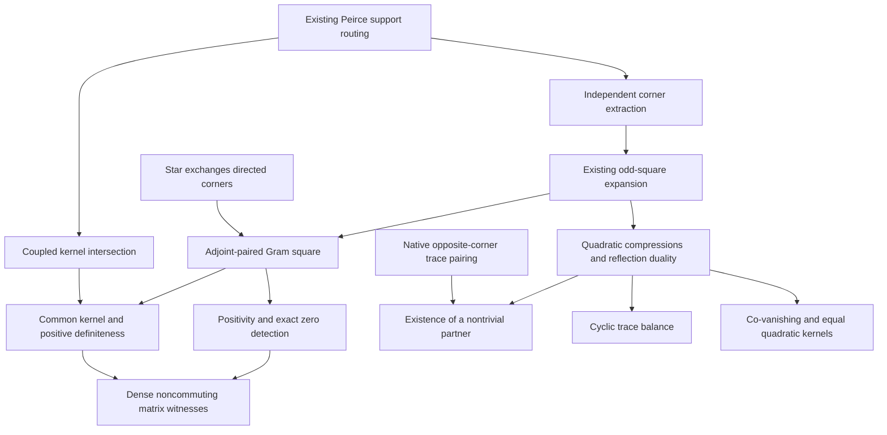

# Canonical opposite-corner mathematics

## Native carriers and conventions

Let `A` be an associative unital ring, `p²=p`, and `q=1-p`. Use the existing
Peirce corner sets, with arbitrary independent `u ∈ pAq` and `v ∈ qAp`.
Write `E=u+v`, `K=uv+vu`, `C=[u,v]=uv-vu`, and `γ=2p-1`.
These are abbreviations for native ring expressions, not new structures.
The concrete matrix realization is the full `Matrix n n ℂ` for arbitrary
finite `n`; its action on vectors is native `Matrix.mulVecLin`.

## Proof prerequisite partial order

Reachability and equality give the prerequisite partial order. The verification
record supplies the exact import DAG and source hashes. The arrows describe
dependencies of mathematical proofs.

## Arbitrary-ring identities

The support equations are

\[
pu=u,\qquad up=0,\qquad pv=0,\qquad vp=v.
\]

The existing same-corner routing gives `u²=v²=0`. The new extraction lemmas
identify `component10 p E=u`, `component01 p E=v`, and `odd p E=E`. Reusing the
existing `odd_square` theorem then proves

\[
E^2=K.
\]

The quadratic operators have the exact compressions

| Operator | Compression by `p` | Compression by `q` |
| --- | --- | --- |
| `K` | `pKp=uv` | `qKq=vu` |
| `C` | `pCp=uv` | `qCq=-vu` |

Both are in the existing even range, which is the centralizer of `p`.
Reflection obeys

\[
\gamma^2=1,\qquad \gamma K=C,\qquad \gamma C=K,
\]
\[
\gamma E\gamma=-E,\qquad \gamma K\gamma=K,\qquad \gamma C\gamma=C.
\]

In particular,

\[
K=0\iff C=0\iff(uv=0\ \land\ vu=0),
\qquad E=0\iff(u=0\ \land\ v=0).
\]

These identities require no cancellation of two and hold in characteristic two.
They do not assert that arbitrary independent corners couple nontrivially.

## Trace and kernel geometry

On full finite matrices over any commutative coefficient ring, native trace
cyclicity and the support equations give

\[
\operatorname{Tr}u=\operatorname{Tr}v=\operatorname{Tr}C=0,
\qquad \operatorname{Tr}K=2\operatorname{Tr}(uv),
\]
\[
\operatorname{Tr}(\gamma K)=0,
\qquad \operatorname{Tr}(\gamma C)=\operatorname{Tr}K.
\]

The two compressed traces of `K` agree; the two compressed traces of `C`
cancel. No cyclicity is claimed for the reflection-weighted functional itself.

The existing opposite-corner trace pairing implies that every nonzero `u` has
some opposite `v` with `Tr(uv) ≠ 0`. The new consumer uses compression to prove
that such a partner has `(u+v)² ≠ 0`, including in characteristic two.

The geometric statements are equalities of native kernel submodules:

\[
\ker E=\ker u\cap\ker v,\qquad \ker K=\ker C.
\]

## Adjoint pairing and positivity

For a complex star projection `p`, taking the adjoint exchanges the directed
corners. The arbitrary-input identity is

\[
(pa(1-p))^\dagger=(1-p)a^\dagger p.
\]

With `v=uᴴ`, the coupled operator and bracket are Hermitian, and

\[
(u+u^\dagger)^2=G:=uu^\dagger+u^\dagger u\succeq0.
\]

Native Gram theorems and support extraction prove

\[
G=0\iff u=0,\qquad 0<\operatorname{Tr}G\iff u\ne0,
\]
\[
\ker G=\ker[u,u^\dagger]=\ker u\cap\ker u^\dagger,
\]
\[
G\text{ is positive definite}\iff\ker u\cap\ker u^\dagger=\{0\}.
\]

The positive and negative bracket compressions are respectively `uuᴴ` and
`-uᴴu`. The unrestricted Gram-positivity theorem itself needs no support
assumption; the Peirce hypotheses identify it with the coupled square.

## Full-matrix boundary witnesses

The code reuses the existing dense `P,S` and sets `U=component10 P S`. Every
row of `U` is `(-13,2,11)/9`. Its two opposite products fail to commute, while

\[
\operatorname{Tr}(UU^\dagger+U^\dagger U)=196/9,
\qquad U(3,-8,5)^T=U^\dagger(3,-8,5)^T=0.
\]

Thus the coupled square is nonzero and positive semidefinite but not positive
definite. Choosing the independent second input `-S` instead gives the negative
Gram square, trace `-196/9`, and failure of positive semidefiniteness. This pair
also fails to commute. The general theorems retain unrestricted full matrices.

No particle interpretation, spontaneous symmetry-breaking theorem, connection,
curvature, topological invariant, or continuum gap is inferred. Exact compiler
and acceptance evidence is recorded separately in the final verification record.
