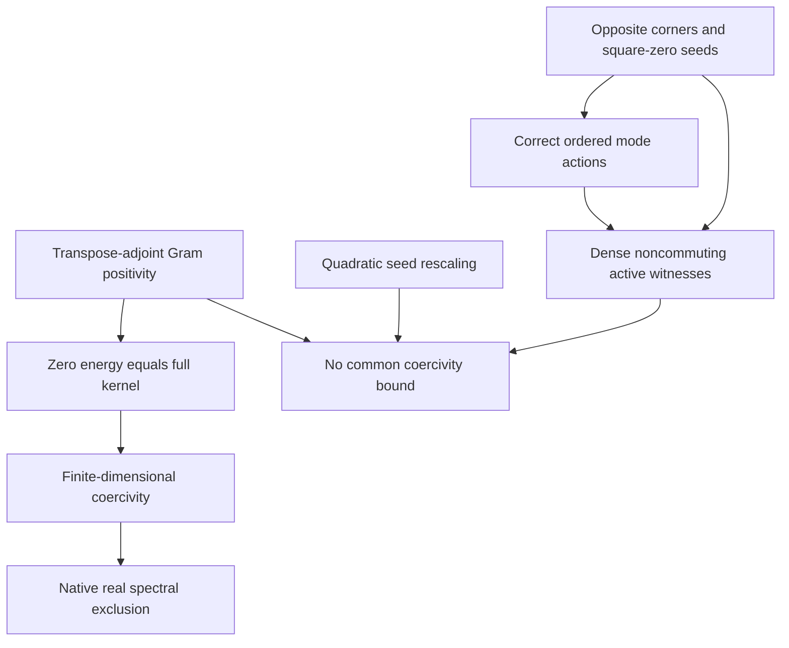

# Real operator gaps and corrected square-zero modes

This intake follows merged PR #253 at base
`d23c9afe00275126fd4d4e25cb0842ee55fe82af`. The two uploaded streams are frozen
byte-for-byte in source order. `message-claim.txt` captures the subsequent user
message with mathematical typography normalized; it is not an original-byte
attachment. `provenance.json` distinguishes those capture methods.

The accepted deliverable consists of native algebraic and analytic theorems on
full noncommutative matrix algebras, real Euclidean spaces and real Frobenius
matrix spaces. The input's claims that its code was already verified are not
verification evidence. The formal contract was reviewed before implementation.

## Source-order extraction

Let `u² = v² = 0`, `K = uv + vu`, `C = uv - vu`, `E = u + v`, `F = u - v`.
These are expressions in the existing carrier, not new structures. Write
`Phi±(x) = uxv ± vxu`, and use the existing canonical generators.

| Source | Mathematical atom | Resolution and owner |
| --- | --- | --- |
| XLII: directed corners | Opposite Peirce corners are square-zero | Existing `Core.PeirceGrading.corners_sq_zero` |
| XLII: quadratic centrality | `[u,K]=[v,K]=0`; `{u,C}={v,C}=0` | Existing zero compositions in `Core.LieJordanBoundaryOperators` and square-zero owners |
| XLII: stationarity | `Gsym(K)=0`, `Gplus(C)=0` | Existing `Core.LieJordanGenerators` quadratic/bracket theorems |
| XLII: intermediate skew claim | `Gplus(K)=0` | Rejected; the existing theorem gives `Gplus(K)=4KC`, with a new dense nonzero witness |
| XLII: sandwich actions | `Phi+(K)=K²`, `Phi-(C)=-C²` | Existing `Core.LieJordanGenerators` sandwich theorems |
| XLII: table sign | `[u,C]=-2uC` | Corrected to `[u,C]=2uC=-2Cu`; multiplication order matters |
| XLIII: sum/difference sandwiches | `Phi±(E)` and `Phi±(F)` | All four are zero, from the actual ordered words `uvv`, `vuu`, `uuv`, `vvu` |
| XLIII: selective damping | `Gsym(E)=0`, `Gsym(F)=-4KF` | Corrected to `Gsym(E)=-2KE`, `Gsym(F)=-2KF`; both mixed generators kill both modes |
| Later message: positivity and gap | Stationarity implies a positive mass gap | Replaced by explicit transpose-adjoint positivity, finite-dimensional coercivity and native real spectrum theorems |
| Later message: universal stability | One fixed-point identity supplies a universal scale | A nonzero active mode rules out a common positive coercivity constant over all positive seed rescalings |

The full corrected action table is:

| Input | `Phi+` | `Phi-` | `Gsym` | `Gplus` |
| --- | --- | --- | --- | --- |
| `1` | `K` | `C` | `0` | `4C` |
| `K` | `K²` | `KC` | `0` | `4KC` |
| `C` | `-KC` | `-C²` | `-4KC` | `0` |
| `E` | `0` | `0` | `-2KE` | `0` |
| `F` | `0` | `0` | `-2KF` | `0` |

Generated-algebra and polynomial stationarity are already owned by
`OperatorAlgebra.PeirceSuperoperators.StationaryAlgebra`; this PR does not
duplicate those declarations or replace their native subalgebras.

## Proof-dependency poset

Reachability in this acyclic graph gives the dependency order. The order
describes mathematical prerequisites; it makes no claim about physical time.

Nilpotency is not needed for the two positivity or fixed-operator gap results.
Finite dimensionality is needed for existence of the positive coercivity
constant. The scaling obstruction needs an actual nonzero active element;
the example proves that hypothesis independently on the two carriers.

## Native module map

| New module | Mathematical contribution |
| --- | --- |
| `Analysis.RealPositiveOperatorGap` | Zero-energy/kernel equivalence, strict energy on `kerᗮ`, compactness coercivity, eigenvalue lower bound, real spectrum exclusion |
| `Analysis.RealPositiveOperatorScaling` | Kernel preservation, actual endomorphism quadratic scaling, no common positive coercivity bound with an explicit active-vector hypothesis |
| `Core.LieJordanModeActions` | Consumed equality of the existing dissipator with the canonical generator, corrected sum/difference actions, native joint-kernel span inclusion |
| `Canonical.RealLieJordanGap` | Separate Gram-vector and Frobenius-matrix specializations; native matrix-spectrum transport |
| `Canonical.RealLieJordanScaling` | Actual seed scaling, preservation of noncommutation and full kernels, separate family-bound obstructions |
| `Canonical.RealLieJordanGapExamples` | Exact dense counterexamples, two active-carrier witnesses, both discharged family-bound obstructions |

For `K = uuᵀ + uᵀu`, the vector operator is `K.toEuclideanLin` on
`EuclideanSpace ℝ n`. Its kernel is the intersection of the vector kernels of
`u` and `uᵀ`. The native algebra equivalence transports its real spectrum to
the matrix-algebra spectrum of `K`.

For `L = -symmetricGenerator u uᵀ`, the carrier is full `Matrix n n ℝ` with
the existing native Frobenius structure. Its kernel is the common-centralizer
submodule. These are different operators with different kernels and spectra.

Both fixed-operator theorems construct `δ > 0` and prove
`δ * ‖x‖² ≤ inner ℝ x (T x)` on `T.kerᗮ`, with the same constant satisfying
`μ ∈ spectrum ℝ T → μ = 0 ∨ δ ≤ μ`. An empty complement is allowed; these
existence theorems alone do not prove that a positive spectral value exists.

The family result formally excludes a common positive **coercivity** bound.
It does not add an exact spectrum-scaling theorem. A singular positive matrix
can still have a positive spectral gap above its kernel.

## Dense witnesses

All witnesses use the existing dense real `P`, `S`, `U` and `U.transpose`.
Their noncommutation is already proved, and the new rescaling theorem
preserves it at every nonzero scale. The kernel-checked entry targets are:

| Expression | Entry | Exact value |
| --- | --- | --- |
| `Gsym(U + Uᵀ)` | `(0,0)` | `5096/81` |
| `Gsym(U - Uᵀ)` | `(0,1)` | `-980/27` |
| `Gplus(UUᵀ + UᵀU)` | `(0,0)` | `-27832/243` |
| `Gsym(P)` | `(0,0)` | `142/27` |
| `(UUᵀ + UᵀU).toEuclideanLin e₀` | `0` | `89/9` |

The last two expressions are actual nonzero images in the respective full
kernel complements. Neither carrier is replaced by a scalar or diagonal model.

## Interpretation boundary and verification

The [official Jaffe–Witten problem](https://www.claymath.org/wp-content/uploads/2022/06/yangmills.pdf),
printed pages 5–6, asks for a nontrivial quantum Yang–Mills theory on ℝ⁴ for
every compact simple gauge group, the stated field-theory axioms and a gap
for its physical time-translation Hamiltonian. The current work establishes
finite-dimensional real operator theorems. Stationarity does not identify
either finite operator with that Hamiltonian. This PR does not claim a
solution of the Millennium problem.

The maintained `tools/quality/check_lie_jordan_geometry.py` receives only six
additional targets; its acceptance logic is unchanged. The workflow receives
the corresponding source-closure path triggers. The gate compiles exact source
copies, treats target warnings as errors, scans constructivity, checks every
module-owned declaration's axiom dependencies, and builds an isolated native
Lake package at unchanged repository pins. `verification.json` records the
completed run and exact source hashes. The scope excludes repository-wide
aggregator builds.
