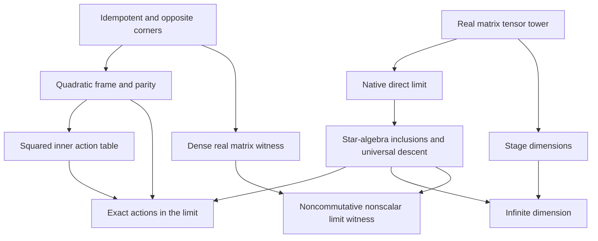

# Real Peirce actions and the matrix tensor colimit

The code formalizes the algebraic content of the preserved `stream.txt` using
the repository's existing Peirce owners and actual real matrix direct limit.
The exact hypotheses and boundaries are in [contract.md](contract.md).
Input provenance is recorded in [provenance.json](provenance.json).

## Canonical extraction

The following order follows the stream's mathematical construction. The final
two items supply the universal property and dimension evidence required by its
proposed target.

| Construction | Native mathematics | Owner or public entry point |
|---|---|---|
| Idempotent splitting | `p`, `1-p`, `p*A*(1-p)`, `(1-p)*A*p` | Existing `Core.PeirceDecomposition` |
| Reflection and linear modes | `s = 2*p-1`, `E = u+v`, `J = u-v`; both modes odd under conjugation by `s` | Existing `Core.PeirceGrading`, `Core.PeirceCoupledCorners`; `limit_peirce_frame` |
| Quadratic modes | `K = u*v+v*u`, `C = ⁅u,v⁆`; both even, with `C = s*K` | Existing `Core.PeirceQuadraticFrame`, `Core.PeirceSandwichDuality`; `limit_peirce_frame` |
| Reflected star expression | For self-adjoint `p` and `v = star u`, `s * star u * s = -star u`, giving the Gram sum | `limit_reflected_star_corner`, `limit_reflected_gram` |
| Signed squared inner actions | Native `LieAlgebra.ad` in the full endomorphism ring | `Core.PeirceDoubleCommutator` |
| Faithful tensor inclusions | Full real matrix stages, `X ↦ X ⊗ I₂`, native `DirectLimit` quotient | Existing `Clifford.Cl11TensorTower`, `Clifford.Cl11TensorTowerLimit`; `ofStageStarAlgHom_injective` |
| Universal descent | Compatible real `StarAlgHom` families admit a unique factorization | `Clifford.Cl11StarUniversal.existsUnique_lift_iff` |
| Infinite dimension | Stage dimension `4^n` and injective real-linear inclusions | `Clifford.Cl11ColimitDimension.not_finiteDimensional` |

All new concrete carriers are real. The general polynomial statements allow
arbitrary associative algebras without assuming multiplication commutative.
Independent opposite corners are permitted; the transpose specialization is
used only where a star or positive-semidefinite Gram statement requires it.

## Proof prerequisite partial order

An arrow means that a later result consumes the earlier construction or proof.
Reachability gives the prerequisite partial order; this diagram is a human
summary of the proof structure, not a generated Lean declaration graph.



## Exact operator table

For `p²=p`, `u ∈ p*A*(1-p)` and `v ∈ (1-p)*A*p`, set

\[
E=u+v,\quad J=u-v,\quad K=uv+vu,\quad C=[u,v],\quad s=2p-1.
\]

The native linear endomorphisms are
`D_E = -(LieAlgebra.ad R A E ^ 2)` and
`D_J = LieAlgebra.ad R A J ^ 2`.

| Input | `D_E` | `D_J` |
|---|---|---|
| `K` | `0` | `0` |
| `E` | `0` | `-4*(K*E)` |
| `J` | `-4*(K*J)` | `0` |
| `C` | `-4*(K*C)` | `-4*(K*C)` |
| `s` | `-4*(K*s)` | `-4*(K*s)` |

Here `4*X` denotes repeated addition, as represented by `4 • X` in the proofs.
The coefficient `K` is retained as a full operator. No division, invertibility,
centrality, or scalar spectral normalization is assumed. The identity
`ad_sum_difference_trinity` proves that the two endomorphisms sum to twice the
existing `symmetricGenerator`.

`PeirceDissipatorColimit` evaluates the complete table on the actual canonical
images. `map_ad_sq` proves naturality under algebra maps,
`ad_sq_weighted_eq_iff` reflects weighted equations through injective maps,
`ofStage_ad_sq_intertwines` states a commuting square of native linear maps,
and `lift_ad_sq` gives the corresponding identity for the universal descent.

## Faithful real colimit

The existing tower is `Stage n = Matrix (Idx n) (Idx n) ℝ`, with
`Fintype.card (Idx n) = 2^n`. Its bonding maps append the identity of the
two-dimensional real matrix factor. The carrier `Limit` is the existing native
root `DirectLimit` quotient.

`ofStageStarAlgHom` exposes each actual inclusion as a native `StarAlgHom ℝ`.
For `B : Type` with `Ring`, `StarRing`, and `Algebra ℝ` instances, the theorem
`existsUnique_lift_iff` proves

\[
\bigl(\exists!\, g:\mathrm{Limit}\to_{\star,\mathbb R}B,
\ \forall n,\ g\circ\iota_n=f_n\bigr)
\quad\Longleftrightarrow\quad
\forall n,x,\ f_{n+1}(\mathrm{stageEmbed}_n(x))=f_n(x).
\]

Faithfulness follows from the injectivity of the actual tensor bonding maps.
`finrank_stage` proves `Module.finrank ℝ (Stage n) = 4^n`. If the limit had
finite dimension `d`, its stage `d` would inject linearly, giving `4^d ≤ d`,
contradicting `d < 4^d`. This proves `¬ FiniteDimensional ℝ Limit` for that
carrier.

## Full matrix witness

`Canonical.PeirceColimitExamples` specifies a dense rational-entry projection
`P` and dense symmetric real matrix `S` in the full algebra `Matrix (Fin 4)
(Fin 4) ℝ`. It proves `P*S ≠ S*P`. The forward corner `U = P*S*(1-P)` is
dense, square-zero, and fails to commute with its transpose.

For `K = U*Uᵀ + Uᵀ*U`, the file proves native `Matrix.PosSemidef`,
`¬ Commute K S`, and the stronger assertion

\[
\forall r\in\mathbb R,\qquad K U\ne rU.
\]

Reindexing into stage two and applying the faithful real star-algebra
inclusion preserves both noncommutation and the nonscalar action certificate.
The public theorems `limit_noncommutative` and `limit_gram_mul_U_ne_smul`
therefore witness these properties inside the actual infinite-dimensional
quotient.

The quotient Gram theorem is an algebraic identity. The finite example also
has an ordered matrix positivity theorem. A scalar spectral gap, an ordered
completion of the quotient, and positivity of a reflection functional require
additional hypotheses and constructions.

## Verification entry point

Use the repository-pinned Lean executable and an unmodified checkout of the
Mathlib revision recorded by `lake-manifest.json`:

```sh
python3 tools/quality/check_real_peirce_colimit.py \
  --mathlib-root /absolute/path/to/pinned-mathlib \
  --output /absolute/path/to/verification
```

The entry point selects the five new owners and the repaired existing
`Clifford.TowerMatrix` owner, and reuses the maintained closure verifier.
`TowerMatrix.Idx` retains its exact recursive type equations and is marked
`noncomputable`, suppressing generation of an executable unsafe/partial helper
for this type-valued definition. Its kernel definition and equation-based
unfolding remain available. No stage, bonding map, or quotient carrier is
replaced. The verifier compiles the exact repository
import closure, treats warnings in all six targets as errors, audits all
declarations in that closure, builds an
isolated native Lake package, and reconciles source hashes and dependency pins.
The scoped GitHub Actions workflow runs the same check and retains its evidence.
