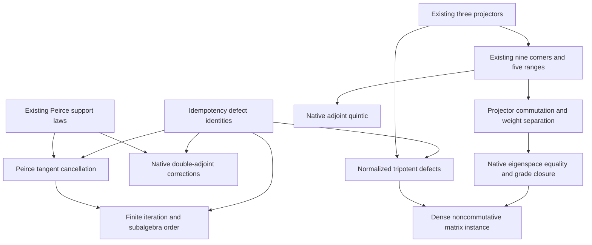

# Noncommutative defect calculus and tripotent eigenspaces

This change extracts the algebraic content of the frozen intake into eight
small Lean owners. The ambient carrier is an arbitrary associative ring or
real associative algebra. The concrete instance is the full real four-by-four
matrix algebra. The intake provenance, initial claim classification, exact
hypotheses, and corrections are recorded in `CONTRACT.md` and `PROVENANCE.json`.

## Mathematical dependency order

The arrows below record prerequisites used by the proofs. Existing Peirce
and tripotent constructions remain their original owners. Reconstruction of
the five components is reused, while the new work identifies those components
with native Mathlib eigenspaces.



The native order theorem is separately formalized: for every `x` in an
associative algebra,

```lean
Antitone (fun n : ℕ => Algebra.adjoin R ({defect^[n] x} : Set A))
```

The order here is Mathlib's actual subalgebra inclusion. The theorem does not
assert strictness of the chain or infinitely many independent operators.

## Proof owners and acceptance surfaces

All paths below are beneath `lean/InfoGeometry/`.

| New owner | Representative proved content |
|---|---|
| `Core/IdempotencyDefect.lean` | `polarization`, `defect_neg_add`, `defect_neg_sub`, `defect_mul_defect_neg`, `cubic_sub_eq_mul_defect`, `cubic_sub_eq_mul_defect_neg`, `map_defect` |
| `Core/PeirceDefect.lean` | `defect_add_idempotent_eq_square_iff`, `tangent_iff_diagonal_corners_zero`, `tangent_iff_mixed_corners`, `commute_square_of_tangent`, directed-corner and coupled-frame defects |
| `Core/DefectIteration.lean` | `commute_iterate`, `iterate_mul_iterate_eq_zero`, `iterate_add_of_mul_eq_zero`, `map_iterate`, `commute_iterate_add_idempotent`, `iterate_mem_adjoin`, `adjoin_iterate_antitone` |
| `Core/PeirceDefectAdjoint.lean` | `negative_ad_squares_sum_eq_defect`, `ad_squares_sub_eq_defect`, `real_ad_cube_eq_ad`, and the three `proj*_ad_apply` identifications |
| `Core/TripotentDefect.lean` | Exact normalized off-shell orthogonality and idempotency defects; `projPos_sub_of_orthogonal`, `projNeg_sub_of_orthogonal`, `projZero_sub_of_orthogonal` |
| `Core/TripotentAdjoint.lean` | `adLinear_eq_ad`, `adGrade_eq_eigenspace`, `fiveGradeProjector_commute_ad`, `ad_quintic` |
| `Core/TripotentEigenspaces.lean` | `fiveGradeRange_eq_eigenspace`, eigenspace exclusion, product and native Lie-bracket weight addition, and out-of-range vanishing |
| `Canonical/TripotentMatrixExample.lean` | Dense matrix entries, the full matrix-unit product law, a self-adjoint tripotent, recovery of its projectors, all five nonzero weight witnesses, noncommuting grade-zero operators, and the native self-Penrose property |

The eigenspace module continues the namespace
`InfoGeometry.Core.TripotentAdjoint`; it does not define an alternate adjoint.
The defect function is the single reusable definition
`InfoGeometry.Core.IdempotencyDefect.defect`.

## A55: defect, tangent directions, and iteration

For `δ(x)=x*x-x`, polarization retains the order of mixed products:

\[
\delta(x+y)-\delta(x)-\delta(y)=xy+yx.
\]

For an idempotent `p`, the exact algebraic linearization is
`y ↦ p*y+y*p-y`. Its kernel equals the sum of the mixed Peirce corners, and

\[
\delta(p+y)=y^2\quad\Longleftrightarrow\quad py+yp=y.
\]

The square commutes with `p`. Every later defect iterate remains in that
centralizer. Mutually annihilating summands remain mutually annihilating even
when their iteration counts differ, and the defect iterates split across
their sum. These are full-ring statements, including characteristic two
where no normalization is requested.

For opposite-corner operators `u,v`, put
`E=u+v`, `J=u-v`, `K=u*v+v*u`, and `C=u*v-v*u`. The two native adjoint-square
corrections are

\[
-\operatorname{ad}_C^2(E)-\operatorname{ad}_J^2(E)
=-4(K^2-K)E,
\qquad
(\operatorname{ad}_C^2-\operatorname{ad}_E^2)(J)=4(K^2-K)J.
\]

The factor `K*K-K` remains an operator. No scalar substitution is made.
The original undefined macro names are not promoted to mathematical owners.

## A56: normalized tripotent defects

The existing `projPos`, `projNeg`, and `projZero` are used unchanged. Their
off-shell errors are expressed exactly in terms of `t*t*t-t`. In particular,

\[
\delta(1-t^2)=t(t^3-t).
\]

The positive sign corrects the intake prose. The expressions `t²±t` are twice
the normalized real projectors. Applying these same projectors to the native
adjoint of an idempotent recovers the existing even part and the two directed
mixed Peirce components. The cubic identity for this adjoint is transported
from the existing integer-linear proof.

## A57: full adjoint eigenspaces and the quintic

For any `t : A` with `t*t*t=t`, let `D = LieAlgebra.ad ℝ A t`. The new theorem
is an equality in the native endomorphism algebra:

\[
D^5-5D^3+4D=0.
\]

The existing five-range decomposition already gives a linear equivalence on
all of `A`. The new converse proves, for each existing grade label `k`,

```lean
fiveGradeRange t k =
  (LieAlgebra.ad ℝ A t).eigenspace (fiveGradeValue k : ℝ)
```

Products and Lie brackets add their weights. An eigenspace at a real weight
outside `{-2,-1,0,1,2}` is zero, so products and brackets whose total weight is
outside that set vanish. The generic theorem is an annihilating-polynomial
result; it does not require that all five weights occur in every algebra.

## Full matrix non-vacuity and geometry

The example uses a dense symmetric orthogonal Householder matrix `Q` and the
actual matrices `Fᵢⱼ = Q * Matrix.single i j 1 * Q`. It proves

\[
F_{ij}F_{kl}=\begin{cases}F_{il}&j=k,\\0&j\ne k.\end{cases}
\]

Every entry of every `Fᵢⱼ` is nonzero. The self-adjoint tripotent
`T=F₀₀-F₁₁` also has every entry nonzero. Its adjoint acts on these full matrices
with weights determined by `(1,-1,0,0)`:

| Weight | Explicit nonzero matrix |
|---:|---|
| −2 | `frameUnit 1 0` |
| −1 | `frameUnit 2 0` |
| 0 | `frameUnit 2 3` |
| 1 | `frameUnit 0 2` |
| 2 | `frameUnit 0 1` |

The two zero-weight matrices `frameUnit 2 3` and `frameUnit 3 2` do not commute.
Thus the neutral component is not forced to be an abelian Cartan subalgebra.
The two named dense self-adjoint matrices `reflection` and `tripotent` also
fail to commute, as proved by `reflection_tripotent_noncommute`.
The geometric consequence uses the existing matrix Moore–Penrose owner with
an explicit proof of self-adjointness.

## Reproducible verification

The selector delegates to the maintained exact-source verifier:

```bash
python3 tools/quality/check_universal_grade_generator.py \
  --mathlib-root /path/to/pinned-mathlib \
  --output /path/to/verification
```

It checks the repository-pinned Lean and Mathlib revisions, copies the exact
repository source closure, compiles all eight new owners with warnings as
errors, audits every declaration in the closure for nonstandard axioms and
unsafe/partial definitions, and builds the closure as a native isolated Lake
package. It checks source hashes and dependency cleanliness again afterward.
All compiler work uses the shared build lock. The scoped CI workflow runs the
same command against the exact PR head and retains its evidence artifact.

The root repository package has unrelated external dependencies and is not
the claim made by this scoped check. Final independent semantic and runtime
acceptance records accompany the verified source hashes in this directory.
