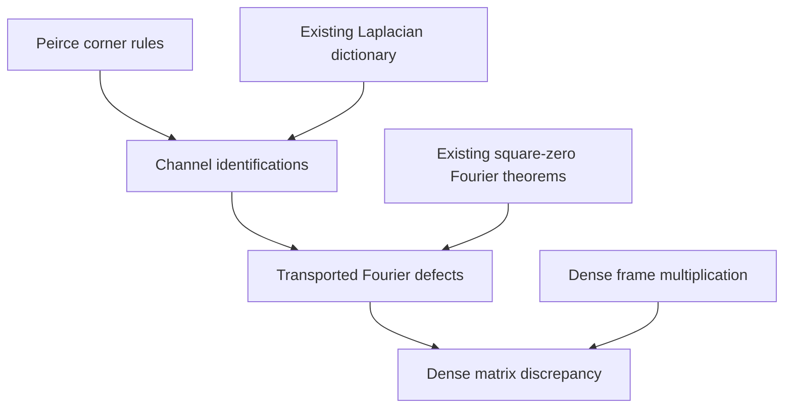

# Peirce channel defects and adjoint-pair nonvanishing

## Intake, branch, and scope

This follow-up starts from `main` at
`a392af178af1fe2bcba2ba39eb405700c6ee103c`. It is independent of PR #323's
tripotent flow extension. The uploaded source is preserved verbatim in
[`sources/peirce_defect_intake_20261112.txt`](sources/peirce_defect_intake_20261112.txt).
Its original name was `Pasted text(20261112-095814).txt`; its 27,678 bytes have
SHA256 `2313829fb9e179b94be11d62e58d0e7ee7f05e14dd72d5dfabf872d81547228d`.
The preserved text is research input, not a statement of accepted results.

The proposed additions concern arbitrary associative rings, proper star-ring
realizations, native C-star norm assumptions, and counterexamples in the full
real four-by-four matrix algebra. No characteristic restriction is imposed on
the ring-level channel identities. No continuum field theory, spectral gap,
bundle classification, or sporadic-group construction is inferred.

## Existing owners and the missing implications

| Existing owner | Reused content | New obligation |
| --- | --- | --- |
| `PeirceSpine.Basic` | Ordered corners, generators, commutator, corner normal form | Keep the ambient carrier noncommutative. |
| `PeirceSpine.Homogenized` | Four double-commutator channels, four Fourier channels, generator evaluations, two-sided expansion | Identify the existing Peirce maps with the more general endomorphism owner. |
| `SquareZeroPairSpectral.FourierCharacterDefect` | All four general defects, the exact `V^2` centralizer criterion for two channels | Transport these established theorems through the channel identifications, rather than re-proving the square-zero algebra. |
| `PeirceSpine.Bridge` | Corner and Laplacian identifications | Complete the channel dictionary used by the transported theorems. |
| `PeirceSpine.StarGrading` | `star_conePlus`, self-adjointness of the paired metric | Prove precisely when the paired metric vanishes. |
| `Canonical.TripotentMatrixExample` | Dense orthonormal frame, all sixteen matrix units, multiplication and star laws | Exhibit nonzero independent cones with zero overlap and a nonzero paired metric with a kernel. |
| `Core.IdempotentDefectIteration` and `PeirceSpine.DefectTower` | Orthogonal splitting at every finite iterate, ring-homomorphism transport | Reuse; do not introduce another defect-tower owner. |
| `PeirceSpine.Unipotent` | Ordered conjugations, idempotent chart formula, finite towers | Correct the intake's reversed conjugation in this contract. |
| `PeirceSpine.CyclotomicBridge` | Off-shell cyclotomic residuals, braiding, reflection squares | Distinguish the unit locus from the larger idempotent locus. |
| `PeirceSpine.TetraktysKleinActionBridge` | Sandwich maps identified with actual Klein automorphisms on `V = 1` | Reuse; do not reinterpret general polynomial channels as automorphisms. |

The search included declarations and consumers under both `lean/` and `src/`;
the additions target the canonical `lean/` owners. Historical aggregate files
and prose supplied navigation, not verification evidence.

## Exact channel contract

Write `V = genV P A C`, `Phi = genPhi P A C`, `J = genJ P A C`, and
`Sigma = genSig P A C`, with `P * P = P`. Let `H` denote the existing
`hProj` channels and `F` the corresponding existing `fourier` channels.
For arbitrary `X : B`, the intended identities are:

\[
\begin{aligned}
H_V(X)-F_V(X)&=3V[V,X]+[V,X]V,\\
H_\Phi(X)-F_\Phi(X)&=-[V^2,X],\\
H_J(X)-F_J(X)&=-[V^2,X],\\
H_\Sigma(X)-F_\Sigma(X)&=-[V,[V,X]].
\end{aligned}
\]

Every equality retains multiplication order. `Commute V X` is a sufficient
condition for all four differences to vanish. For the `Phi` and `J` channels,
the exact condition is `Commute X (V * V)`, proved as an equivalence. No
necessity of `Commute V X` is asserted for the mass or spin channel: a
commutator can be annihilated by other factors. The existing channels are not
redefined, and equality is not assumed on the entire ring.

The intake's unequal sandwich weighting has value `5 V^3` on `V` and
`V^2 * Phi` on `Phi`. The existing correctly weighted Fourier sum is

\[
F_V(X)=2\bigl(V^2X+V(\Phi X\Phi-JXJ)+\Sigma X\Sigma\bigr).
\]

On the centralizer this agrees with `H_V`; its value on `V` is `8 V^3`.
The coefficient two must multiply the entire sum.

## Adjoint-pair contract

In a ring with star, assume explicitly that
`star x * x = 0` implies `x = 0`. For `N * N = 0`, prove

\[
NN^*+N^*N=0\quad\Longleftrightarrow\quad N=0.
\]

This is a zero criterion. It supplies neither an order nor a positive lower
bound. The native C-star norm identity discharges the explicit properness
hypothesis in the normed specialization. For a self-adjoint idempotent `P`,
`star_conePlus` identifies `coneMinus P (star A)` with
`star (conePlus P A)`, so the criterion applies to `genV P A (star A)`.
The nonvanishing hypothesis must concern the selected upper corner, not just
the full commutator `[P,A]`.

The ordered specialization separately proves nonnegativity using native
`StarOrderedRing`. It needs `star P = P` but does not need idempotence of `P`.

## Dependency structure



The separate star chain is square-zero multiplication plus explicit star
properness, followed by the Gram-sum zero criterion and then its Peirce
specialization. Native C-star properness supplies the normed corollaries.
Star-order positivity is an independent branch. None of these edges points to
a spectral-gap or bundle-classification theorem.

## Corrections and unproved interpretations

| Intake claim | Correct scope or obstruction |
| --- | --- |
| `(1-N) P (1+N) = P-N` for the upper corner | It equals `P+N`; the existing `conjPlus = (1+N) P (1-N)` equals `P-N`. Order determines the sign. |
| `E12` and `E31` have both products zero | Their reverse product is `E32`. A valid example uses disjoint arrows in four dimensions. |
| Adjoint pairing and nonzero corner imply a spectral gap | They imply nonzero paired metric under the stated hypotheses. A nonzero positive matrix can have a kernel; coercivity requires additional assumptions. This does not rule out a gap above a specified ground-state subspace. |
| `[P,A] != 0` implies the selected paired metric is nonzero | A purely lower-corner `A` has nonzero commutator but zero upper corner. |
| `delta(V)=0` is the cyclotomic unit-shell condition | It only says `V^2=V`. The residual `omega^2-omegaBar=1-V` vanishes exactly at `V=1`. Equal reflection squares alone impose the weaker condition. |
| Algebraicity of `V` makes the defect iterates vanish | False: `delta(2)=2` in characteristic zero. Algebraicity gives relations, not eventual vanishing. |
| A global idempotent is a global gauge fixing | A global projection can represent a nontrivial vector bundle. It does not provide a section of the gauge-orbit projection. |
| Four integral generators form a free/Azumaya module in every realization | A generating bound is not freeness, linear independence, or the Azumaya property. The proposed `Phi,J,Sigma` basis may require inverses absent over the integers. |
| Split signature forbids every `S4` action or every Golay/Leech realization | Preservation of squares obstructs a particular permutation of named generators when `1 != -1`; it does not exclude every action, representation, tensor construction, or extension. |

For the topology distinction, Swan's original
[Vector Bundles and Projective Modules](https://wiki.math.ntnu.no/_media/ma8107/2014h/swan_-_vector_bundles_and_projective_modules.pdf)
constructs vector bundles as summands of trivial bundles and relates their
sections to projective modules. Singer's
[Some Remarks on the Gribov Ambiguity](https://projecteuclid.org/journals/communications-in-mathematical-physics/volume-60/issue-1/Some-remarks-on-the-Gribov-ambiguity/cmp/1103904019.pdf)
concerns the obstruction to a global continuous gauge choice. These are
different constructions. No bundle-patching theorem is added by this change.

## Verification record

Independent semantic and infrastructure source review passed for all three
modules, this contract, and the scoped workflow. The staged proof gate passed.
The computed project import closure contains 38 modules.

The local command
`python3 tools/infra/run_locked_lake_build.py InfoGeometry.OperatorAlgebra.PeirceSpine.Homogenized`
exited with code 2 because the shared build lock was held by another task
(`structural-gaps:3`). No compiler was stopped and no lock or cache was removed.

The isolated CI command is:

```bash
python3 project/tools/quality/check_peirce_channel_defects.py \
  --mathlib-root pinned-mathlib --output verification
```

Status: kernel verification pending. Success will be recorded only after the
exact-source closure and every declaration owned by the added modules pass the
pinned Lean checker. Repository-wide build status is separate from this
selected-source check; dependency pins and existing quality gates are unchanged.
