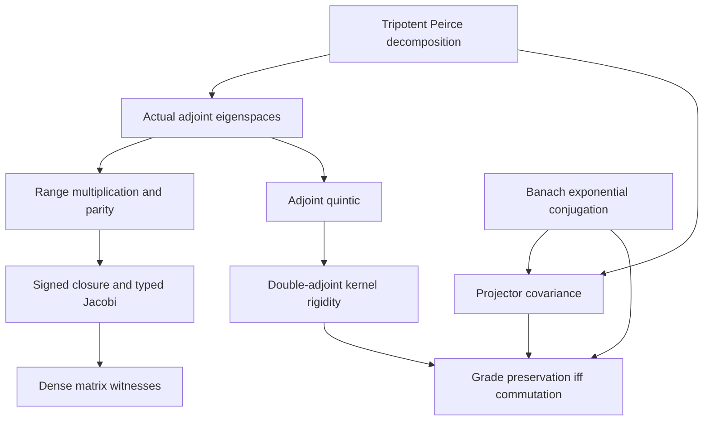

# Tripotent superbrackets and compatible operator flows

## Intake and provenance

Task: `tripotent-super-flow-20261112`.
Source: the user's Bulgarian message in this conversation on 2026-11-12,
following publication of PR #318. Repository base:
`a392af178af1fe2bcba2ba39eb405700c6ee103c`.

The intake combines the following claims, retained here for review:

> S acts by ad_S(X) = [S,X], with S^3 = S and weights -2,-1,0,1,2.
> The superbracket adds the degrees, with degrees outside this range zero.
> K = -log rho belongs to degree zero and [J K, -] preserves every degree.
> P0 = 1-S^2 is a vacuum/horizon fixed by the infinity twistor.
> Four bosonic and N fermionic normal-ordering shifts cancel at N=4,
> making the entire superalgebra free of quantum anomalies.
> Photons are Goldstone modes of the boundary/modular/Andreev system.

These are English claim extracts, not a verbatim transcription or a checksum
of the full source message. The original message also proposes para-Kähler,
Fisher–Rao, conformal real-form, dilaton, heat-equation, and Andreev-scattering
identifications. They remain separate claims; repetition of the photon passage
does not add an algebraic hypothesis or a proof dependency.

## Existing owners

- `Physics/Algebra/TripotentPeirceProjectors` constructs the spectral
  idempotents in a real associative algebra.
- `Physics/Algebra/TripotentFiveGradingDecomposition` constructs the native
  five ranges and their linear direct-sum equivalence.
- `Core/TripotentAdjoint` identifies the native adjoint map and proves its
  quintic annihilator.
- `Core/TripotentEigenspaces` identifies each five range with the corresponding
  eigenspace and proves multiplication/Lie-bracket closure and vanishing
  outside the five-weight support.
- `OperatorAlgebra/PeirceSpine/TripotentParity` relates these actual ranges to
  the parity induced by the middle idempotent.
- `Algebra/SupergradedJordanLieSplit`, `Algebra/SupergradedHomogeneousClosure`,
  and `Algebra/SuperAdjointDerivation` own the signed associative bracket and
  homogeneous super-Jacobi/derivation identities.
- `OperatorAlgebra/ConservedOperatorFlow` owns the actual exponential
  conjugation flow in complete real normed algebras, including its group and
  product laws and the equivalence between conservation and commutation.
- `OperatorAlgebra/FiveGradeActionPreservation` already proves that an
  algebra equivalence fixing the grading element preserves its grades.

The search does not treat similarly named trace packets or unrelated number
operator gradings as constructions of this particular tripotent grading.

## Implemented statements

### Signed closure on the existing five ranges

Carrier: an arbitrary associative unital ring `A` with `Algebra ℝ A`.
Hypothesis: `S * S * S = S`.
Use the existing `fiveGradeRange`, the existing P0-induced parity, and the
existing signed bracket. Prove its degree-addition law on these actual
subspaces and zero products/brackets when the sum is outside the support.
Connect homogeneous super-Jacobi to that grading without replacing the
carrier or asserting a conformal real-form classification.

The support is contained in five weights. Individual weight spaces may be
zero. Neither a Jordan/Kantor universal construction nor a physical SUSY
representation is inferred from weight support alone.

### Compatibility with actual exponential conjugation

Carrier: the complete real normed algebra used by `ConservedOperatorFlow`,
with its explicit rational/real normed-algebra instances.
Use `expTransport H X t = exp(t H) X exp(-t H)`.

Under `Commute H S`, prove compatibility with the existing spectral
idempotents, joint Peirce projections, five-grade projections, and their
ranges. Establish the converse for conservation of the spectral idempotents
using `S = Pplus - Pminus` and the existing conservation/commutation theorem.
The stronger converse is supplied by
`gradeZero_preserved_iff_commute` and
`all_fiveGradeRanges_preserved_iff_commute`. For a tripotent S, each of the
following conditions is equivalent:

1. `Commute H S`.
2. Every real-time conjugation preserves the full degree-zero range.
3. Every real-time conjugation preserves each of the five ranges.

For the converse, apply degree-zero preservation to S itself. Differentiating
`[S, expTransport H S t] = 0` at zero gives `ad_S^2 H = 0`. The existing
quintic `D^5 - 5 D^3 + 4 D = 0`, with `D = ad_S`, then gives `ad_S H = 0`.
`Core/TripotentAdjointRigidity` exposes this reusable kernel equality.

The quantifier over every real time matters: a discrete conjugation may
permute spectral sectors while normalizing the centralizer. Conservation of
P0 alone only controls S squared and does not imply commutation with S.

For the proposed generator `J * K`, the required condition concerns
`Commute (J * K) S`. Separate sufficient hypotheses on J and K may be used;
neither `J^2 = -1` nor a name such as modular Hamiltonian supplies them.

### Owned declarations and nonzero witnesses

| Owner | Principal declarations |
| --- | --- |
| `Core/TripotentAdjointRigidity` | `ad_sq_apply_eq_zero_iff`, `ker_ad_sq_eq_ker_ad` |
| `OperatorAlgebra/PeirceSpine/TripotentSuperbracket` | `fiveGradeParity_add`, `parityConj_projZero_eq_fiveGradeParity`, `superBracket_mem_fiveGradeRange`, `superBracket_eq_zero_of_fiveGrade_sum_not_mem`, `fiveGradeSuperBracket_jacobi` |
| `OperatorAlgebra/TripotentExponentialFlow` | Spectral/joint/five-projector covariance, actual range preservation, `peirceProjectors_conserved_iff_commute`, `gradeZero_preserved_iff_commute`, `all_fiveGradeRanges_preserved_iff_commute` |
| `Canonical/TripotentSuperbracketExample` | `oddRaising_sq`, nonzero odd self-bracket in degree +2, `middleLowering_mul_projZero_ne_zero`, `positiveDiagonal_not_middle_corner` |

The signed bracket is the existing associative expression

$$[X,Y]_s=XY-(-1)^{p(X)p(Y)}YX.$$

The new homogeneous bracket has the actual range subtypes as its inputs and
output. Its Jacobi identity is an equality in the common output submodule,
with explicit in-support pair-sum and total-grade hypotheses. Pair brackets
whose summed weight is outside the support vanish by a separate theorem.
This does not install a new `LieSuperalgebra` instance or assert a specific
physical superalgebra classification.

The witness uses the full dense real 4-by-4 carrier and transported matrix
units already owned by `Canonical/TripotentMatrixExample`. Its tripotent has
frame weights `(1,-1,0,0)`. Thus

$$Q=E_{02}+E_{21}\in A_1,\qquad Q^2=E_{01}\ne0,
\qquad [Q,Q]_s=2E_{01}\in A_2.$$

For the same frame, `E12` has degree -1 and `E12 * P0 = E12 != 0`.
This refutes automatic annihilation of the entire middle sector by every
negative-grade operator; it does not exclude individual annihilated vectors.
`E00` has degree zero but cannot equal `P0 * X * P0` for any X. The existing
`zero_weight_noncommute` remains the owner showing that degree zero can be
nonabelian.

## Interpretation boundaries and countermodel targets

1. Degree zero is the centralizer of S. It is generally larger than
   `P0 * A * P0` and is not the center of A.
2. A vector in the zero-eigenspace of S is not automatically annihilated by
   all negative grades. The dense-matrix witness above formalizes this
   obstruction without replacing the noncommutative carrier.
3. The existing real infinity raising operator has an orientation fixed by
   its actual matrix. Its radical does not automatically equal the zero
   sector of an independently chosen tripotent.
4. A logarithm of a density operator needs an actual functional-calculus
   construction and commutation hypotheses to enter degree zero.
5. An endogenous complex structure J²=-1 is distinct from Tomita's modular
   conjugation, which is an antiunitary involution.
6. A normal-ordering scalar cancellation is not a proof of all quantum
   anomalies vanishing.
7. Large-U(1) soft-photon Goldstone results require their asymptotic field
   theory and vacuum hypotheses. They do not identify finite Peirce sectors
   with null infinity, establish a finite-frequency photon representation,
   or derive Andreev scattering or a diffusion equation.

## Physical terminology and required additional constructions

| Proposed identification | Exact status and missing input |
| --- | --- |
| Five supported adjoint weights imply a KKT algebra | The generic decomposition is established. A Jordan/Kantor construction requires its triple identities, maps, and identification with the resulting Lie algebra. Jordan/Jordan-triple constructions are three-graded; the Kantor-triple extension is five-graded [1]. |
| Algebraically orthogonal idempotents imply metric orthogonal sectors | Pairwise zero products are proved. Metric orthogonality requires a representation and compatible adjoint/self-adjointness hypotheses. |
| Degree zero is a center or the middle corner | It is exactly the centralizer of S. The dense witnesses separate it from the middle corner and from an abelian algebra. |
| `J * (-log rho)` is automatically a modular grade-preserving generator | This work supplies the precise commutation criterion. A state, functional calculus, logarithm, and the proposed flow's modular identification remain additional constructions. Tomita modular conjugation is an antiunitary involution with square +1, distinct from a real linear complex structure with square -1 [2]. |
| All photons arise as Goldstone quanta of this finite grading | Broken angle-dependent large U(1) transformations have zero-momentum photon Goldstone modes in the asymptotic QED setting of [3]. That result does not construct a map from the finite Peirce sector to null infinity or a finite-frequency photon representation. |
| `4*hbar - 4*hbar = 0` proves complete anomaly freedom | This is a scalar cancellation. A specified anomaly/cocycle and its vanishing require a separate theorem; N=4 superconformal gauge theory can have a Weyl anomaly in background geometry [4]. |
| Andreev exchange identifies P0 with a superconducting horizon | Existing `PeirceBdGFiveGradeBridge` proves explicit particle-hole grade reversal. Its chiral tripotent squares to one, so its middle projector vanishes. A scattering interface, pairing potential, energy regime, and boundary conditions remain separate data. |
| A coordinate change makes a hyperbolic wave operator a diffusion operator | A nonsingular coordinate change does not supply a dissipative limit. A diffusion claim needs an actual limiting or open-system construction and its convergence theorem. |

The user stream also proposes a para-Kähler super-Grassmannian, an equality
with Fisher–Rao geometry, and particular conformal real forms. None of these
objects is constructed by the new owners. They require the stated manifold,
integrability/closedness conditions, metric comparison maps, and real-form
constraints; a block-size assignment or a name does not provide them.

### Primary references

1. Jakob Palmkvist, [A Realization of the Lie Algebra Associated to a Kantor
   Triple System](https://arxiv.org/abs/math/0504544), introduction and sections
   3.1–3.2.
2. Edward Witten, [Notes On Some Entanglement Properties Of Quantum Field
   Theory](https://arxiv.org/abs/1803.04993), section 3.1, equations 3.10–3.16.
3. Temple He, Prahar Mitra, Achilleas P. Porfyriadis, Andrew Strominger,
   [New Symmetries of Massless QED](https://arxiv.org/abs/1407.3789).
4. Måns Henningson, Kostas Skenderis,
   [The Holographic Weyl anomaly](https://arxiv.org/abs/hep-th/9806087).

## Dependency and verification contract

The two intended additions use independently owned algebraic and analytic
inputs. Their compatibility maps, hypotheses, and actual Lean theorem
dependencies determine the arrows. No physical or philosophical causal edge
is asserted merely by conjoining their conclusions.



The diagram records mathematical input relationships. For example, the
quintic proof uses the decomposition/projector eigenvalues already owned by
`Core/TripotentAdjoint`; it does not import the later `TripotentEigenspaces`
module. The Lean import graph remains acyclic.

The new proof scripts have passed independent semantic source review. Kernel
validation is pending at this checkpoint. The maintained focused entry point
is:

```bash
python3 tools/quality/check_tripotent_super_flow.py \
  --mathlib-root .lake/packages/mathlib \
  --output tmp/tripotent-super-flow-20261112/verification
```

It delegates to the existing locked exact-source checker, retaining the
repository's Lean/Mathlib pins. It recompiles the 57-module project import
closure and audits every declaration owned by the four new modules. Allowed
foundational axioms are `propext`, `Classical.choice`, and `Quot.sound`.
Source hashes and logs are emitted by that checker. The matching GitHub
Actions workflow runs the same entry point and uploads its evidence.

Local root preflight was launched for `InfoGeometry.Core.TripotentAdjoint`.
At this checkpoint it is still waiting for a previously held shared build
lock, before Lake has run. No completed root build is claimed. The declared
path dependencies `external_refs/homotopy-hypothesis-lean4` and
`external_refs/atlas-lean` are absent in this fresh checkout; they have not
been fabricated or removed from the manifest. Pins and existing quality
gates are unchanged. Final verification results must be recorded separately
from this pending checkpoint.
